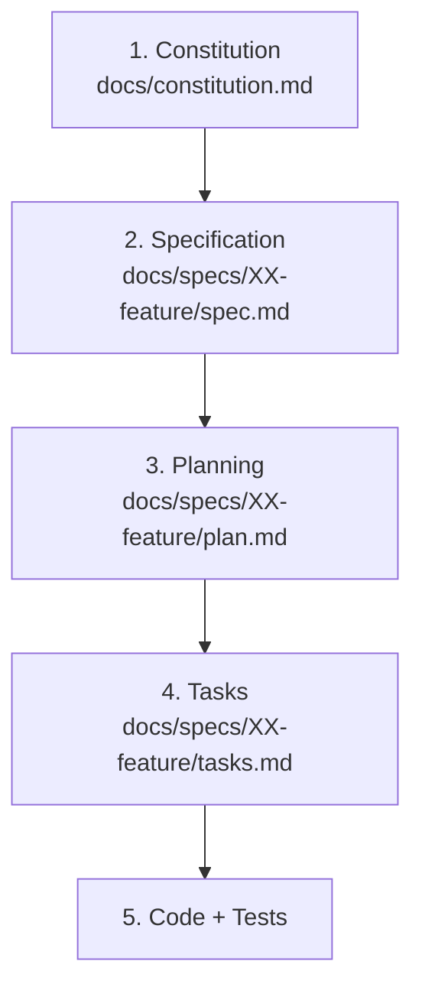

# AGENTS.md — Guía Operativa de Desarrollo (Spec-Driven Development)

Este documento establece las directrices operativas, límites de autonomía, jerarquía documental y flujo metodológico obligatorio para cualquier asistente de IA y desarrollador que trabaje en este repositorio bajo el enfoque **Spec-Driven Development (SDD)**.

---

## 1. Jerarquía de Verdad y Precedencia por Ámbito

Cuando existan dudas, ambigüedades o conflictos, las decisiones se resuelven estrictamente siguiendo esta jerarquía:



> **Regla de Precedencia:** Un nivel inferior no puede contradecir una decisión explícita de un nivel superior, pero puede definir decisiones propias dentro de su propio ámbito.

### Referencias Canónicas (Rutas Relativas)
* **Gobernanza y Reglas Globales:** `docs/constitution.md`
* **Especificaciones Funcionales:** `docs/specs/XX-feature/spec.md`
* **Planes Técnicos y Arquitectura:** `docs/specs/XX-feature/plan.md`
* **Desglose de Tareas Ejecutables:** `docs/specs/XX-feature/tasks.md`

*(Nota: Nunca se deben utilizar rutas absolutas locales como `C:\...` ni URIs absolutos de máquina).*

---

## 2. Flujo Metodológico SDD y Ciclo de Vida

El desarrollo avanza a través de fases formales secuenciales y trazables:

```text
/sdd-init
    ↓
/sdd-constitution-trial
    ↓
/sdd-spec-high (o /sdd-spec-low)
    ↓
/sdd-spec-clarify
    ↓
/sdd-planning
    ↓
/sdd-task
    ↓
/sdd-execution
    ↓
/sdd-spec-anchored (en caso de cambios, evolución o retroalimentación)
```

### Tabla de Ciclo de Vida

| Fase | Workflow | Entrada | Salida | Propósito |
| :--- | :--- | :--- | :--- | :--- |
| **0** | `/sdd-init` | Reglas globales SDD | `AGENTS.md` | Inicializar gobernanza y directrices del agente |
| **1** | `/sdd-constitution-trial` | Visión y dominio del proyecto | `docs/constitution.md` | Definir reglas globales, lenguaje ubicuo y restricciones |
| **2** | `/sdd-spec-high` / `/sdd-spec-low` | Requerimiento o necesidad de negocio | `docs/specs/XX-feature/spec.md` | Definir el QUÉ funcional, reglas de negocio y criterios de aceptación |
| **3** | `/sdd-spec-clarify` | `spec.md` en revisión | `spec.md` (APPROVED) | Auditoría QA funcional y resolución de ambigüedades |
| **4** | `/sdd-planning` | `spec.md` aprobado | `docs/specs/XX-feature/plan.md` | Diseñar el CÓMO técnico, arquitectura, contratos y persistencia |
| **5** | `/sdd-task` | `spec.md` + `plan.md` aprobados | `docs/specs/XX-feature/tasks.md` | Descomponer en vertical slices y tareas ejecutables atómicas |
| **6** | `/sdd-execution` | `tasks.md` | Código + Tests + Evidencia | Implementación con ciclo TDD y validación física |
| **7** | `/sdd-spec-anchored` | Solicitud de cambio o retroalimentación | Artefactos sincronizados | Evolución controlada manteniendo consistencia documental |

---

## 3. Principios de Autonomía Técnica y Límites de Decisión

El asistente debe actuar como un **copiloto técnico senior**, aplicando la siguiente categorización de decisiones:

1. **Decisiones de Negocio:**
   * Pertenecen exclusivamente al usuario, cliente o especificación funcional (ej: reglas de cancelación, restricciones de dominio, políticas de cobro).
   * **Prohibido inventar:** La IA debe identificar la ambigüedad, formular opciones neutrales con su impacto y esperar confirmación.
2. **Decisiones Arquitectónicas:**
   * Decisiones con impacto estructural (ej: patrones de persistencia, protocolos de comunicación, librerías críticas).
   * La IA puede proponer opciones fundamentadas en simplicidad, rendimiento y consistencia, pero debe validarlas en la fase de planificación (`plan.md`).
3. **Decisiones Técnicas de Bajo Impacto:**
   * La IA tiene autonomía para decidir nombres internos de variables, orden de imports, helpers privados y refactorizaciones menores reversibles que no alteren contratos ni comportamiento.
4. **Flujos Completos y Coherencia:**
   * Se prohíben deliberadamente implementaciones parciales (ej: pantallas sin persistencia, endpoints sin validación/errores, modelos huérfanos).

---

## 4. Reglas de Calidad y Verificación

Todo código desarrollado en el proyecto debe adherirse a los siguientes estándares:

* **Tipado Estricto:** Evitar el uso indiscriminado de `any` o conversiones no seguras.
* **Manejo Explícito de Errores:** Control de excepciones, códigos de estado claros y estados de error observables en la interfaz.
* **Validación Basada en Riesgo:**
  * **Caja Negra:** Pruebas E2E, BDD o integración para flujos funcionales críticos.
  * **Caja Blanca:** Pruebas unitarias para algoritmos, cálculos y reglas complejas.
* **Higiene de Código:** Ausencia de código muerto, componentes no utilizados o dependencias innecesarias.
* **Verificación Física:** Ninguna tarea se considera completada sin haber ejecutado y verificado físicamente el comando o prueba correspondiente.

---

## 5. Invariantes Operativas del Proyecto

1. **Invariante 1 — No inventar negocio:** La IA nunca decide silenciosamente una regla de negocio.
2. **Invariante 2 — No contradecir niveles superiores:** `Spec` respeta `Constitution`; `Plan` respeta `Spec`; `Tasks` respeta `Plan`; `Code` respeta la intención aprobada.
3. **Invariante 3 — No saltar decisiones necesarias:** Ninguna fase avanza consumiendo un artefacto en estado `NEEDS_CLARIFICATION` o `BLOCKED`.
4. **Invariante 4 — Evidencia física:** Verificación real mediante consola, linters o tests antes de marcar `[X]` en tareas.
5. **Invariante 5 — Trazabilidad:** Los requerimientos (`RF`), escenarios (`SC`), componentes técnicos (`Plan`) y tareas (`Task`) deben ser mutuamente rastreables.
6. **Invariante 6 — Corrección en el nivel correcto:** Las fallas de diseño o requerimiento se corrigen en el documento origen, jamás parcheando código para tapar errores de especificación.
7. **Invariante 7 — No sobre-especificar UI:** Centrarse en comportamiento, estados observables y flujos de usuario, otorgando ergonomía a la implementación visual sin fijar arbitrariamente píxeles o márgenes irrelevantes.

---

## 6. Comandos del Proyecto

*(Nota: Esta sección se actualizará automáticamente conforme se defina e inicialice el stack tecnológico en `/sdd-constitution-trial` y `/sdd-planning`).*

| Comando | Descripción |
| :--- | :--- |
| `docker compose up --build` | Inicia contenedores de desarrollo (Django Backend + PostgreSQL + Next.js Web) |
| `docker compose down` | Detiene y remueve los contenedores activos |
| `docker compose exec backend python manage.py migrate` | Aplica migraciones de base de datos en Django / PostgreSQL |
| `docker compose exec backend python manage.py test` | Ejecuta las pruebas automatizadas del backend Django |
| `npm run dev` (en frontend) | Servidor de desarrollo local para Next.js |
| `flutter run` (en app móvil) | Ejecuta la aplicación móvil Flutter en emulador o dispositivo físico |
| `flutter test` (en app móvil) | Ejecuta pruebas unitarias y de widgets en Flutter |

---

## 7. Regla Maestra

> **Primero se define la intención, después se valida la intención, luego se diseña la solución, se descompone el trabajo, se implementa y finalmente se verifica mediante evidencia.**
