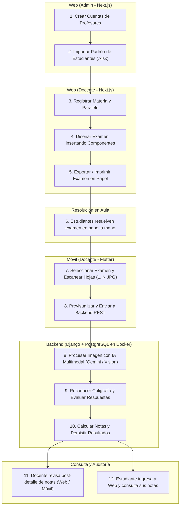
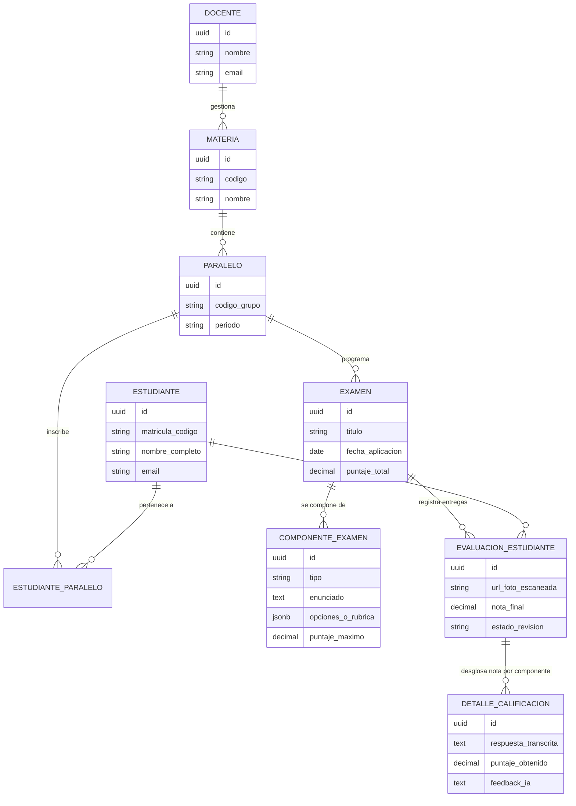

# Constitution

Status: APPROVED

## 1. Mission and Domain

El sistema tiene como misión automatizar y modernizar el ciclo de evaluación académica universitaria y escolar, combinando el diseño curricular digital con la evaluación tradicional manuscrita. 

El dominio del sistema abarca la gestión académica docente (Materias, Paralelos, Estudiantes), la composición interactiva y modular de exámenes en plataforma Web, la digitalización física de pruebas resueltas a mano mediante captura fotográfica móvil con cámara de smartphone, y la interpretación automatizada de diferentes caligrafías y formatos mediante modelos de Visión e Inteligencia Artificial Multimodal para generar calificaciones precisas, auditables y transparentes para profesores y estudiantes.

---

## 2. Global Scope

### 2.1 En Alcance (In Scope)
* **Plataforma Web (Administrador):**
  * Creación y administración de cuentas de Profesores/Docentes.
  * Carga masiva e importación exclusiva de listas de Estudiantes matriculados a partir de archivos Excel (`.xlsx`).
* **Plataforma Web (Docente):**
  * Gestión jerárquica académica: Configuración de Materias y asignación de Paralelos (Aulas A, B, C...).
  * Visualización y consulta de la ficha y detalle académico de cada Estudiante.
  * Constructor interactivo de exámenes mediante componentes modulares y contexto extendido.
  * Generación y exportación de exámenes para impresión física (con o sin QR).
  * Panel post-detalle para visualización, ajuste con observación y publicación controlada de notas.
* **Plataforma Web (Estudiante):**
  * Acceso simplificado y seguro exclusivamente mediante su ID de estudiante (matrícula/código) para consultar sus materias, exámenes calificados, desglose de corrección y fotos escaneadas.
* **Autenticación y Experiencia de Acceso (Web y Móvil):**
  * Soporte nativo de "Usuarios de Prueba" (Demo Users con 1-click login para Admin, Docente y Estudiante) para agilizar demostraciones y validación del sistema.
* **Aplicación Móvil (Docente - Flutter):**
  * Selección de Materia $\rightarrow$ Paralelo $\rightarrow$ Examen.
  * Módulo de captura multipágina en formato JPG (1 a N hojas por alumno) con detección automática de QR o disparo manual asistido.
  * Consulta post-detalle de notas de los estudiantes tras el escaneo.
* **Backend y Motor de Evaluación (Django + IA en Docker):**
  * API REST para consumo de clientes Web y Móvil.
  * Pipeline de recepción de imágenes JPG y calificación mediante Google Gemini API v1beta con Cascade Fallback y cuota Free Tier.
  * Persistencia relacional en base de datos PostgreSQL.

### 2.2 Fuera de Alcance (Out of Scope Global)
* Rendición de exámenes online en tiempo real para estudiantes (la resolución es física en papel manuscrito).
* Pasarelas de pago o cobros de matrículas.
* Escaneo de exámenes desde la cuenta de estudiantes (el escaneo y digitalización es exclusivo del docente evaluador).
* Creación de profesores o importación de estudiantes por parte de docentes (exclusivo del Administrador).

---

## 3. Ubiquitous Language

* **Administrador:** Actor institucional responsable exclusivo de crear profesores e importar el padrón de estudiantes desde archivos Excel.
* **Docente / Profesor:** Actor evaluador creado por el Administrador. Gestiona materias, diseña exámenes, consulta el detalle individual del estudiante, escanea evaluaciones físicas, audita y publica notas.
* **Estudiante / Alumno:** Actor evaluado que rinde exámenes manuscritos y accede al portal web identificándose con su ID de estudiante para consultar sus notas y exámenes.
* **ID de Estudiante:** Código único de matrícula asignado al alumno (capturado del Excel), utilizado como credencial principal de consulta en la Web.
* **Usuario de Prueba (Demo User):** Perfiles precargados accesibles desde la pantalla de login para conmutar rápidamente entre Administrador, Docente y Estudiante durante pruebas.
* **Materia / Asignatura:** Unidad académica dictada por el docente (ej. "Ingeniería de Software II", "Cálculo I").
* **Paralelo / Grupo / Aula:** Sección específica de una materia durante un periodo lectivo (ej. "Aula A", "Aula B").
* **Examen (Plantilla / Modelo):** Instrumento de evaluación configurado en la web mediante componentes modulares con contexto extendido y márgenes de tolerancia.
* **Componente de Examen:** Bloque estructurado de contenido dentro del examen (pregunta abierta/desarrollo, opción múltiple, verdadero/falso, puntaje).
* **Evaluación Escaneada:** Evidencia fotográfica JPG (de 1 a N páginas por estudiante) capturada en la app móvil.
* **Calificación / Nota:** Puntuación cuantitativa y cualitativa asignada por la IA y editable por el profesor mediante observación visible.

---

## 4. Actors and Global Roles

| Rol | Plataforma de Acceso | Responsabilidades y Permisos Globales |
| :--- | :--- | :--- |
| **Administrador** | Web | **Único actor autorizado** para crear cuentas de profesores e importar estudiantes al sistema mediante archivos Excel (`.xlsx`). |
| **Docente (Profesor)** | Web & Móvil | Creado por el Admin. Gestiona materias, consulta el detalle de los estudiantes, diseña exámenes con contexto extendido, escanea pruebas físicas (1 a N hojas), audita y publica calificaciones. |
| **Estudiante** | Web | Ingreso y autenticación exclusiva mediante su **ID de estudiante** (matrícula/código). Consulta restringida a su propio estado, notas, desglose y fotos de examen. |

---

## 5. Global E2E Flow

---

## 6. Conceptual Data Model

---

## 7. Global Technology and Architecture Constraints

* **Frontend Web:** Next.js (React) con TypeScript para interfaces docentes y estudiantiles de alto rendimiento y SEO/SSR optimizado.
* **Backend API:** Django con Django REST Framework (Python), estructurado para gestión académica y orquestación del pipeline de IA.
* **Aplicación Móvil:** Flutter (Dart) para soporte móvil multiplataforma, integrando control nativo de cámara para captura fotográfica optimizada de hojas de examen.
* **Base de Datos:** PostgreSQL para persistencia transaccional e integridad relacional.
* **Entorno de Ejecución:** Docker y Docker Compose para empaquetado, orquestación local y portabilidad de los servicios (Backend, Base de Datos y Web).
* **Protocolo de Comunicación:** REST API sobre HTTPS con serialización JSON estándar y endpoints seguros autenticados mediante tokens (JWT).

---

## 8. External Integrations and Dependencies

* **Motor de Reconocimiento y Evaluación IA (Google Gemini API - Free Tier):**
  * Consumo a través del endpoint REST oficial de Google AI Studio (`v1beta`).
  * **Modelos Vigentes Aprobados (Capa Gratuita):**
    * `gemini-2.5-flash`: Modelo principal por defecto para OCR de caligrafía y evaluación contextual rápida.
    * `gemini-2.5-pro`: Modelo para razonamiento analítico avanzado y fallback de rúbricas complejas.
    * `gemini-2.5-flash-lite`: Ultra baja latencia para pre-validación de legibilidad.
    * `gemini-3.8-flash`: Modelo sucesor oficial de alta velocidad y multimodalidad.
    * `gemini-flash-latest`: Alias dinámico para estabilidad ante releases menores.
  * **Modelos Prohibidos por Obsolescencia:** Queda estrictamente vetado el uso de modelos deprecados (`gemini-1.5-flash`, `gemini-1.5-flash-8b`, `gemini-2.0-flash`).
  * **Arquitectura de Resiliencia (Cascade Fallback):** Rotación secuencial automática ante errores 404, 503 o 429 (`gemini-2.5-flash` $\rightarrow$ `gemini-2.5-pro` $\rightarrow$ `gemini-2.5-flash-lite` $\rightarrow$ `gemini-3.8-flash` $\rightarrow$ `gemini-flash-latest`).
  * **Parámetros de Inferencia Determinista:** Uso mandatorio de `responseMimeType: "application/json"`, temperatura baja (`0.1` - `0.2`) y payload multimodal en Base64 (`image/jpeg`).
  * **Control de Cuotas y Límites (Free Tier):** Respeto estricto del límite de ~15 RPM y ~1,500 peticiones diarias, implementando reintentos con Exponential Backoff ante código HTTP 429 (`RESOURCE_EXHAUSTED`).
  * **Timeout Preventivo:** Límite máximo de 10 a 15 segundos por llamada; si la cuota se agota o hay timeout, la evaluación se degrada elegantemente a `REVISION_DOCENTE` sin colapsar el sistema.
* **Almacenamiento de Imágenes:** Repositorio seguro para almacenar las capturas fotográficas JPG de los exámenes físicos evaluados (storage local montado en Docker o Cloud Storage S3-compatible).

---

## 9. Resilience, Connectivity and Integrity

* **Inmutabilidad y Auditoría de Notas:** Todo ajuste manual realizado por el docente sobre una calificación generada automáticamente por IA debe quedar registrado con fecha y motivo.
* **Degradación Elegante ante Fallos de IA:** Si la API de Gemini agota su cuota (HTTP 429), experimenta timeout (>15s) o la caligrafía es ilegible, el sistema nunca colapsa: conserva íntegramente las fotos JPG y marca la evaluación en estado `REVISION_DOCENTE` para calificación manual asistida por el docente.
* **Manejo de Caligrafía Compleja:** Si la imagen escaneada posee baja resolución, iluminación deficiente o texto manuscrito ininteligible, el sistema marca el componente en estado `REQUIERE_REVISION_DOCENTE` sin bloquear el procesamiento del resto del lote de exámenes.
* **Subida Asíncrona / Resiliente Móvil:** La app móvil Flutter permite encolar capturas de exámenes y reintentar la subida si se experimenta intermitencia en la red wifi/móvil.

---

## 10. Non-Negotiable Principles

1. **Privacidad de las Calificaciones:** Ningún estudiante puede acceder ni inferir las notas o exámenes de otro estudiante. Las consultas están estrictamente filtradas por el token del estudiante autenticado.
2. **Soberanía y Supervisión Docente:** La IA actúa como un asistente acelerador de calificación; el docente siempre posee la potestad y la herramienta visual en web y móvil para revisar la imagen original escaneada, modificar cualquier puntaje o corregir la transcripción.
3. **Reproducibilidad y Fidelidad:** Cada evaluación calificada debe mantener el enlace directo a la imagen escaneada original que sirvió de evidencia.

---

## 11. Global Constraints

* **Conformidad con Docker:** El backend Django y la base de datos PostgreSQL deben ejecutarse de forma orquestada mediante `docker compose up`.
* **Cámara Móvil Optimizada:** La aplicación Flutter debe contar con una guía visual para encuadrar la hoja de examen y optimizar el contraste de imagen previo al envío.
* **Separación de Vistas por Rol:** La interfaz web de Estudiante es estrictamente de consulta personal y no debe cargar ni exponer rutas o componentes del panel docente.

---

## 12. Decisions

* **DEC-001 (Evaluación Física + Digitalización Móvil):** Los exámenes son resueltos en papel por los estudiantes y digitalizados con el smartphone del profesor para preservar la dinámica del aula tradicional mientras se automatiza la calificación.
* **DEC-002 (Motor Multimodal de IA con Resiliencia Free Tier):** Se aprueba el uso de Google Gemini API en Capa Gratuita (Free Tier v1beta) bajo arquitectura de Cascade Fallback (iniciando en `gemini-2.5-flash`), respuestas JSON forzadas (`application/json`), temperatura 0.1-0.2, timeout de 10-15s y degradación elegante a revisión docente ante HTTP 429.
* **DEC-003 (Stack Tripartito de 3 Proyectos Autónomos):** Se define formalmente la separación física estricta en tres proyectos desacoplados e independientes: `backend/` (Django 5.x REST Framework), `frontend/` (Next.js 14+ App Router TypeScript) y `mobile/` (Flutter Dart), comunicados exclusivamente mediante API REST HTTP/JSON y orquestados en la raíz con Docker Compose.
* **DEC-004 (Modelo Tripartito de Roles y Gobernanza):**
  * **Administrador:** Autoridad institucional única facultada para crear profesores e importar el padrón de estudiantes desde archivos Excel.
  * **Docente (Profesor):** Administra materias, paralelos/aulas, consulta el detalle individual del estudiante, diseña exámenes, escanea en Flutter y audita calificaciones.
  * **Estudiante:** Acceso directo simplificado mediante su ID de estudiante para consultar sus notas, desglose y fotos.
  * **Usuarios de Prueba (Demo Users):** Mecanismo transversal en el login web/móvil para pruebas y demostraciones con 1-click.

---

## 13. Assumptions

* **ASSUMP-001:** Los estudiantes contarán con un código o credencial única provista por el profesor o institución para su autenticación en la plataforma web.
* **ASSUMP-002:** El smartphone del docente cuenta con cámara con resolución mínima de 8 MP para asegurar la legibilidad del texto manuscrito por el motor de IA.

---

## 14. Pending Decisions (Para Specification y Planning)

* **PEND-001 (Spec):** Definición detallada del catálogo de componentes de examen en web (opción múltiple, completar oraciones, preguntas abiertas con palabras clave o rúbricas de ponderación).
* **PEND-002 (Planning):** Arquitectura y formato de los prompts enviados al motor de IA y límites de tasa (rate limiting) de la API multimodal.
* **PEND-003 (Planning):** Definición del esquema exacto de tablas relacionales en Django ORM y migraciones PostgreSQL.

---

## 15. Exceptions

* No aplican excepciones globales en esta fase.

---

## 16. Governance and Evolution

Toda modificación que altere los roles de usuario, la estructura macro académica (Materia $\rightarrow$ Paralelo $\rightarrow$ Examen $\rightarrow$ Estudiante), las tecnologías del stack o las políticas de calificación por IA requerirá una actualización formal de este documento bajo el workflow `/sdd-spec-anchored`.
