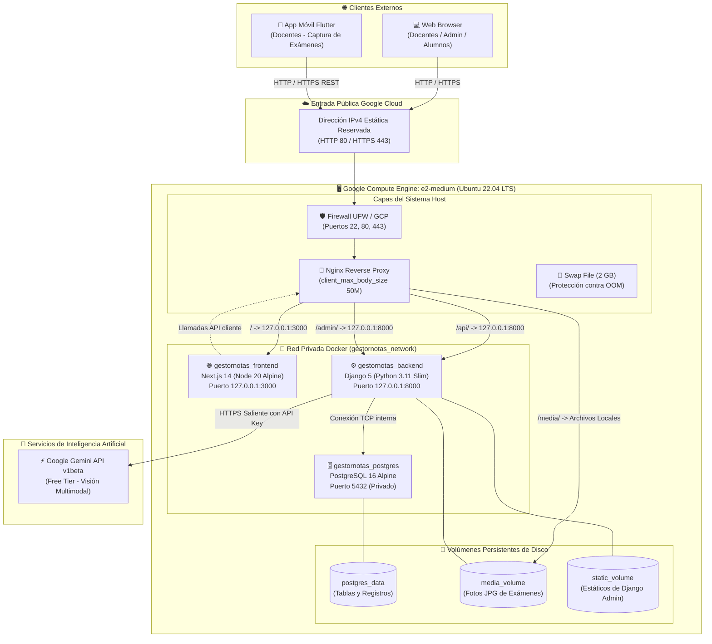

# 🚀 00. Resumen General del Despliegue

[↑ Índice General](./00_RESUMEN_GENERAL.md) | [Siguiente Paso: 01_CONFIGURAR_PROYECTO.md →](./01_CONFIGURAR_PROYECTO.md)

---

## 1. Ficha Técnica del Entorno de Producción

| Parámetro | Valor Técnico | Justificación de Arquitectura |
| :--- | :--- | :--- |
| **Proyecto** | Gestor de Notas & Evaluaciones con IA Multimodal | Plataforma de evaluación de pruebas manuscritas con IA |
| **Repositorio** | `SW2-PF-GESTOR-NOTAvF-26-2` | Monorepo con backend Django, frontend Next.js y app móvil Flutter |
| **Proveedor Cloud** | Google Cloud Platform (GCP) | Infraestructura IaaS con red global de alta velocidad y tier económico |
| **Servicio de Cómputo** | Compute Engine (Instancia de Máquina Virtual) | Control operativo total sobre el kernel Linux, Docker y Nginx |
| **Tipo de Instancia** | `e2-medium` (2 vCPU, 4.0 GB RAM) | Capacidad balanceada para ejecutar simultáneamente Django, Next.js y Postgres sin OOM |
| **Almacenamiento** | 30 GB Balanced Persistent Disk (`pd-balanced`) | Espacio suficiente para capas Docker, logs, base de datos y fotos de exámenes |
| **Sistema Operativo** | Ubuntu 22.04 LTS (x86_64) | Distribución de referencia para servidores empresariales de larga duración |
| **Estrategia de Ejecución** | Docker & Docker Compose | Contenedores portables, aislados y reproducibles |
| **Motor de Base de Datos** | PostgreSQL 16 Alpine en contenedor Docker | Persistencia relacional ACID aislada en red interna con volumen en disco |
| **Capa Web / Edge Proxy** | Nginx Reverse Proxy (Host `systemd`) | Terminación HTTP/HTTPS, enrutamiento inverso y límite de carga de 50MB |
| **Entorno** | Producción | Optimizado para rendimiento, seguridad y aislamiento de secretos |
| **Estado Documental** | READY / GENERATED | Aprobado conforme a las reglas de calidad SDD |

---

## 2. Diagrama de Arquitectura de Producción

---

## 3. Matriz de Puertos y Seguridad de Red

> [!WARNING]
> Ningún servicio interno debe exponerse directamente a Internet salvo los puertos estándar administrados por Nginx y la consola segura SSH.

| Puerto | Protocolo | Ámbito / Origen | Servicio / Destino | Justificación Técnica |
| :---: | :---: | :---: | :--- | :--- |
| **`22`** | TCP | `0.0.0.0/0` (o IP fija del admin) | SSH (OpenSSH) | Administración y consola remota segura mediante par de llaves criptográficas. |
| **`80`** | TCP | `0.0.0.0/0` (Público Internet) | Nginx Reverse Proxy | Tráfico HTTP inicial, redirección segura y validación ACME para certificados SSL. |
| **`443`** | TCP | `0.0.0.0/0` (Público Internet) | Nginx Reverse Proxy | Tráfico HTTPS cifrado mediante TLS para la interfaz web y endpoints de API. |
| **`3000`** | TCP | `127.0.0.1` (Localhost) | Next.js Frontend | Puerto privado; el público sólo accede a través del reverse proxy Nginx. |
| **`8000`** | TCP | `127.0.0.1` (Localhost) | Django Backend | Puerto privado de la API REST; Nginx enruta `/api/` y `/admin/` internamente. |
| **`5432`** | TCP | Red interna Docker | PostgreSQL DB | Aislado estrictamente dentro del contenedor; inaccesible desde el exterior. |

---

## 4. Tabla de Estimación y Control de Costos Mensuales en GCP

Estimación calculada para la región `us-central1` (Iowa, Estados Unidos):

| Recurso / Componente | Modalidad de Facturación | Costo Mensual Estimado (24/7) | Costo al Apagar la VM (Detenida) |
| :--- | :--- | :---: | :---: |
| **Instancia `e2-medium` (2 vCPU, 4 GB)** | Cómputo por segundo de CPU/RAM | ~$24.40 USD / mes | **$0.00 USD** (Cero cobro) |
| **Disco 30 GB Balanced Persistent Disk** | Almacenamiento por GB/mes | ~$3.00 USD / mes | ~$3.00 USD / mes (Se mantiene) |
| **Dirección IPv4 Externa Estática** | Gratuita mientras la VM esté activa | $0.00 USD | ~$2.88 USD / mes si queda huérfana |
| **Tráfico de Red Saliente (Egress)** | Primer 1 GB/mes gratuito | < $0.50 USD | $0.00 USD |
| **Google Gemini API (Free Tier)** | Modelo gemini-1.5-flash (v1beta) | **$0.00 USD** (Capa gratuita) | **$0.00 USD** |
| **TOTAL ESTIMADO** | **Operación Continua** | **~$27.40 USD / mes** | **~$3.00 USD / mes** |

> [!TIP]
> **Estrategia de Ahorro Máximo:** Si apagas la máquina virtual durante noches y fines de semana cuando no se toman exámenes, el costo mensual desciende a menos de **$10 USD / mes**.

---

## 5. Tabla de Prerrequisitos de Despliegue

Antes de iniciar la ejecución, valida la siguiente lista de verificación:

- [ ] **Cuenta GCP Activa:** Con proyecto creado (ej. `gestor-notas-prod`) y facturación habilitada.
- [ ] **Permisos de Administrador:** Rol de `Compute Admin` o `Owner` en el proyecto de Google Cloud.
- [ ] **Herramienta Local:** `gcloud CLI` instalada y autenticada o acceso web a [Google Cloud Console](https://console.cloud.google.com/).
- [ ] **Clave de Gemini API:** Generada gratuitamente desde [Google AI Studio](https://aistudio.google.com/).
- [ ] **Repositorio Git:** Código subido a GitHub con permisos de lectura (HTTPS con Personal Access Token o SSH Deploy Key).

---

## 6. Navegación Rápida de la Suite Documental

| Archivo | Contenido y Misión |
| :--- | :--- |
| **[00_RESUMEN_GENERAL.md](./00_RESUMEN_GENERAL.md)** | Tablero de control, arquitectura Mermaid, matriz de puertos y costos. |
| **[01_CONFIGURAR_PROYECTO.md](./01_CONFIGURAR_PROYECTO.md)** | `docker-compose.prod.yml`, `Dockerfile.prod`, `.env.production` y pruebas locales. |
| **[02_CREAR_INFRAESTRUCTURA_GCP.md](./02_CREAR_INFRAESTRUCTURA_GCP.md)** | Provisión de VM en Compute Engine, reserva de IP estática y Firewall de GCP. |
| **[03_INSTALAR_HERRAMIENTAS.md](./03_INSTALAR_HERRAMIENTAS.md)** | Conexión SSH, usuario admin, Swap de 2GB, Docker, Compose, UFW y Nginx. |
| **[04_DESPLEGAR_Y_VERIFICAR.md](./04_DESPLEGAR_Y_VERIFICAR.md)** | Clonación, build, migraciones, superusuario, Nginx vhost, tests y troubleshooting. |
| **[05_ACTUALIZAR_PRODUCCION.md](./05_ACTUALIZAR_PRODUCCION.md)** | Flujo dual PC/Servidor, backups automáticos de PostgreSQL y rollback de emergencia. |
| **[06_APAGAR_Y_REACTIVAR.md](./06_APAGAR_Y_REACTIVAR.md)** | Ciclo de vida Stop vs Delete, costos residuales, reactivación 100% automática. |
| **[07_FLUJO_VISUAL_DESPLIEGUE.html](./07_FLUJO_VISUAL_DESPLIEGUE.html)** | Dashboard interactivo visual con diagrama de nodos, Dark Mode y copiado rápido. |

---

[← Volver al Inicio](#) | [Siguiente Paso: 01_CONFIGURAR_PROYECTO.md →](./01_CONFIGURAR_PROYECTO.md)
