# 🚀 00. Resumen General del Despliegue en Microsoft Azure

[↑ Índice General](./00_RESUMEN_GENERAL.md) | [Siguiente Paso: 01_CONFIGURAR_PROYECTO.md →](./01_CONFIGURAR_PROYECTO.md)

---

## 1. Ficha Técnica del Entorno de Producción

| Parámetro | Valor Técnico | Justificación de Arquitectura |
| :--- | :--- | :--- |
| **Proyecto** | Gestor de Notas & Evaluaciones con IA Multimodal | Plataforma de digitalización de exámenes físicos, escaneo QR y calificación automatizada con IA |
| **Repositorio** | `SW2-PF-GESTOR-NOTAvF-26-2` | Monorepo con backend Django 5, frontend Next.js 14 y app móvil Flutter |
| **Proveedor Cloud** | Microsoft Azure | Plataforma de nube empresarial con alta disponibilidad y presencia regional en América Latina |
| **Servicio de Cómputo** | Azure Virtual Machine (IaaS) | Control operativo absoluto sobre kernel Linux, Docker Compose, almacenamiento y demonios de sistema |
| **Tamaño de Instancia** | `Standard_B2s` (2 vCPU, 4.0 GiB RAM) | Capacidad equilibrada de la serie B (burstable) para ejecutar simultáneamente Django, Next.js y PostgreSQL sin Out-Of-Memory (OOM) |
| **Almacenamiento** | 30 GB Standard SSD (`StandardSSD_LRS`) | Rendimiento sólido para capas Docker, base de datos relacional y almacenamiento de fotos JPG de exámenes |
| **Sistema Operativo** | Ubuntu 22.04 LTS (Jammy Jellyfish, x86_64) | Sistema operativo de referencia para servidores empresariales con soporte extendido y compatibilidad Docker |
| **Estrategia de Ejecución** | Docker & Docker Compose (`docker-compose.prod.yml`) | Aislamiento modular de servicios en contenedores portables con redes internas privadas |
| **Motor de Base de Datos** | PostgreSQL 16 Alpine (Contenedor Docker) | Persistencia relacional ACID aislada en red interna con volumen local persistente en disco |
| **Capa Web / Edge Proxy** | Nginx Reverse Proxy (Host `systemd`) | Terminación SSL/TLS, enrutamiento inverso hacia frontend y backend, compresión gzip y límite de subida de 50MB |
| **Seguridad de Red** | Azure Network Security Group (NSG) | Firewall de red perimetral que restringe el acceso únicamente a los puertos esenciales 22, 80 y 443 |
| **Integración IA** | Google Gemini API v1beta (Free Tier) | Inferencia multimodal en la nube para transcripción caligráfica y corrección pedagógica |
| **Estado Documental** | `READY / APPROVED` | Especificado y validado conforme a los contratos de calidad SDD |

---

## 2. Diagrama de Arquitectura de Producción en Azure

```mermaid
flowchart TD
    subgraph CLIENTES["🌐 Clientes Externos"]
        W["💻 Web Browser\n(Docentes / Administradores / Estudiantes)"]
        M["📱 App Móvil Flutter\n(Docentes - Escaneo QR y Captura JPG)"]
    end

    subgraph RED_PUBLICA_AZURE["☁️ Entrada Pública de Microsoft Azure"]
        IP["Dirección IPv4 Pública / FQDN de Azure\n(ej: gestornotas.eastus.cloudapp.azure.com)\nPuertos Públicos: HTTP 80 / HTTPS 443"]
    end

    subgraph NSG["🛡️ Azure Network Security Group (NSG)"]
        RULE_SSH["Regla 1000: SSH (Puerto 22 TCP)"]
        RULE_HTTP["Regla 1010: HTTP (Puerto 80 TCP)"]
        RULE_HTTPS["Regla 1020: HTTPS (Puerto 443 TCP)"]
    end

    subgraph VM_AZURE["🖥️ Azure Virtual Machine: Standard_B2s (Ubuntu 22.04 LTS)"]
        subgraph HOST_SERVICES["Capas del Sistema Operativo Host"]
            NGINX["🔀 Nginx Reverse Proxy & SSL (Let's Encrypt)\n(client_max_body_size 50M)"]
            SWAP["💾 Memoria Swap (2 GB)\n(Protección preventiva contra picos de memoria)"]
        end

        subgraph DOCKER_COMPOSE["🐳 Red Privada Docker (gestornotas_network)"]
            LD["🚀 gestornotas_landing\nLanding Page Comercial (Next.js / Node 20)\nEnlace Local: 127.0.0.1:3002"]
            FE["🌐 gestornotas_frontend\nPlataforma Académica Web (Next.js 14 App Router)\nEnlace Local: 127.0.0.1:3000"]
            BE["⚙️ gestornotas_backend\nDjango 5 + DRF + SimpleJWT (Python 3.12)\nEnlace Local: 127.0.0.1:8000"]
            DB["🗄️ gestornotas_postgres\nPostgreSQL 16 Alpine\nPuerto Interno 5432 (No expuesto al host)"]
        end

        subgraph VOLUMENES["💾 Volúmenes Persistentes de Disco Administrado"]
            VOL_DB[("postgres_data\n(Tablas, Usuarios y Calificaciones)")]
            VOL_MEDIA[("media_volume\n(Hojas de Examen Escaneadas en JPG)")]
            VOL_STATIC[("static_volume\n(Archivos Estáticos Django Admin)")]
        end
    end

    subgraph CLOUD_EXTERNO["🤖 Servicios de Inteligencia Artificial"]
        GEMINI["⚡ Google Gemini API v1beta\n(Inferencia Multimodal de Caligrafía y Rúbricas)"]
    end

    CLIENTES -->|HTTPS / WSS| IP
    IP --> NSG
    NSG --> NGINX
    NGINX -->|Proxy inverso / (Landing Page)| LD
    NGINX -->|Proxy inverso /app/ (Plataforma Web)| FE
    NGINX -->|Proxy inverso /api/ y /admin/| BE
    NGINX -->|Proxy inverso /media/| BE
    LD -.->|Enlace CTA a Login| FE
    FE -.->|Llamadas REST internas| BE
    M -.->|Envío de Exámenes /api/v1/evaluaciones/| NGINX
    BE -->|Conexión interna SQL TCP:5432| DB
    BE -->|Subida y Lectura de Fotos JPG| VOL_MEDIA
    BE -->|Almacenamiento Relacional| VOL_DB
    BE -->|Peticiones HTTPS de Evaluación| GEMINI
```

---

## 3. Matriz de Puertos y Seguridad Perimetral

El Grupo de Seguridad de Red (NSG) en Azure actúa como el primer escudo de protección, bloqueando por defecto cualquier tráfico entrante que no esté explícitamente autorizado:

| Puerto | Protocolo | Origen Autorizado | Destino | Servicio | Propósito y Justificación de Seguridad |
| :---: | :---: | :---: | :---: | :--- | :--- |
| **`22`** | TCP | `0.0.0.0/0` (o IP fija de administración) | `VirtualNetwork` | **SSH** | Administración remota segura mediante par de llaves criptográficas RSA/ED25519 (acceso por contraseña deshabilitado). |
| **`80`** | TCP | `0.0.0.0/0` (Internet) | `VirtualNetwork` | **HTTP** | Desafío y renovación automática de certificados SSL de Let's Encrypt (ACME HTTP-01) y redirección obligatoria a HTTPS (301 Moved Permanently). |
| **`443`** | TCP | `0.0.0.0/0` (Internet) | `VirtualNetwork` | **HTTPS** | Canal cifrado seguro (TLS 1.2 / 1.3) para los usuarios de la plataforma web y la sincronización de la app móvil. |
| **`8000`** | TCP | **Bloqueado** | — | Django API | Cerrado al exterior. Django escucha exclusivamente en `127.0.0.1:8000` y solo responde a través del reverse proxy Nginx. |
| **`3000`** | TCP | **Bloqueado** | — | Next.js Web | Cerrado al exterior. Next.js escucha exclusivamente en `127.0.0.1:3000` y solo responde a través de Nginx. |
| **`5432`** | TCP | **Bloqueado** | — | PostgreSQL | Cerrado al exterior. PostgreSQL solo es accesible por el contenedor backend a través del bridge privado `gestornotas_network`. |

---

## 4. Estimación y Control de Costos en Microsoft Azure

| Recurso | Tipo / Nivel en Azure | Costo Estimado Mensual | Estrategia de Optimización de Costos |
| :--- | :--- | :--- | :--- |
| **Máquina Virtual (Cómputo)** | `Standard_B2s` (2 vCPU, 4 GiB RAM) | ~ \$30.36 USD / mes | Elegible para créditos de prueba gratuitos de Azure (\$200 USD iniciales o créditos anuales de Azure for Students). Se puede apagar en periodos vacacionales. |
| **Disco Administrado** | 30 GB Standard SSD (`StandardSSD_LRS`) | ~ \$1.80 USD / mes | Proporciona IOPS suficientes para desarrollo y producción ligera a un costo significativamente menor que Premium SSD. |
| **Dirección IP Pública** | IPv4 Estática / Dinámica Standard SKU | ~ \$3.60 USD / mes | Permite asignar un subdominio gratuito de Azure (`.eastus.cloudapp.azure.com`) sin costo adicional de registro de dominio. |
| **Tráfico de Red Saliente** | Hasta 100 GB / mes (Internet Egress) | Gratuito (Primeros 100 GB en Azure) | El tráfico entrante es 100% gratuito en Azure; el tráfico saliente ligero no genera sobrecostos. |
| **Certificados SSL/TLS** | Let's Encrypt via Certbot | **\$0.00 USD (Gratis)** | Renovación automática de por vida sin costo de adquisición de certificados comerciales. |
| **Google Gemini API** | Free Tier (Google AI Studio) | **\$0.00 USD (Gratis)** | Capa gratuita con límite de 15 peticiones por minuto (RPM), suficiente para calificaciones académicas por lote. |
| **TOTAL ESTIMADO** | **Infraestructura Completa** | **~ \$35.76 USD / mes** *(o \$0.00 consumiendo créditos activos)* |

---

## 5. Tabla de Requisitos Previos

Antes de ejecutar las instrucciones de los siguientes manuales, asegúrate de contar con:

1. **Cuenta en Microsoft Azure:** Suscripción activa con permisos de creación de recursos (Suscripción Pay-As-You-Go, Evaluación Gratuita o Azure for Students).
2. **Azure CLI (`az`) o Navegador Web:** Para interactuar con la consola de Azure Cloud Shell o el [Portal de Azure](https://portal.azure.com/).
3. **Cliente SSH:** OpenSSH disponible de forma nativa en Windows PowerShell (`ssh`), Linux o macOS.
4. **Clave de API de Google Gemini:** API Key válida obtenida de forma gratuita en [Google AI Studio](https://aistudio.google.com/).
5. **Git instalado localmente:** Para gestionar el repositorio y las credenciales de despliegue.

---

## 6. Mapa de Navegación del Despliegue

Sigue el orden secuencial de los documentos para asegurar un despliegue exitoso:

```mermaid
flowchart LR
    D0["00_RESUMEN_GENERAL.md"] --> D1["01_CONFIGURAR_PROYECTO.md"]
    D1 --> D2["02_CREAR_INFRAESTRUCTURA_AZURE.md"]
    D2 --> D3["03_INSTALAR_HERRAMIENTAS.md"]
    D3 --> D4["04_DESPLEGAR_Y_VERIFICAR.md"]
    D4 --> D5["05_ACTUALIZAR_PRODUCCION.md"]
    D5 --> D6["06_APAGAR_Y_REACTIVAR.md"]
```



| N° | Documento | Propósito Técnico |
| :---: | :--- | :--- |
| **00** | [00_RESUMEN_GENERAL.md](./00_RESUMEN_GENERAL.md) | Ficha técnica, arquitectura, matriz de puertos, costos y prerrequisitos. |
| **01** | [01_CONFIGURAR_PROYECTO.md](./01_CONFIGURAR_PROYECTO.md) | Validación local de Dockerfiles, Docker Compose y variables de producción. |
| **02** | [02_CREAR_INFRAESTRUCTURA_AZURE.md](./02_CREAR_INFRAESTRUCTURA_AZURE.md) | **Guía visual paso a paso para principiantes:** Provisión de VM Ubuntu 22.04, Firewall NSG, IP pública, FQDN gratuito y conexión SSH desde el Portal Web de Azure ([portal.azure.com](https://portal.azure.com/)). |
| **03** | [03_INSTALAR_HERRAMIENTAS.md](./03_INSTALAR_HERRAMIENTAS.md) | Conexión SSH, configuración de Swap, instalación de Docker, Docker Compose y Nginx. |
| **04** | [04_DESPLEGAR_Y_VERIFICAR.md](./04_DESPLEGAR_Y_VERIFICAR.md) | Clonación, arranque de contenedores, migraciones, SSL Let's Encrypt y pruebas de salud. |
| **05** | [05_ACTUALIZAR_PRODUCCION.md](./05_ACTUALIZAR_PRODUCCION.md) | Flujo seguro de actualización de código, respaldos previos y rollback. |
| **06** | [06_APAGAR_Y_REACTIVAR.md](./06_APAGAR_Y_REACTIVAR.md) | Detención para ahorro de costos, snapshots y protocolo de reactivación. |
| **07** | [07_FLUJO_VISUAL_DESPLIEGUE.html](./07_FLUJO_VISUAL_DESPLIEGUE.html) | Dashboard interactivo con diagrama de nodos, checklist y Dark Mode. |

---

[Siguiente Paso: 01_CONFIGURAR_PROYECTO.md →](./01_CONFIGURAR_PROYECTO.md)
