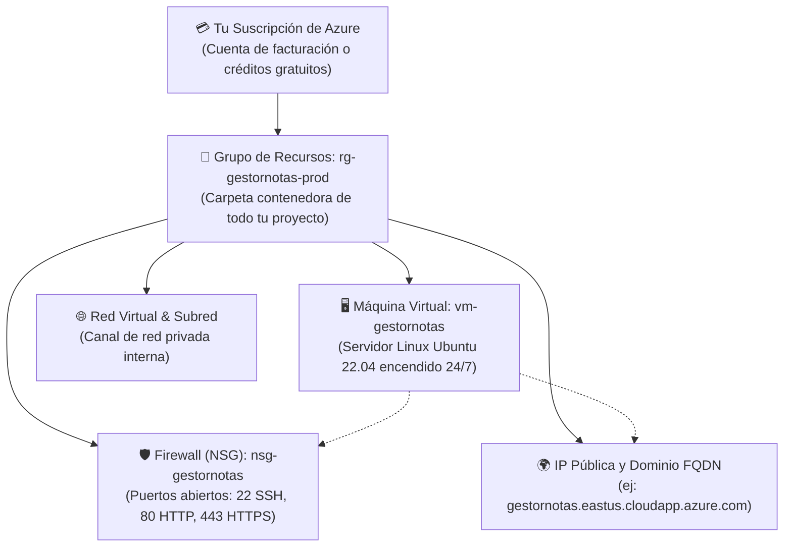

# 🚀 02. Crear la Infraestructura en Microsoft Azure (Guía Visual Paso a Paso)

[← Paso Anterior: 01_CONFIGURAR_PROYECTO.md](./01_CONFIGURAR_PROYECTO.md) | [↑ Índice General](./00_RESUMEN_GENERAL.md) | [Siguiente Paso: 03_INSTALAR_HERRAMIENTAS.md →](./03_INSTALAR_HERRAMIENTAS.md)

---

## 1. Visión para Principiantes: ¿Qué vamos a hacer?

Si **nunca antes has utilizado Microsoft Azure**, no te preocupes: esta guía está diseñada para llevarte de la mano **pantalla por pantalla y campo por campo** a través de la interfaz web gráfica ([portal.azure.com](https://portal.azure.com/)).

### Glosario Básico de Azure (En Lenguaje Sencillo)



* **Suscripción (`Subscription`):** Tu cuenta de Azure donde se cargan los servicios (puedes usar una cuenta con créditos gratuitos de estudiante, evaluación gratuita de $200 USD o Pay-As-You-Go).
* **Grupo de Recursos (`Resource Group`):** Imagina una carpeta en tu computadora. En Azure, agrupa todo lo que creemos (`rg-gestornotas-prod`). Si algún día quieres borrar todo el servidor, solo eliminas esta carpeta.
* **Máquina Virtual (`Virtual Machine` o VM):** Una computadora remota en los centros de datos de Microsoft ejecutando **Ubuntu Linux 22.04 LTS**.
* **Tamaño `Standard_B2s`:** El modelo de computadora que usaremos (2 núcleos de procesador vCPU y 4 GB de memoria RAM). Es el tamaño ideal para que Django, Next.js y PostgreSQL funcionen fluidos sin saturar la memoria.
* **Grupo de Seguridad de Red (`NSG` o Firewall):** El guardia de seguridad perimetral. Bloquea todo por defecto y solo permite entrar por los puertos autorizados: **22** (consola remota SSH), **80** (web HTTP) y **443** (web segura HTTPS).
* **IP Pública y FQDN:** La dirección de Internet para que tus alumnos y profesores puedan entrar al sistema. Azure nos regala un subdominio gratuito (`.eastus.cloudapp.azure.com`).

---

## 2. Método Principal: Paso a Paso en la Interfaz Gráfica (Portal Web)

> [!IMPORTANT]
> Sigue estos pasos tal como se describen. No necesitas instalar nada en tu computadora para esta etapa; todo se realiza desde tu navegador web.

---

### 🌐 Paso 1: Ingresar al Portal de Azure y Crear Máquina Virtual

1. Abre tu navegador web e ingresa a: **[https://portal.azure.com](https://portal.azure.com)**.
2. Inicia sesión con tu cuenta de Microsoft (Outlook, Hotmail o cuenta institucional de universidad).
3. Una vez en la página principal (*Inicio de Azure*):
   - En la barra de búsqueda azul superior (arriba al centro), escribe: `Máquinas virtuales` (o `Virtual machines`).
   - En los resultados de búsqueda, haz clic en el ícono azul de **Máquinas virtuales**.
4. En la parte superior izquierda de la lista de máquinas virtuales, haz clic en el botón:
   $$\mathbf{+\ Crear} \quad \longrightarrow \quad \text{Máquina virtual de Azure}$$
   *(Asegúrate de elegir la primera opción: "Máquina virtual de Azure hospedada por Azure")*.

Se abrirá el asistente de creación con varias pestañas horizontales: `Aspectos básicos`, `Discos`, `Redes`, etc. A continuación configuramos cada una.

---

### 📝 Paso 2: Pestaña "Aspectos básicos" (Basics)

Configura los campos exactamente como indica la siguiente tabla:

| Sección | Campo en Pantalla | Valor que debes seleccionar o escribir | ¿Por qué elegimos esto? |
| :--- | :--- | :--- | :--- |
| **Datos del proyecto** | **Suscripción** | *(Selecciona tu suscripción activa)* | Es la cuenta donde se aplicarán los créditos o el cobro. |
| | **Grupo de recursos** | Haz clic en el enlace azul **"Crear nuevo"** e ingresa: `rg-gestornotas-prod` | Agrupa todos los recursos del proyecto en una sola carpeta limpia. |
| **Detalles de instancia** | **Nombre de máquina virtual** | `vm-gestornotas` | Nombre identificador de tu servidor. |
| | **Región** | `(US) Este de EE. UU.` (o `East US`) | Región con tarifas más bajas y excelente velocidad de conexión. *(Alternativa: `Brazil South` o `South Central US`)*. |
| | **Opciones de disponibilidad** | `No se requiere redundancia de la infraestructura` | Evita costos adicionales de alta redundancia geográfica innecesaria. |
| | **Tipo de seguridad** | `Estándar` | Compatibilidad estándar para servidores Linux con Docker. |
| | **Imagen** | Haz clic en el menú y selecciona:<br/>**Ubuntu Server 22.04 LTS - x64 Gen2** | Sistema operativo base con soporte oficial a largo plazo (LTS) y compatibilidad total con Docker. |
| | **Arquitectura de VM** | `x64` | Arquitectura estándar para contenedores Docker. |
| | **Tamaño** | Haz clic en **"Ver todos los tamaños"** $\rightarrow$ Busca y selecciona:<br/>**Standard_B2s** (2 vCPU, 4 GiB de memoria RAM) | 4 GB de RAM son necesarios para correr Next.js build y Django sin que se congele el servidor. |
| **Cuenta de administrador** | **Tipo de autenticación** | Tienes 2 opciones (elige la que prefieras):<br/>• **Opción A (Recomendada):** `Clave pública SSH`<br/>• **Opción B (Más sencilla):** `Contraseña` | Ver detalles abajo antes de decidir. |

#### ¿Cómo configurar la "Cuenta de administrador"?

* **Si eliges Opción A (Clave pública SSH - Recomendada por Seguridad):**
  - **Nombre de usuario administrador:** `azureuser`
  - **Origen de clave pública SSH:** Selecciona `Generar un nuevo par de claves`.
  - **Nombre del par de claves:** `vm-gestornotas_key`.
  - *(Al final, Azure descargará automáticamente un archivo `.pem` a tu computadora. Ese archivo es tu llave de acceso).*
* **Si eliges Opción B (Contraseña - Más fácil si nunca has usado llaves SSH):**
  - **Nombre de usuario administrador:** `azureuser`
  - **Contraseña:** Crea una contraseña fuerte (ej: `GestorNotas2026!#Seguro`).
  - **Confirmar contraseña:** Vuelve a escribirla exactamente igual. *(¡Anótala en un lugar seguro!)*.

#### Reglas de puertos de entrada (al final de la pestaña):
- **Puertos de entrada públicos:** Marca la opción `Permitir los puertos seleccionados`.
- **Seleccionar puertos de entrada:** Abre el menú desplegable y marca la casilla **SSH (22)**. *(Los puertos 80 y 443 los agregaremos en la pestaña Redes)*.

👉 Haz clic en el botón azul inferior: **"Siguiente: Discos >"**.

---

### 💾 Paso 3: Pestaña "Discos" (Disks)

En esta pantalla configuramos el almacenamiento del sistema operativo:

1. **Tipo de disco del SO:** Haz clic en el selector y cámbialo a:
   **SSD estándar (almacenamiento con redundancia local LRS)**.
   *(Es más económico que el SSD Premium y ofrece excelente rendimiento para nuestro proyecto)*.
2. **Tamaño:** Déjalo en el valor por defecto (**30 GiB**).
3. **Eliminar con máquina virtual:** Asegúrate de que la casilla esté **marcada (checked)**. Así, si alguna vez borras el servidor, no quedarán discos huérfanos generándote cobros.
4. Las demás opciones déjalas tal como vienen por defecto.

👉 Haz clic en el botón azul inferior: **"Siguiente: Redes >"**.

---

### 🛡️ Paso 4: Pestaña "Redes" (Networking) — ¡Muy Importante!

Aquí conectamos el servidor a Internet y preparamos las reglas de seguridad:

1. **Red virtual:** Azure sugerirá crear una nueva llamada `rg-gestornotas-prod-vnet`. Déjala tal cual.
2. **Subred:** Déjala en `default (10.0.0.0/24)`.
3. **Dirección IP pública:**
   - Haz clic en el enlace azul **"Crear nueva"** debajo del campo.
   - En la ventana lateral que aparece:
     - **Nombre:** `pip-gestornotas`.
     - **SKU:** Selecciona `Estándar`.
     - **Asignación:** Selecciona `Estática`.
   - Haz clic en **Aceptar**.
4. **Grupo de seguridad de red de la NIC (Firewall):**
   - Selecciona la opción **Básico**.
   - En el campo **Puertos de entrada públicos**, selecciona: `Permitir los puertos seleccionados`.
   - En el menú desplegable **Seleccionar puertos de entrada**, marca estas 3 casillas:
     - [X] **SSH (22)** *(Para administrar el servidor por consola)*
     - [X] **HTTP (80)** *(Para tráfico web y certificados SSL)*
     - [X] **HTTPS (443)** *(Para tráfico web cifrado y seguro)*
5. **Eliminar la IP pública y la NIC cuando se elimine la VM:**
   - Marca ambas casillas (**checked**).
6. Deja el resto de opciones con sus valores predeterminados.

👉 Haz clic en el botón azul inferior: **"Revisar y crear"** *(las pestañas Administración, Supervisión y Opciones avanzadas usan valores óptimos por defecto)*.

---

### ✅ Paso 5: Pestaña "Revisar y crear" (Review + Create)

1. Azure realizará una validación automática. Verás en verde en la parte superior:
   $$\color{green}{\checkmark\ \text{Validación superada}}$$
2. Verás un resumen con el costo por hora estimado (aproximadamente `$0.04 - $0.05 USD / hora`).
3. Haz clic en el botón azul grande: **"Crear"**.

#### ⚠️ ¡ATENCIÓN: Ventana Emergente de Descarga de Clave!
* Si en el Paso 2 elegiste **Clave pública SSH**, aparecerá una ventana emergente que dice:
  **"Generar nuevo par de claves"**.
* Haz clic en el botón azul: **"Descargar clave privada y crear el recurso"**.
* Tu navegador descargará automáticamente un archivo llamado `vm-gestornotas_key.pem` a tu carpeta de **Descargas** (`Downloads`).
* **¡NO PIERDAS ESTE ARCHIVO!** Es la llave única para conectarte a tu servidor.

4. Espera de 1 a 2 minutos mientras la pantalla dice: *"Implementación en curso..."*.
5. Cuando termine, la pantalla mostrará:
   $$\color{green}{\checkmark\ \text{Se completó la implementación}}$$
6. Haz clic en el botón azul: **"Ir al recurso"**.

---

### 🌍 Paso 6: Configurar el Dominio Gratuito de Azure (Nombre DNS)

Ahora dotaremos a tu servidor de una URL pública gratuita terminada en `.cloudapp.azure.com` para que no tengas que memorizar números de IP:

1. En la pantalla general de tu máquina virtual recién creada (`vm-gestornotas`):
   - En la columna derecha verás el resumen con:
     - **Dirección IP pública:** Un número como `20.102.45.67`.
     - **Nombre DNS:** Dice en azul: **`No configurado`**.
2. Haz clic directamente sobre el texto azul **"No configurado"**.
3. Se abrirá la página de configuración de la IP pública:
   - Busca el campo: **Etiqueta de nombre DNS (opcional)**.
   - Escribe un nombre en minúsculas y sin espacios representativo de tu proyecto (por ejemplo: `gestornotas-tuapellido` o `gestornotas-sw2-2026`).
   - El sistema comprobará si el nombre está disponible (aparecerá un check verde).
   - Abajo verás tu dirección completa de Internet, por ejemplo:
     ```text
     gestornotas-tuapellido.eastus.cloudapp.azure.com
     ```
4. En la parte superior izquierda, haz clic en el botón con ícono de disquete: **"Guardar"**.
5. Espera unos segundos hasta que diga *"Dirección IP pública guardada correctamente"*.

> [!TIP]
> **¡Anota estos dos datos!** Los necesitarás en todos los pasos siguientes:
> - **Tu Dirección IP:** (Ejemplo: `20.102.45.67`)
> - **Tu Nombre de Dominio (FQDN):** (Ejemplo: `gestornotas-tuapellido.eastus.cloudapp.azure.com`)

---

### 🛡️ Paso 7: Comprobar las Reglas de Firewall (NSG) en el Portal

Para asegurarte al 100% de que tu servidor podrá recibir tráfico web:

1. En el menú lateral izquierdo de la máquina virtual, busca la sección **Redes** (ícono de planeta con cables).
2. Haz clic en **Redes** $\rightarrow$ pestaña **Reglas de puerto de entrada**.
3. Revisa la lista de reglas activas. Deben figurar estas tres:

| Prioridad | Nombre | Puerto | Protocolo | Acción |
| :---: | :--- | :---: | :---: | :---: |
| 1000 (o 300) | `SSH` | `22` | TCP | Permitir (Allow) |
| 1010 (o 310) | `HTTP` | `80` | TCP | Permitir (Allow) |
| 1020 (o 320) | `HTTPS` | `443` | TCP | Permitir (Allow) |

> [!NOTE]
> **¿Falta el puerto 80 o 443 en la lista?**
> Si por algún motivo no aparecen, agregarlos toma 10 segundos:
> 1. Haz clic en el botón **"+ Agregar regla de puerto de entrada"** (arriba a la derecha de la tabla).
> 2. En el panel lateral:
>    - En el campo **Servicio**, selecciona `HTTP` (automáticamente pondrá el puerto `80`).
>    - **Prioridad:** Escribe `1010`.
>    - **Nombre:** Escribe `Allow-HTTP`.
>    - Haz clic en **Agregar**.
> 3. Repite para HTTPS:
>    - Servicio: `HTTPS` (puerto `443`).
>    - **Prioridad:** Escribe `1020`.
>    - **Nombre:** Escribe `Allow-HTTPS`.
>    - Haz clic en **Agregar**.

---

## 3. Cómo Conectarte al Servidor por Primera Vez desde Windows

Ahora que tu servidor está encendido en la nube de Azure, nos conectaremos a su consola remota usando **Windows PowerShell** o la **Terminal de Windows** de tu computadora:

### Caso A: Si usaste Llave SSH (`vm-gestornotas_key.pem`)

1. Abre **PowerShell** o **Windows Terminal** en tu computadora local.
2. Navega a tu carpeta de Descargas donde Azure guardó la llave:
   ```powershell
   cd ~/Downloads
   ```
3. Verifica que el archivo exista ejecutando:
   ```powershell
   ls vm-gestornotas_key.pem
   ```
4. **Permisos en Windows:** Windows a veces restringe el uso de llaves si tienen permisos compartidos. Ejecuta estos dos comandos rápidos para asegurar los permisos de tu llave privada:
   ```powershell
   icacls.exe vm-gestornotas_key.pem /inheritance:r
   icacls.exe vm-gestornotas_key.pem /grant:r "$($env:USERNAME):(R)"
   ```
5. Conéctate a tu servidor de Azure reemplazando `<TU_IP_PUBLICA>` por la IP de tu servidor:
   ```powershell
   ssh -i vm-gestornotas_key.pem azureuser@<TU_IP_PUBLICA>
   ```
   *(Ejemplo: `ssh -i vm-gestornotas_key.pem azureuser@20.102.45.67` o usando tu dominio: `ssh -i vm-gestornotas_key.pem azureuser@gestornotas-tuapellido.eastus.cloudapp.azure.com`)*.

6. **Confirmación de Seguridad inicial:**
   La primera vez que te conectes, la terminal te preguntará:
   ```text
   The authenticity of host '20.102.45.67' can't be established.
   Are you sure you want to continue connecting (yes/no/[fingerprint])?
   ```
   Escribe exactamente **`yes`** y presiona **Enter**.

---

### Caso B: Si usaste Contraseña

1. Abre **PowerShell** o **Windows Terminal** en tu computadora.
2. Ejecuta:
   ```powershell
   ssh azureuser@<TU_IP_PUBLICA>
   ```
3. La terminal te solicitará tu contraseña:
   ```text
   azureuser@20.102.45.67's password:
   ```
4. Escribe la contraseña que definiste en el Paso 2 y presiona **Enter**.
   *(Nota: En los sistemas Linux, los caracteres de la contraseña no se muestran en pantalla mientras escribes por motivos de seguridad; escribe tu clave completa y presiona Enter)*.

---

### 🎉 Salida Esperada: ¡Bienvenido a Ubuntu en Azure!

Sabrás que estás adentro de tu nuevo servidor en la nube porque el prompt de tu terminal cambiará a color verde y mostrará:

```text
Welcome to Ubuntu 22.04.5 LTS (GNU/Linux 5.15.0-1075-azure x86_64)

 * Documentation:  https://help.ubuntu.com
 * Management:     https://landscape.canonical.com
 * Support:        https://ubuntu.com/pro

azureuser@vm-gestornotas:~$
```

*(Cuando veas `azureuser@vm-gestornotas:~$`, significa que estás controlando tu servidor en la nube. Para salir en cualquier momento, solo escribe `exit`)*.

---

## 4. Método Alternativo B: Mediante Azure CLI (Para Usuarios Avanzados)

Si prefieres la automatización completa por consola mediante comandos sin usar el portal web, puedes ejecutar este bloque desde tu terminal con Azure CLI configurado:

```bash
# 1. Crear el Resource Group
az group create --name rg-gestornotas-prod --location eastus --output table

# 2. Crear la VNet y Subred
az network vnet create \
  --resource-group rg-gestornotas-prod \
  --name vnet-gestornotas \
  --address-prefix 10.0.0.0/16 \
  --subnet-name snet-default \
  --subnet-prefix 10.0.1.0/24 \
  --output table

# 3. Crear el NSG y reglas de firewall
az network nsg create --resource-group rg-gestornotas-prod --name nsg-gestornotas --output table

az network nsg rule create --resource-group rg-gestornotas-prod --nsg-name nsg-gestornotas \
  --name Allow-SSH --priority 1000 --destination-port-ranges 22 --protocol Tcp --access Allow --output table

az network nsg rule create --resource-group rg-gestornotas-prod --nsg-name nsg-gestornotas \
  --name Allow-HTTP --priority 1010 --destination-port-ranges 80 --protocol Tcp --access Allow --output table

az network nsg rule create --resource-group rg-gestornotas-prod --nsg-name nsg-gestornotas \
  --name Allow-HTTPS --priority 1020 --destination-port-ranges 443 --protocol Tcp --access Allow --output table

# 4. Crear IP Pública con FQDN único
az network public-ip create \
  --resource-group rg-gestornotas-prod \
  --name pip-gestornotas \
  --sku Standard \
  --dns-name "gestornotas-demo-$RANDOM" \
  --output table

# 5. Crear la Máquina Virtual Ubuntu 22.04 en Standard_B2s
az vm create \
  --resource-group rg-gestornotas-prod \
  --name vm-gestornotas \
  --image Canonical:0001-com-ubuntu-server-jammy:22_04-lts-gen2:latest \
  --size Standard_B2s \
  --admin-username azureuser \
  --generate-ssh-keys \
  --vnet-name vnet-gestornotas \
  --subnet snet-default \
  --nsg nsg-gestornotas \
  --public-ip-address pip-gestornotas \
  --os-disk-size-gb 30 \
  --output table
```

---

## 5. Solución de Problemas Frecuentes en el Portal

> [!WARNING]
> * **Problema:** En el paso de "Tamaño", el portal dice *"No disponible"* para `Standard_B2s` o aparece en gris.
>   * **Causa:** La región seleccionada no tiene cuota disponible para la serie B en tu suscripción.
>   * **Solución:** Regresa al campo **Región** y cámbiala a `(US) Este de EE. UU. 2` (`East US 2`), `(US) Centro-sur de EE. UU.` (`South Central US`) o `(US) Oeste de EE. UU. 3` (`West US 3`).
> * **Problema:** Al guardar la etiqueta de nombre DNS, sale un error rojo que dice *"El registro DNS ya está en uso"*.
>   * **Causa:** Otra persona en el mundo ya eligió ese mismo nombre de subdominio.
>   * **Solución:** Agrega tus iniciales o números al final (ej: `gestornotas-tuapellido-2026`).
> * **Problema:** Al ejecutar el comando SSH en PowerShell aparece: `Permissions are too open` o `UNPROTECTED PRIVATE KEY FILE!`.
>   * **Causa:** En Windows, el archivo `.pem` heredó permisos de otros usuarios de tu PC.
>   * **Solución:** Ejecuta los dos comandos de `icacls` indicados en la sección 3 (Paso 4).

---

## 6. Checklist de Cierre del Paso 02

Antes de pasar a la instalación de herramientas en el servidor, confirma que cuentas con:

- [ ] Grupo de recursos `rg-gestornotas-prod` visible en el portal.
- [ ] Máquina virtual `vm-gestornotas` con estado **"En ejecución"** (Running).
- [ ] Dirección IP Pública y Nombre DNS FQDN anotados (ej: `gestornotas-xxx.eastus.cloudapp.azure.com`).
- [ ] Reglas de Firewall (NSG) activas para puertos `22`, `80` y `443`.
- [ ] Archivo de clave privada `vm-gestornotas_key.pem` resguardado en tu PC (o contraseña anotada).
- [ ] Conexión SSH exitosa desde tu terminal viendo el prompt `azureuser@vm-gestornotas:~$`.

---

[← Paso Anterior: 01_CONFIGURAR_PROYECTO.md](./01_CONFIGURAR_PROYECTO.md) | [↑ Índice General](./00_RESUMEN_GENERAL.md) | [Siguiente Paso: 03_INSTALAR_HERRAMIENTAS.md →](./03_INSTALAR_HERRAMIENTAS.md)
