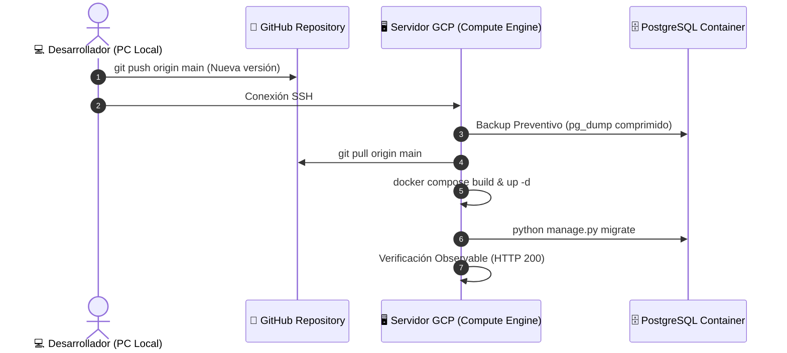

# 🚀 05. Actualizar Producción (Mantenimiento y Nuevas Versiones)

[← Paso Anterior: 04_DESPLEGAR_Y_VERIFICAR.md](./04_DESPLEGAR_Y_VERIFICAR.md) | [↑ Índice General](./00_RESUMEN_GENERAL.md) | [Siguiente Paso: 06_APAGAR_Y_REACTIVAR.md →](./06_APAGAR_Y_REACTIVAR.md)

---

## 1. Visión de la Fase

Este documento establece el procedimiento estándar de actualización continua y mantenimiento para publicar nuevas funcionalidades, corregir incidencias o aplicar migraciones de base de datos en producción. Se garantiza un enfoque de despliegue con mínimo tiempo de inactividad (*Zero-Downtime*), respaldo previo obligatorio de PostgreSQL y protocolo de reversión inmediata (*Rollback*).

---

## 2. Flujo Dual de Actualización



---

## 3. Pasos Estructurados de Actualización

### 🚀 Paso 1: Enviar Cambios desde la Computadora Local

> [!NOTE]
> **Propósito:** Confirmar que todos los cambios locales estén limpios, probados y subidos a la rama principal de Git antes de iniciar la intervención en el servidor.
> **Contexto de Ejecución:** `[PC LOCAL]`
> **Ruta de Trabajo:** Raíz del proyecto local

```bash
# 1. Comprobar que no existan archivos modificados sin confirmar
git status

# 2. Agregar cambios
git add .
git commit -m "feat: nuevas mejoras en reconocimiento IA y reportes de notas"

# 3. Subir commits al repositorio remoto
git push origin main
```

> [!TIP]
> **Verificación Observable & Salida Esperada:**
> ```text
> To https://github.com/Thebetus7/SW2-G17-SDD-26-2.git
>    1234567..89abcde  main -> main
> ```

---

### 🚀 Paso 2: Crear Backup Preventivo Obligatorio de PostgreSQL

> [!NOTE]
> **Propósito:** Generar un volcado físico comprimido de la base de datos antes de aplicar cualquier actualización de código o migración de modelos de Django. Si ocurre cualquier incompatibilidad, este archivo permite restaurar los datos en menos de 60 segundos.
> **Contexto de Ejecución:** `[SSH / SERVIDOR]`
> **Ruta de Trabajo:** `~/proyecto-gestor-notas`

Conéctate por SSH y ejecuta:

```bash
cd ~/proyecto-gestor-notas

# 1. Crear carpeta de respaldos si no existe
mkdir -p ~/backups_db

# 2. Exportar volcado comprimido de la base de datos con marca de tiempo ISO
docker compose -f docker-compose.prod.yml exec postgres pg_dump -U gestornotas_admin gestornotas_prod_db | gzip > ~/backups_db/backup_pre_update_$(date +%Y%m%d_%H%M%S).sql.gz

# 3. Comprobar que el archivo se haya generado con tamaño superior a cero
ls -lh ~/backups_db/
```

> [!TIP]
> **Verificación Observable & Salida Esperada:**
> ```text
> -rw-rw-r-- 1 usuario usuario 128K Oct  3 16:00 backup_pre_update_20261003_160000.sql.gz
> ```

---

### 🚀 Paso 3: Descargar el Código Actualizado desde Git

> [!NOTE]
> **Propósito:** Sincronizar el árbol de trabajo local del servidor con los últimos commits validados en GitHub.
> **Contexto de Ejecución:** `[SSH / SERVIDOR]`
> **Ruta de Trabajo:** `~/proyecto-gestor-notas`

```bash
git pull origin main
```

> [!TIP]
> **Verificación Observable & Salida Esperada:**
> ```text
> Updating 1234567..89abcde
> Fast-forward
>  backend/apps/... | 15 +++++--
>  frontend/src/... | 42 ++++++++++++++++++
>  2 files changed, 50 insertions(+), 7 deletions(-)
> ```

---

### 🚀 Paso 4: Reconstruir y Reiniciar los Contenedores Actualizados

> [!NOTE]
> **Propósito:** Compilar nuevamente las imágenes que hayan sufrido cambios de código y recrear los contenedores en caliente sin detener la base de datos ni tocar los volúmenes de datos.
> **Contexto de Ejecución:** `[SSH / SERVIDOR]`
> **Ruta de Trabajo:** `~/proyecto-gestor-notas`

```bash
# 1. Reconstruir imágenes de backend y frontend
docker compose -f docker-compose.prod.yml build

# 2. Levantar los nuevos contenedores recreando solo los modificados
docker compose -f docker-compose.prod.yml up -d --remove-orphans
```

> [!TIP]
> **Verificación Observable & Salida Esperada:**
> Docker mostrará que recrea los servicios en caliente:
> ```text
> Container gestornotas_backend   Recreate
> Container gestornotas_frontend  Recreate
> Container gestornotas_postgres  Running (sin cambios)
> ```

---

### 🚀 Paso 5: Aplicar Migraciones y Recolectar Estáticos

> [!NOTE]
> **Propósito:** Ejecutar en la base de datos las migraciones que hayan sido incorporadas en la nueva versión y recopilar los nuevos estáticos de Django.
> **Contexto de Ejecución:** `[SSH / SERVIDOR]`
> **Ruta de Trabajo:** `~/proyecto-gestor-notas`

```bash
# 1. Aplicar migraciones en Django
docker compose -f docker-compose.prod.yml exec backend python manage.py migrate --noinput

# 2. Actualizar archivos estáticos
docker compose -f docker-compose.prod.yml exec backend python manage.py collectstatic --noinput
```

> [!TIP]
> **Verificación Observable & Salida Esperada:**
> ```text
> Operations to perform:
>   Apply all migrations: ...
> Running migrations:
>   No migrations to apply. (o Applying ...)
> 0 static files copied, 135 unmodified.
> ```

---

### 🚀 Paso 6: Limpieza de Capas e Imágenes Huérfanas de Docker

> [!NOTE]
> **Propósito:** Liberar espacio en disco eliminando las capas de imágenes previas que quedan sin etiqueta (`<none>`) tras la reconstrucción.
> **Contexto de Ejecución:** `[SSH / SERVIDOR]`

```bash
docker image prune -f
```

> [!TIP]
> **Verificación Observable & Salida Esperada:**
> ```text
> Total reclaimed space: 1.25GB
> ```

---

### 🚀 Paso 7: Verificación Post-Actualización

> [!NOTE]
> **Propósito:** Confirmar que los 3 contenedores estén saludables y que Nginx responda sin interrupciones.
> **Contexto de Ejecución:** `[SSH / SERVIDOR]`

```bash
# 1. Estado de los contenedores
docker compose -f docker-compose.prod.yml ps

# 2. Inspeccionar últimos logs del backend
docker compose -f docker-compose.prod.yml logs --tail=30 backend

# 3. Comprobar respuesta HTTP
curl -s -I http://localhost | head -n 3
```

> [!TIP]
> **Verificación Observable & Salida Esperada:**
> Los 3 servicios en estado `Up` y respuesta `HTTP/1.1 200 OK`.

---

## 4. Procedimiento de Reversión Inmediata (Rollback de Emergencia)

Si tras la actualización se detecta un error crítico imprevisto en producción:

[SSH / SERVIDOR]

```bash
cd ~/proyecto-gestor-notas

# 1. Revertir el código de Git al commit anterior estable
git log --oneline -n 5
git reset --hard <HASH_DEL_COMMIT_ANTERIOR>

# 2. Si la base de datos fue alterada, restaurar el volcado previo:
gunzip -c ~/backups_db/backup_pre_update_YYYYMMDD_HHMMSS.sql.gz | docker compose -f docker-compose.prod.yml exec -T postgres psql -U gestornotas_admin -d gestornotas_prod_db

# 3. Reconstruir y reiniciar la versión anterior estable
docker compose -f docker-compose.prod.yml up -d --build --force-recreate
```

---

## 5. Checklist de Cierre del Paso 05

- [ ] Commits enviados y limpios en GitHub.
- [ ] Backup comprimido de PostgreSQL generado en `~/backups_db/`.
- [ ] `git pull origin main` ejecutado sin conflictos.
- [ ] Contenedores reconstruidos y levantados en caliente.
- [ ] Migraciones aplicadas en Django sin errores.
- [ ] Capas residuales de Docker limpiadas.
- [ ] Pruebas observables superadas con código HTTP 200.

---

[← Paso Anterior: 04_DESPLEGAR_Y_VERIFICAR.md](./04_DESPLEGAR_Y_VERIFICAR.md) | [↑ Índice General](./00_RESUMEN_GENERAL.md) | [Siguiente Paso: 06_APAGAR_Y_REACTIVAR.md →](./06_APAGAR_Y_REACTIVAR.md)
