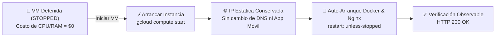

# 🚀 06. Apagar, Reactivar y Control de Costos en GCP

[← Paso Anterior: 05_ACTUALIZAR_PRODUCCION.md](./05_ACTUALIZAR_PRODUCCION.md) | [↑ Índice General](./00_RESUMEN_GENERAL.md) | [Siguiente Paso: 07_FLUJO_VISUAL_DESPLIEGUE.html →](./07_FLUJO_VISUAL_DESPLIEGUE.html)

---

## 1. Visión de la Fase

Este documento establece la gobernanza del ciclo de vida de la infraestructura en Google Cloud Platform. Detalla el procedimiento para suspender temporalmente la máquina virtual (reduciendo los costos de cómputo a **$0.00 USD**) durante periodos sin actividad académica (vacaciones, fines de semana o noches), y cómo reactivarla sin pérdida de datos ni modificaciones en la IP pública.

---

## 2. Diferencia Operativa: Detener (STOP) vs Eliminar (DELETE)

> [!CAUTION]
> **NUNCA ELIMINES (DELETE) LA INSTANCIA PARA AHORRAR DINERO:**
> En Google Cloud Compute Engine, las operaciones de suspensión y destrucción son radicalmente diferentes:

| Operación | Estado de la VM | Costo de Cómputo (CPU / RAM) | Costo de Almacenamiento (Disco 30 GB) | Dirección IPv4 Estática | Integridad de la Base de Datos y Media |
| :--- | :--- | :---: | :---: | :---: | :--- |
| **Detener (STOP)** | `TERMINATED / STOPPED` | **$0.00 / hora** (Cero cobro) | ~$3.00 USD / mes (Se mantiene) | Se conserva sin costo si está asociada | **100% Intactos y Seguros** |
| **Eliminar (DELETE)** | `DELETED` | $0.00 | Se destruye el disco | Se libera a la red pública | **Se pierde definitivamente** |

---

## 3. Flujo de Reactivación Garantizada



---

## 4. Pasos Estructurados de Apagado y Reactivación

### 🚀 Paso 1: Crear Snapshot Preventivo del Disco de la VM

> [!NOTE]
> **Propósito:** Generar una instantánea (*Snapshot*) en Google Cloud del disco persistente antes de apagar la máquina por periodos prolongados, garantizando un punto de restauración histórico en la nube.
> **Contexto de Ejecución:** `[PC LOCAL]`
> **Ruta de Trabajo:** Terminal local

```bash
gcloud compute disks snapshot gestornotas-vm-prod \
    --zone=us-central1-a \
    --snapshot-names=snapshot-gestornotas-$(date +%Y%m%d) \
    --description="Backup preventivo previo a periodo de suspension"
```

> [!TIP]
> **Verificación Observable & Salida Esperada:**
> ```text
> Created [https://www.googleapis.com/compute/v1/projects/.../snapshots/...].
> STATUS: READY
> ```

---

### 🚀 Paso 2: Procedimiento para Apagar / Detener la Instancia de VM

> [!NOTE]
> **Propósito:** Detener el consumo de vCPU y memoria RAM en Google Cloud para reducir la facturación inmediatamente a cero en el rubro de cómputo.
> **Contexto de Ejecución:** `[PC LOCAL]` o `[CONSOLA WEB]`

#### Opción A: Desde la consola web de Google Cloud
1. Ingresa a: [https://console.cloud.google.com/compute/instances](https://console.cloud.google.com/compute/instances)
2. Selecciona la máquina `gestornotas-vm-prod`.
3. Haz clic en el botón superior **"Detener"** (icono de cuadrado Stop) y confirma.

#### Opción B: Mediante comando `gcloud CLI`
```bash
gcloud compute instances stop gestornotas-vm-prod --zone=us-central1-a
```

#### Opción C: Desde la propia sesión SSH
```bash
sudo shutdown -h now
```

> [!TIP]
> **Verificación Observable & Salida Esperada:**
> ```bash
> gcloud compute instances describe gestornotas-vm-prod --zone=us-central1-a --format='value(status)'
> ```
> *Salida esperada:*
> ```text
> TERMINATED
> ```

---

### 🚀 Paso 3: Procedimiento para Reactivar / Iniciar la Instancia de VM

> [!NOTE]
> **Propósito:** Reanudar la máquina virtual cuando comience un nuevo periodo de evaluaciones académicas.
> **Contexto de Ejecución:** `[PC LOCAL]` o `[CONSOLA WEB]`

#### Opción A: Desde la consola web de Google Cloud
1. En **Compute Engine** $\rightarrow$ **Instancias de VM**, selecciona `gestornotas-vm-prod`.
2. Haz clic en el botón superior **"Iniciar / Reanudar"** (icono de triángulo Play).
3. Espera 30 a 45 segundos hasta que aparezca el icono verde de verificación.

#### Opción B: Mediante comando `gcloud CLI`
```bash
gcloud compute instances start gestornotas-vm-prod --zone=us-central1-a
```

> [!TIP]
> **Verificación Observable & Salida Esperada:**
> ```text
> Starting instance(s) gestornotas-vm-prod...done.
> ```

---

### 🚀 Paso 4: Comprobación de Reanudación 100% Automática

> [!NOTE]
> **Propósito:** Comprobar que los servicios se reanudaron por sí solos sin requerir intervención manual dentro del servidor.
> **Contexto de Ejecución:** `[SSH / SERVIDOR]` o `[PC LOCAL]`

Gracias a la arquitectura implementada en los pasos previos:
1. **Nginx:** Inicia automáticamente como servicio del sistema (`systemd`).
2. **Motor Docker:** Inicia automáticamente con `systemd` (`systemctl enable docker`).
3. **Contenedores Docker:** Gracias a la directiva `restart: unless-stopped`, los 3 contenedores (`gestornotas_postgres`, `gestornotas_backend`, `gestornotas_frontend`) se levantan automáticamente.
4. **IP Pública:** Como se reservó una IP estática en el Paso 02, la dirección IP pública es **idéntica a la anterior**.

Prueba física de reactivación:
```bash
# Comprobar que Nginx y el frontend responden en puerto 80
curl -s -I http://<TU_IP_PUBLICA_GCP> | head -n 3
```

*Salida esperada:*
```text
HTTP/1.1 200 OK
```

---

### 🚀 Paso 5: Desmantelamiento Definitivo (Fin del Ciclo del Proyecto)

> [!CAUTION]
> Ejecuta este paso **únicamente** cuando la materia universitaria haya finalizado y no se requiera conservar la plataforma en la nube, para evitar cualquier cobro residual futuro.

[PC LOCAL]

```bash
# 1. Crear y descargar el último backup de base de datos a tu computadora
# 2. Eliminar la instancia de máquina virtual y su disco persistente
gcloud compute instances delete gestornotas-vm-prod --zone=us-central1-a --quiet

# 3. Liberar la IP estática reservada (evita cobros por IP ociosa no asociada a VMs)
gcloud compute addresses delete gestornotas-ip-estatica --region=us-central1 --quiet
```

---

## 5. Checklist de Cierre del Paso 06

- [ ] Comprendida la diferencia entre `STOP` ($0 CPU/RAM) y `DELETE` (destrucción).
- [ ] Procedimiento de parada ejecutado y verificado en estado `TERMINATED`.
- [ ] Procedimiento de encendido probado y verificado en estado `RUNNING`.
- [ ] Confirmado el auto-arranque de Nginx y contenedores Docker sin intervención manual.
- [ ] Confirmada la preservación de la misma IP pública estática y datos de PostgreSQL.

---

[← Paso Anterior: 05_ACTUALIZAR_PRODUCCION.md](./05_ACTUALIZAR_PRODUCCION.md) | [↑ Índice General](./00_RESUMEN_GENERAL.md) | [Dashboard Interactivo: 07_FLUJO_VISUAL_DESPLIEGUE.html →](./07_FLUJO_VISUAL_DESPLIEGUE.html)
