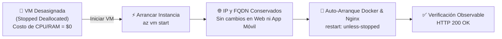

# 🚀 06. Apagar, Reactivar y Control de Costos en Microsoft Azure

[← Paso Anterior: 05_ACTUALIZAR_PRODUCCION.md](./05_ACTUALIZAR_PRODUCCION.md) | [↑ Índice General](./00_RESUMEN_GENERAL.md) | [Siguiente Paso: 07_FLUJO_VISUAL_DESPLIEGUE.html →](./07_FLUJO_VISUAL_DESPLIEGUE.html)

---

## 1. Visión de la Fase

Este documento establece la gobernanza del ciclo de vida de la infraestructura en **Microsoft Azure**. Detalla el procedimiento para suspender temporalmente la máquina virtual (reduciendo los costos de cómputo a **\$0.00 USD**) durante periodos sin actividad académica (vacaciones, recesos o fines de semana), y cómo reactivarla sin pérdida de datos ni modificaciones en el subdominio DNS asignado.

---

## 2. Diferencia Operativa Crítica en Azure: Desasignar (Deallocate) vs Detener (Stop) vs Eliminar (Delete)

> [!CAUTION]
> **REGLA DE FACTURACIÓN CRÍTICA EN AZURE:**
> Si ejecutas `sudo poweroff` o apagas la máquina desde la terminal Linux, Azure la deja en estado **`Stopped (Allocated)`**, lo que **SIGUE FACTURANDO POR CPU Y RAM**.
> Para que Azure deje de cobrar por cómputo, la máquina virtual debe pasar al estado **`Stopped (Deallocated)`**.

| Operación | Estado en Azure | Costo de Cómputo (vCPU / RAM) | Costo de Disco (30 GB SSD) | Dirección IP Pública y FQDN | Integridad de Datos (PostgreSQL y Fotos JPG) |
| :--- | :--- | :---: | :---: | :---: | :--- |
| **Desasignar (Deallocate)** | `Stopped (deallocated)` | **\$0.00 / hora (Cero cobro)** | ~\$1.80 USD / mes (Se mantiene) | Se conserva y mantiene la etiqueta DNS | **100% Intactos y Seguros en disco administrado** |
| **Detener en SO (Stop)** | `Stopped (allocated)` | Sigue facturando igual | ~\$1.80 USD / mes | Se conserva | Intactos |
| **Eliminar (Delete)** | `Terminated / Deleted` | \$0.00 | Se destruye | Se libera a la red pública | **Se pierde definitivamente** |

---

## 3. Flujo de Reactivación Garantizada



---

## 4. Pasos Estructurados de Apagado y Reactivación

### 🚀 Paso 1: Crear Snapshot Preventivo del Disco en Azure

> [!NOTE]
> **Propósito:** Generar una instantánea (*Snapshot*) en Azure del disco del sistema operativo antes de suspender la máquina por periodos prolongados, garantizando un punto de restauración histórico en la nube.
> **Contexto de Ejecución:** `[PC LOCAL]`
> **Ruta de Trabajo:** Terminal local con Azure CLI

```bash
# 1. Obtener el ID del disco del sistema operativo de la VM
OS_DISK_ID=$(az vm show \
  --resource-group rg-gestornotas-prod \
  --name vm-gestornotas \
  --query "storageProfile.osDisk.managedDisk.id" \
  --output tsv)

# 2. Crear el Snapshot preventivo en Azure
az snapshot create \
  --resource-group rg-gestornotas-prod \
  --name "snapshot-gestornotas-$(date +%Y%m%d)" \
  --source "$OS_DISK_ID" \
  --output table
```

> [!TIP]
> **Verificación Observable & Salida Esperada:**
> Azure confirmará `ProvisioningState: Succeeded` y el snapshot quedará registrado en tu grupo de recursos.

---

### 🚀 Paso 2: Procedimiento para Desasignar (Apagar) la Máquina Virtual

> [!NOTE]
> **Propósito:** Liberar los recursos de hardware en el datacenter de Azure y pausar la facturación de CPU y memoria RAM inmediatamente.
> **Contexto de Ejecución:** `[PC LOCAL]` o `[PORTAL AZURE]`

#### Opción A: Desde Azure CLI (Recomendado)

```bash
az vm deallocate \
  --resource-group rg-gestornotas-prod \
  --name vm-gestornotas \
  --output table
```

#### Opción B: Desde el Portal Web de Azure
1. Ingresa a: [https://portal.azure.com/](https://portal.azure.com/)
2. En la lista de recursos, selecciona tu máquina virtual **`vm-gestornotas`**.
3. En la barra superior, haz clic en el botón **Detener (Stop)**.
4. Cuando el cuadro de diálogo pregunte si deseas conservar la dirección IP pública, marca **Aceptar**.
5. Espera a que el estado cambie a **Detenida (desasignada)** / *Stopped (deallocated)*.

> [!TIP]
> **Verificación Observable & Salida Esperada:**
> Comprueba el estado con Azure CLI:
> ```bash
> az vm get-instance-view \
>   --resource-group rg-gestornotas-prod \
>   --name vm-gestornotas \
>   --query "instanceView.statuses[?starts_with(code, 'PowerState/')].displayStatus" \
>   --output tsv
> ```
> *Salida esperada:*
> ```text
> VM deallocated
> ```

---

### 🚀 Paso 3: Procedimiento para Reactivar la Infraestructura

> [!NOTE]
> **Propósito:** Encender nuevamente la máquina virtual al reanudar actividades académicas. Como los contenedores Docker tienen la directiva `restart: unless-stopped` y Nginx está habilitado como servicio systemd, **todos los servicios se levantarán automáticamente sin intervención manual**.
> **Contexto de Ejecución:** `[PC LOCAL]` o `[PORTAL AZURE]`

#### Opción A: Desde Azure CLI

```bash
az vm start \
  --resource-group rg-gestornotas-prod \
  --name vm-gestornotas \
  --output table
```

#### Opción B: Desde el Portal de Azure
1. Ingresa al Portal y navega a **`vm-gestornotas`**.
2. Haz clic en el botón **Iniciar (Start)**.
3. Espera 60 segundos a que el sistema operativo y el demonio de Docker concluyan su arranque.

> [!TIP]
> **Verificación Observable & Salida Esperada:**
> ```text
> PowerState      Status
> --------------  ----------
> VM running      VM running
> ```

---

### 🚀 Paso 4: Comprobación de Salud Post-Reactivación

> [!NOTE]
> **Propósito:** Validar que los servicios web, la base de datos y la API REST estén activos y respondiendo correctamente tras el encendido.
> **Contexto de Ejecución:** `[PC LOCAL]`

Ejecuta las pruebas de verificación externa:

```bash
# 1. Probar respuesta HTTP/HTTPS del Frontend
curl -s -I "https://<TU_FQDN_AZURE>/" | head -n 3

# 2. Probar respuesta de la API REST Backend
curl -s -I "https://<TU_FQDN_AZURE>/api/v1/health/" | head -n 3
```

*Salida esperada:* Ambos comandos responderán con código `HTTP/1.1 200 OK` (o redirección `301` si ingresaste por HTTP puerto 80).

---

## 5. Checklist de Cierre del Paso 06

- [ ] Comprendida la diferencia entre `Stopped (Allocated)` y `Stopped (Deallocated)`.
- [ ] Snapshot preventivo del disco administrado generado con éxito.
- [ ] Comando `az vm deallocate` probado y verificado en estado `VM deallocated`.
- [ ] Comando `az vm start` probado y verificado en estado `VM running`.
- [ ] Servicios Docker y Nginx reactivados automáticamente sin intervención manual.
- [ ] Plataforma web y API REST respondiendo con código HTTP 200 tras el encendido.

---

[← Paso Anterior: 05_ACTUALIZAR_PRODUCCION.md](./05_ACTUALIZAR_PRODUCCION.md) | [↑ Índice General](./00_RESUMEN_GENERAL.md) | [Siguiente Paso: 07_FLUJO_VISUAL_DESPLIEGUE.html →](./07_FLUJO_VISUAL_DESPLIEGUE.html)
