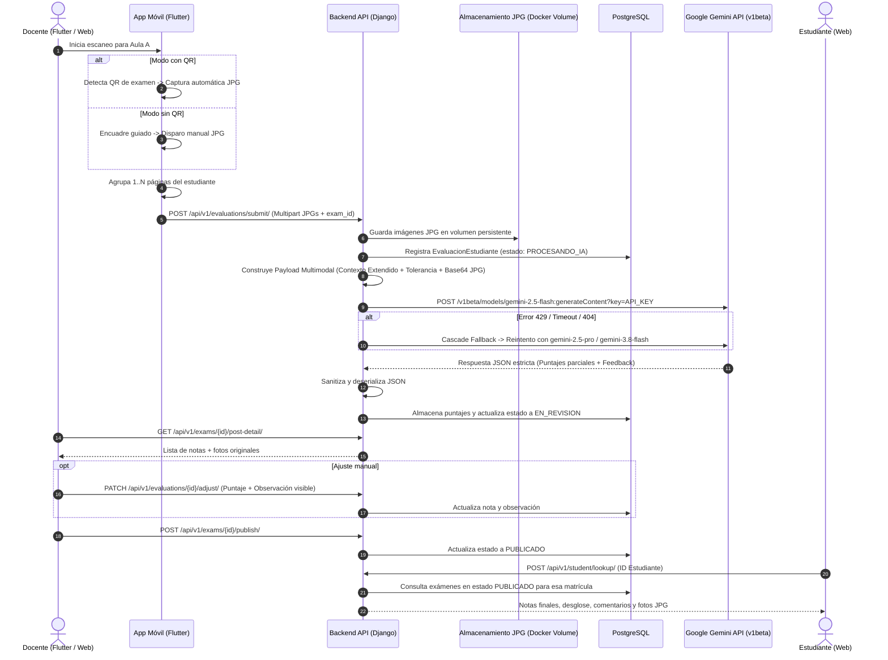

# Plan Técnico: Sistema de Gestión y Evaluación de Exámenes con IA

> Módulo: `docs/specs/01-gestion-evaluacion-examenes/` | Especificación Base: `spec.md` | Constitución: `docs/constitution.md` | Estado: Diseñado | Metodología: SDD-Planning

---

## 1. Resumen Arquitectónico y Matriz de Componentes

### 1.1 Objetivo Técnico
Diseñar e implementar una arquitectura tripartita estrictamente desacoplada en tres proyectos autónomos dentro del repositorio:
* **Proyecto 1: `backend/` (Django REST Framework en Python 3.11):** Proyecto API totalmente independiente, con su propio entorno, dependencias (`requirements.txt`), `Dockerfile`, migraciones PostgreSQL, orquestador de inferencia multimodal Gemini API v1beta Free Tier (Cascade Fallback), procesador de Excel y generador de PDF con QR.
* **Proyecto 2: `frontend/` (Next.js 14+ en TypeScript):** Proyecto Web cliente totalmente independiente, con su propio `package.json`, `Dockerfile`, enrutador App Router, temas CafeBlend (Light & Dark Mode) y constructor interactivo de exámenes.
* **Proyecto 3: `mobile/` (Flutter en Dart):** Proyecto Móvil totalmente independiente, ejecutable de forma nativa en Android/iOS con su propio `pubspec.yaml`, control de hardware de cámara, escaneo de QR y captura multipágina en formato JPG.
* **Orquestación Raíz (`docker-compose.yml`):** Coordina los proyectos en red interna `gestornotas_network` montando volúmenes persistentes para PostgreSQL y almacenamiento de imágenes JPG sin acoplamiento de código.

### 1.2 Patrón Arquitectónico y Desacoplamiento
Los tres proyectos son autónomos y se comunican **estrictamente a través de contratos HTTP REST tipados en JSON**:
* No existen dependencias cruzadas de código fuente entre `frontend/`, `backend/` ni `mobile/`.
* Cada subproyecto puede ser clonado, desarrollado, compilado y testeado de manera independiente en su propio entorno de ejecución.

---

## 2. Estructura Física de los 3 Proyectos Separados

### 2.1 Principio de Aislamiento y Autonomía de Proyectos
El repositorio está concebido con **tres proyectos totalmente desacoplados y autónomos**, ubicados en carpetas independientes en la raíz. Cada proyecto cuenta con su propio gestor de dependencias, runtime, variables de entorno y ciclo de compilación/ejecución:

1. **Proyecto 1: Backend (`backend/`)**: API REST desarrollada en Django 5.x y Django REST Framework. No tiene dependencias de front ni de mobile. Gestiona la lógica de negocio, base de datos PostgreSQL, orquestador de IA Gemini, importación de Excel y generación de PDF.
2. **Proyecto 2: Frontend Web (`frontend/`)**: Aplicación Web SPA/SSR desarrollada en Next.js 14+ (TypeScript y React). No comparte código con backend ni mobile. Consume la API REST del backend exclusivamente mediante HTTP/JSON.
3. **Proyecto 3: Móvil (`mobile/`)**: Aplicación móvil nativa multiplataforma desarrollada en Flutter (Dart). No comparte código con backend ni frontend. Consume la API REST del backend para autenticación, subida multipart de fotos JPG escaneadas y consulta de notas.
4. **Raíz del Repositorio**: Actúa exclusivamente como orquestador de infraestructura local (`docker-compose.yml`), exclusión de versiones (`.gitignore`), variables globales (`.env.example`) y repositorio de especificaciones SDD (`docs/`).

```text
SW2-PF-GESTOR-NOTAvF-26-2/ (Raíz Monorepo de Orquestación)
├── .env.example                               # Plantilla de variables globales para Docker Compose
├── .gitignore                                 # Blindaje de secretos (.env), archivos media y cachés
├── docker-compose.yml                         # Orquestador multi-contenedor (backend, postgres, frontend)
├── AGENTS.md                                  # Guía operativa y gobernanza SDD
├── docs/                                      # Especificaciones formales y arquitectura del sistema
│   ├── constitution.md                        # Principios innegociables y decisiones canónicas
│   └── specs/01-gestion-evaluacion-examenes/
│       ├── spec.md                            # Requerimientos funcionales y criterios de aceptación
│       ├── plan.md                            # Plan técnico y arquitectura de componentes
│       └── tasks.md                           # Desglose de tareas ejecutables
│
├── ========================================================================
├── PROYECTO 1: BACKEND (Django REST Framework — Totalmente Autónomo)
├── ========================================================================
├── backend/
│   ├── .env.example                           # Variables específicas de Django, PostgreSQL y Gemini API
│   ├── Dockerfile                             # Contenedor autónomo Python 3.11
│   ├── requirements.txt                       # Django, DRF, psycopg2, google-genai, openpyxl, reportlab
│   ├── manage.py                              # Entrada CLI de Django
│   ├── pytest.ini                             # Configuración del motor de pruebas de backend
│   ├── config/                                # Configuración global del proyecto Django
│   │   ├── __init__.py
│   │   ├── settings.py                        # Centralización de credenciales via django-environ
│   │   ├── urls.py                            # Ruteo principal de endpoints REST (/api/v1/...)
│   │   └── wsgi.py
│   ├── apps/                                  # Aplicaciones modulares del backend
│   │   ├── authentication/                    # Cuentas de usuario, roles (Admin, Docente, Estudiante) y JWT
│   │   │   ├── models.py                      # Custom User
│   │   │   ├── serializers.py
│   │   │   ├── views.py                       # Login tradicional + Demo Users 1-clic
│   │   │   └── urls.py
│   │   ├── academics/                         # Gestión académica base
│   │   │   ├── models.py                      # Subject (Materia), ClassroomParallel (Aula), Student (Estudiante)
│   │   │   ├── services/
│   │   │   │   └── excel_importer.py          # Lector y validador de archivos Excel (.xlsx) con openpyxl
│   │   │   ├── serializers.py
│   │   │   ├── views.py                       # CRUD materias/paralelos, importación masiva y ficha estudiante
│   │   │   └── urls.py
│   │   ├── exams/                             # Constructor de Exámenes
│   │   │   ├── models.py                      # Exam, ExamComponent (JSONB dinámico)
│   │   │   ├── services/
│   │   │   │   └── pdf_generator.py           # Generación de PDF imprimible con/sin código QR de formato
│   │   │   ├── serializers.py
│   │   │   ├── views.py                       # CRUD de exámenes y descarga de PDF
│   │   │   └── urls.py
│   │   ├── evaluations/                       # Hojas escaneadas y notas
│   │   │   ├── models.py                      # StudentEvaluation, EvaluationPage (JPG), GradeDetail
│   │   │   ├── serializers.py
│   │   │   ├── views.py                       # Recepción multipart JPG, post-detalle, publicación y portal alumno
│   │   │   └── urls.py
│   │   └── ai_engine/                         # Inferencia Multimodal y Resiliencia Gemini
│   │       ├── services/
│   │       │   ├── gemini_client.py           # GeminiResilientClient con Cascade Fallback, 14s timeout y cuotas
│   │       │   ├── prompt_builder.py          # Prompts con contexto, rúbrica y tolerancia para preguntas abiertas
│   │       │   └── response_sanitizer.py      # Sanitización y deserialización JSON segura
│   │       └── exceptions.py
│   └── tests/                                 # Batería de pruebas automatizadas del backend
│       ├── test_auth_demo.py                  # Pruebas de autenticación y usuarios demo
│       ├── test_excel_importer.py             # Pruebas de importación de estudiantes
│       ├── test_gemini_fallback.py            # Pruebas de rotación y resiliencia ante 429/503/timeout
│       └── test_evaluation_pipeline.py        # Pruebas del pipeline de calificación
│
├── ========================================================================
├── PROYECTO 2: FRONTEND (Next.js 14+ TypeScript — Totalmente Autónomo)
├── ========================================================================
├── frontend/
│   ├── .env.example                           # NEXT_PUBLIC_API_URL apuntando al backend
│   ├── Dockerfile                             # Contenedor autónomo Node.js 20 Alpine
│   ├── package.json                           # Dependencias de React, Next.js, Lucide Icons, etc.
│   ├── tsconfig.json                          # Configuración de TypeScript
│   ├── next.config.mjs                        # Configuración de Next.js
│   ├── src/
│   │   ├── app/                               # Next.js App Router
│   │   │   ├── layout.tsx                     # Layout global con tema CafeBlend (Light/Dark Mode)
│   │   │   ├── globals.css                    # Tokens de diseño CafeBlend (:root y .dark)
│   │   │   ├── page.tsx                       # Redirección inicial o landing
│   │   │   ├── login/page.tsx                 # Login con credenciales y botones Demo Users (Admin, Docente, Estudiante)
│   │   │   ├── admin/                         # Vistas exclusivas del Administrador
│   │   │   │   ├── teachers/page.tsx          # Gestión y creación de cuentas de profesores
│   │   │   │   └── students/import/page.tsx   # Importador de archivos Excel (.xlsx) con vista previa
│   │   │   ├── teacher/                       # Vistas exclusivas del Docente
│   │   │   │   ├── courses/page.tsx           # Gestión de Materias y Paralelos
│   │   │   │   ├── students/[id]/page.tsx     # Ficha detallada del Estudiante (historial y notas)
│   │   │   │   ├── exams/builder/page.tsx     # Constructor modular de exámenes con contexto y tolerancia
│   │   │   │   └── exams/[id]/grades/page.tsx # Panel post-detalle con ajuste manual de notas y publicación
│   │   │   └── student/                       # Vista exclusiva del Estudiante
│   │   │       └── portal/page.tsx            # Consulta por ID de notas y fotos JPG escaneadas
│   │   ├── components/                        # Design System CafeBlend
│   │   │   ├── ui/                            # Botones neumórficos, inputs cálidos, badges, cards, modales
│   │   │   └── exams/                         # Componentes arrastrables/modulares para el constructor
│   │   ├── lib/
│   │   │   └── api.ts                         # Cliente HTTP desacoplado (Fetch/Axios) con interceptores JWT
│   │   └── types/                             # Interfaces TypeScript que tipan los contratos JSON de la API
│   └── tests/                                 # Pruebas de integración del frontend
│       └── student_portal.test.tsx
│
├── ========================================================================
├── PROYECTO 3: MOBILE (Flutter Dart — Totalmente Autónomo)
├── ========================================================================
└── mobile/
    ├── pubspec.yaml                           # Dependencias Flutter: camera, dio, flutter_bloc/provider, qr_code_scanner
    ├── analysis_options.yaml                  # Reglas de linter de Dart
    ├── android/                               # Configuración de proyecto nativo Android
    ├── ios/                                   # Configuración de proyecto nativo iOS
    ├── lib/
    │   ├── main.dart                          # Punto de entrada de la aplicación móvil
    │   ├── core/
    │   │   ├── config/env_config.dart         # URL base de la API REST del backend
    │   │   ├── network/api_client.dart        # Cliente HTTP desacoplado basado en Dio
    │   │   └── theme/cafeblend_theme.dart     # Sistema de diseño CafeBlend adaptado a Flutter
    │   └── modules/
    │       ├── auth/                          # Pantalla de login para docentes en la app móvil
    │       ├── scanner/                       # Escáner de exámenes
    │       │   ├── views/camera_scanner_view.dart # Visor de cámara con guías de encuadre y disparo
    │       │   ├── controllers/scanner_controller.dart # Lógica de captura 1..N páginas y lectura QR
    │       │   └── widgets/page_thumbnail_list.dart    # Miniaturas de páginas capturadas por alumno
    │       └── grades/                        # Visualización post-detalle en móvil
    │           └── views/mobile_grades_view.dart       # Lista de alumnos calificados y observaciones
    └── test/                                  # Pruebas de widgets y controladores de Flutter
        └── scanner_flow_test.dart
```

---

## 3. Diagrama de Secuencia Técnico



---

## 4. Contratos de Código e Interfaces Tipadas

### 4.1 Modelos de Dominio en Django ORM (Python)

```python
# backend/apps/academics/models.py
from django.db import models
from django.contrib.auth.models import AbstractUser
import uuid

class User(AbstractUser):
    class Role(models.TextChoices):
        ADMIN = 'ADMIN', 'Administrador'
        TEACHER = 'TEACHER', 'Docente'
        STUDENT = 'STUDENT', 'Estudiante'
        
    id = models.UUIDField(primary_key=True, default=uuid.uuid4, editable=False)
    role = models.CharField(max_length=20, choices=Role.choices, default=Role.TEACHER)
    student_id_code = models.CharField(max_length=50, null=True, blank=True, unique=True)

class Subject(models.Model):
    id = models.UUIDField(primary_key=True, default=uuid.uuid4, editable=False)
    code = models.CharField(max_length=50, unique=True)
    name = models.CharField(max_length=200)
    created_at = models.DateTimeField(auto_now_add=True)

class ClassroomParallel(models.Model):
    id = models.UUIDField(primary_key=True, default=uuid.uuid4, editable=False)
    subject = models.ForeignKey(Subject, on_delete=models.RESTRICT, related_name='parallels')
    teacher = models.ForeignKey(User, on_delete=models.RESTRICT, related_name='assigned_parallels')
    identifier = models.CharField(max_length=50) # Ej. "Aula A"
    period = models.CharField(max_length=50)       # Ej. "2026-I"

class Student(models.Model):
    id = models.UUIDField(primary_key=True, default=uuid.uuid4, editable=False)
    student_id = models.CharField(max_length=50, unique=True) # Extraído del Excel
    full_name = models.CharField(max_length=255)
    parallels = models.ManyToManyField(ClassroomParallel, related_name='students')
```

```python
# backend/apps/exams/models.py
from django.db import models
import uuid

class Exam(models.Model):
    class Status(models.TextChoices):
        DRAFT = 'DRAFT', 'Borrador'
        CONFIGURED = 'CONFIGURED', 'Configurado'
        IN_EVALUATION = 'IN_EVALUATION', 'En Evaluación'
        PUBLISHED = 'PUBLISHED', 'Calificaciones Publicadas'

    class GenerationMode(models.TextChoices):
        WITH_QR = 'WITH_QR', 'Con QR'
        WITHOUT_QR = 'WITHOUT_QR', 'Sin QR'

    id = models.UUIDField(primary_key=True, default=uuid.uuid4, editable=False)
    parallel = models.ForeignKey('academics.ClassroomParallel', on_delete=models.RESTRICT, related_name='exams')
    title = models.CharField(max_length=200)
    total_score = models.DecimalField(max_digits=5, decimal_places=2, default=100.0)
    generation_mode = models.CharField(max_length=20, choices=GenerationMode.choices, default=GenerationMode.WITH_QR)
    status = models.CharField(max_length=25, choices=Status.choices, default=Status.DRAFT)
    estimated_pages = models.PositiveSmallIntegerField(default=1)

class ExamComponent(models.Model):
    class ComponentType(models.TextChoices):
        OPEN_QUESTION = 'OPEN_QUESTION', 'Pregunta Abierta'
        MULTIPLE_CHOICE = 'MULTIPLE_CHOICE', 'Opción Múltiple'
        TRUE_FALSE = 'TRUE_FALSE', 'Verdadero o Falso'

    class SemanticTolerance(models.TextChoices):
        STRICT = 'STRICT', 'Estricta'
        MODERATE = 'MODERATE', 'Moderada'
        FLEXIBLE = 'FLEXIBLE', 'Flexible'

    id = models.UUIDField(primary_key=True, default=uuid.uuid4, editable=False)
    exam = models.ForeignKey(Exam, on_delete=models.CASCADE, related_name='components')
    order = models.PositiveSmallIntegerField()
    component_type = models.CharField(max_length=25, choices=ComponentType.choices)
    statement = models.TextField()
    extended_context = models.TextField(blank=True, default='')
    semantic_tolerance = models.CharField(max_length=20, choices=SemanticTolerance.choices, default=SemanticTolerance.MODERATE)
    config = models.JSONField(default=dict) # Opciones, clave correcta, rúbrica
    max_score = models.DecimalField(max_digits=5, decimal_places=2)
```

```python
# backend/apps/evaluations/models.py
from django.db import models
import uuid

class StudentEvaluation(models.Model):
    class ReviewStatus(models.TextChoices):
        PROCESSING_AI = 'PROCESSING_AI', 'Procesando IA'
        IN_REVIEW = 'IN_REVIEW', 'En Revisión Docente'
        REQUIRES_TEACHER_REVIEW = 'REQUIRES_TEACHER_REVIEW', 'Requiere Revisión Docente'
        PUBLISHED = 'PUBLISHED', 'Publicado'

    id = models.UUIDField(primary_key=True, default=uuid.uuid4, editable=False)
    exam = models.ForeignKey('exams.Exam', on_delete=models.CASCADE, related_name='evaluations')
    student = models.ForeignKey('academics.Student', on_delete=models.RESTRICT, related_name='evaluations', null=True, blank=True)
    status = models.CharField(max_length=30, choices=ReviewStatus.choices, default=ReviewStatus.PROCESSING_AI)
    final_score = models.DecimalField(max_digits=5, decimal_places=2, default=0.0)
    created_at = models.DateTimeField(auto_now_add=True)

class EvaluationPage(models.Model):
    id = models.UUIDField(primary_key=True, default=uuid.uuid4, editable=False)
    evaluation = models.ForeignKey(StudentEvaluation, on_delete=models.CASCADE, related_name='pages')
    page_number = models.PositiveSmallIntegerField()
    image = models.ImageField(upload_to='examenes/%Y/%m/') # Formato JPG estricto

class ComponentScoreDetail(models.Model):
    id = models.UUIDField(primary_key=True, default=uuid.uuid4, editable=False)
    evaluation = models.ForeignKey(StudentEvaluation, on_delete=models.CASCADE, related_name='details')
    component = models.ForeignKey('exams.ExamComponent', on_delete=models.CASCADE)
    transcribed_answer = models.TextField(blank=True, default='')
    score_assigned = models.DecimalField(max_digits=5, decimal_places=2, default=0.0)
    ai_feedback = models.TextField(blank=True, default='')
    teacher_observation = models.TextField(blank=True, default='')
    manually_adjusted = models.BooleanField(default=False)
```

### 4.2 Servicio de Inferencia Resiliente Gemini (Free Tier)

```python
# backend/apps/ai_engine/services/gemini_client.py
import base64
import json
import requests
import time
from django.conf import settings

class GeminiResilientClient:
    MODELS_CASCADE = [
        'gemini-2.5-flash',
        'gemini-2.5-pro',
        'gemini-2.5-flash-lite',
        'gemini-3.8-flash',
        'gemini-flash-latest'
    ]
    
    BASE_URL = "https://generativelanguage.googleapis.com/v1beta/models"

    @classmethod
    def evaluate_exam(cls, image_bytes_list: list[bytes], prompt: str) -> dict:
        api_key = settings.GEMINI_API_KEY
        if not api_key:
            raise ValueError("GEMINI_API_KEY no configurada.")

        parts = [{"text": prompt}]
        for img_bytes in image_bytes_list:
            b64_img = base64.b64encode(img_bytes).decode('utf-8')
            parts.append({
                "inline_data": {
                    "mime_type": "image/jpeg",
                    "data": b64_img
                }
            })

        payload = {
            "contents": [{"parts": parts}],
            "generationConfig": {
                "responseMimeType": "application/json",
                "temperature": 0.15
            }
        }

        last_error = None
        for model in cls.MODELS_CASCADE:
            url = f"{cls.BASE_URL}/{model}:generateContent?key={api_key}"
            for attempt in range(2): # Reintento con backoff ante 429
                try:
                    response = requests.post(url, json=payload, timeout=14.0)
                    if response.status_code == 200:
                        raw_json = response.json()
                        text_content = raw_json['candidates'][0]['content']['parts'][0]['text']
                        # Sanitizar envoltorios markdown
                        clean_text = text_content.strip().removeprefix("```json").removesuffix("```").strip()
                        return json.loads(clean_text)
                    elif response.status_code == 429: # Resource Exhausted
                        time.sleep(2.0 * (attempt + 1))
                        continue
                    else:
                        break # Probar siguiente modelo en la cascada
                except requests.RequestException as e:
                    last_error = e
                    break
        
        # Degradación elegante ante agotamiento total
        raise RuntimeError(f"Fallo en inferencia IA tras rotación de modelos. Motivo: {last_error}")
```

### 4.3 Interfaces Tipadas en Frontend (TypeScript / Next.js)

```typescript
// frontend/src/types/index.ts
export type UserRole = 'ADMIN' | 'TEACHER' | 'STUDENT';

export interface StudentDetail {
  id: string;
  studentId: string;
  fullName: string;
  parallels: { id: string; subjectName: string; parallelName: string }[];
  examHistory: {
    examId: string;
    examTitle: string;
    finalScore: number;
    maxScore: number;
    status: string;
    createdAt: string;
  }[];
  cumulativeAverage: number;
}

export interface StudentExamView {
  examTitle: string;
  studentId: string;
  studentName: string;
  finalScore: number;
  totalScore: number;
  status: 'PUBLISHED';
  pageImages: string[];
  components: {
    order: number;
    statement: string;
    scoreAssigned: number;
    maxScore: number;
    aiFeedback: string;
    teacherObservation?: string;
  }[];
}
```

---

## 5. Garantías de Runtime, Persistencia y Seguridad de Credenciales

### 5.1 Centralización de Credenciales y Política de `.gitignore`
Para dar cumplimiento estricto al requerimiento del usuario, la gestión de secretos se estructura en dos niveles:
1. **Archivo de Entorno Centralizado (`backend/.env` y raíz `.env`):**
   * Contiene `DJANGO_SECRET_KEY`, `GEMINI_API_KEY`, `POSTGRES_DB`, `POSTGRES_USER`, `POSTGRES_PASSWORD`, `DATABASE_URL`.
2. **Plantilla Pública Versionable (`.env.example`):**
   * Mapea todas las variables requeridas sin exponer valores reales, documentando cada clave para los entornos de desarrollo y producción.
3. **Exclusión Estricta en `.gitignore`:**
   * Regla innegociable: `.env`, `*.env`, `.env.local`, `*.key`, `.pem`, y la carpeta `backend/media/` quedan estrictamente ignorados por Git para evitar fugas de información.

### 5.2 Integridad Relacional y Claves Foráneas
* `Materia` $\rightarrow$ `Paralelo`: `on_delete=models.RESTRICT` (impide borrar una materia si tiene paralelos activos con alumnos).
* `Paralelo` $\rightarrow$ `Examen`: `on_delete=models.RESTRICT` (protege exámenes programados y notas).
* `Examen` $\rightarrow$ `ExamComponent`: `on_delete=models.CASCADE` (los componentes son propiedad intrínseca del examen).
* `StudentEvaluation` $\rightarrow$ `EvaluationPage` y `ComponentScoreDetail`: `on_delete=models.CASCADE` (las páginas y detalles de nota dependen de la entrega).
* `StudentEvaluation` $\rightarrow$ `Student`: `on_delete=models.RESTRICT` (impide borrar a un estudiante si ya tiene evaluaciones registradas).

### 5.3 Patrón del Selector Tridimensional (The 3-Way Selector) en Constructor Web
* **Selección existente:** Lista reactiva de paralelos/aulas del docente.
* **Creación en caliente:** Modal para crear un aula o materia sin abandonar el borrador del examen.
* **Estado neutro (Zero-State Invariant):** Si el docente no tiene materias creadas, se presenta una pantalla de bienvenida guiada sin componentes rotos ni bloqueos.

---

## 6. Estrategia de Testing y Verificación

* **Tests de Caja Negra (BDD / E2E):**
  1. `test_admin_import_flow`: Verifica que el Administrador cargue un archivo `.xlsx` y los estudiantes queden disponibles en `Aula A`.
  2. `test_teacher_scan_and_publish_flow`: Simula la recepción de JPGs, la inferencia con mock de Gemini, la auditoría del docente y el pase a `PUBLICADO`.
  3. `test_student_lookup_by_id`: Verifica que un estudiante consulte su examen únicamente digitando su ID.
  4. `test_demo_users_login`: Verifica que los botones de 1-clic autentiquen inmediatamente al usuario en la sesión deseada.
* **Tests de Caja Blanca (Unitarios):**
  1. `test_cascade_fallback_gemini`: Simula un HTTP 429 en `gemini-2.5-flash` y valida que el cliente rote automáticamente a `gemini-2.5-pro` sin lanzar excepción al usuario.
  2. `test_excel_format_sanitization`: Prueba la extracción de columnas de número y nombre con filas vacías o espacios en blanco.
