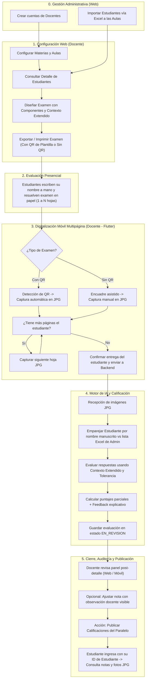

# Specification: Sistema de Gestión y Evaluación de Exámenes con IA

Status: APPROVED

## 1. Context

Este módulo funcional constituye el núcleo operativo del sistema académico integral. Permite al docente administrar su catálogo curricular (Materias, Paralelos/Aulas A, B, C y Estudiantes mediante importación de archivos Excel), diseñar exámenes modulares en plataforma Web proveyendo contexto semántico detallado y tolerancias de corrección, capturar y escanear pruebas físicas manuscritas de 1 a N páginas por estudiante desde la aplicación móvil mediante dos modalidades (con código QR de plantilla o sin QR con lectura de estructura) en formato JPG, procesar la evaluación con inteligencia artificial multimodal, auditar los resultados en un panel post-detalle con capacidad de ajuste y publicar las calificaciones de forma controlada con respaldo fotográfico para la consulta individual del estudiante.

---

## 2. Objective

Proveer un flujo continuo, riguroso y automatizado de evaluación académica que elimine la carga de corrección manual de exámenes físicos en papel, garantizando precisión en la lectura de caligrafía variada mediante abundante contexto docente, soporte para evaluaciones multipágina, flexibilidad en el diseño modular de pruebas y máxima transparencia para el estudiante al consultar sus notas, la justificación de corrección y la evidencia visual de su evaluación.

---

## 3. Scope

### 3.1 In Scope
* **Administración Institucional Centralizada (Web - Administrador):**
  * Creación y gestión de cuentas de Profesores/Docentes.
  * Carga masiva e importación exclusiva de listas de Estudiantes matriculados a partir de archivos Excel (`.xlsx`), formateando y capturando automáticamente el número de matrícula (ID de estudiante) y nombre completo.
* **Gestión Académica y Ficha de Estudiante (Web - Docente):**
  * Creación y edición de Materias (nombre y código) y asignación de Paralelos (Aulas A, B, C...).
  * **Detalle del Estudiante:** Vista detallada e historial académico de cada estudiante matriculado en su paralelo (datos personales, exámenes rendidos, promedio acumulado y notas obtenidas).
* **Constructor Modular de Exámenes con Contexto Enriquecido (Web - Docente):**
  * Creación de evaluaciones asignadas a un Paralelo/Aula específico.
  * Inserción y configuración de Componentes de Evaluación:
    1. Preguntas Abiertas / Desarrollo: enunciado, respuesta modelo esperada, contexto pedagógico extendido, conceptos clave, margen de tolerancia semántica y puntaje máximo.
    2. Preguntas de Opción Múltiple: enunciado, lista de alternativas, indicador de opción u opciones correctas y puntaje asignado.
    3. Preguntas de Verdadero / Falso: enunciado, valor de verdad correcto, justificación opcional y puntaje.
  * Generación y exportación de examen imprimible (1 a N páginas) con dos modalidades:
    * Modalidad Con QR: Código QR en cabecera que codifica el formato y la plantilla del examen y aula. Incluye casillas manuscritas para que el estudiante escriba su nombre y número.
    * Modalidad Sin QR: Formato tradicional con casillas de identificación personal y preguntas numeradas.
* **Módulo de Escaneo y Digitalización Móvil Multipágina (App Flutter - Docente):**
  * Selección de Materia $\rightarrow$ Paralelo (Aula) $\rightarrow$ Examen.
  * Soporte de escaneo multipágina (1 a N páginas por estudiante): la app permite encuadrar y capturar páginas consecutivas agrupadas bajo la misma entrega antes de pasar al siguiente alumno.
  * Captura de Examen Con QR: Detección óptica del QR en visor de cámara, disparo/captura automática de la foto en formato JPG y asociación inmediata de la plantilla.
  * Captura de Examen Sin QR: Encuadre guiado, disparo manual de foto en formato JPG, extracción por IA de preguntas/respuestas manuscritas y correlación contra la plantilla.
  * Previsualización de imágenes capturadas con confirmación de nitidez y transmisión al backend.
* **Procesamiento y Calificación Automatizada (Backend + IA con Gemini Free Tier):**
  * Recepción de imágenes en formato JPG.
  * Identificación del estudiante en la hoja: en exámenes con QR o sin QR, la IA extrae el nombre y número manuscrito en el encabezado y lo empareja con la lista de estudiantes inscritos en el aula (cargados previamente vía Excel por el Admin).
  * Inferencia con IA Multimodal aplicando el contexto extendido y márgenes de tolerancia provistos por el docente para calificar preguntas abiertas con puntajes parciales proporcionales y justificación explicativa.
  * Asignación del estado de evaluación (`CALIFICADO` o `REVISION_DOCENTE`).
* **Auditoría Docente y Publicación Controlada (Web y Móvil):**
  * Panel post-detalle con la lista de notas de los estudiantes del paralelo, conservando el estado inicial `EN_REVISION`.
  * Visualización comparativa de la fotografía JPG del examen versus el puntaje otorgado y la transcripción de la IA.
  * Edición manual de puntajes por el profesor con campo para ingresar observaciones visibles para el estudiante que justifiquen el ajuste.
  * Acción explícita de "Publicar Calificaciones del Paralelo": control de visibilidad que desbloquea el acceso a las notas para los estudiantes del aula una vez auditadas.
* **Portal de Consulta Estudiantil por ID (Web):**
  * **Acceso y Login por ID de Estudiante:** El estudiante ingresa o consulta su estado y notas únicamente digitando su ID de estudiante (matrícula/código), sin credenciales engorrosas.
  * Visualización de sus exámenes publicados con: nota final, desglose de puntaje por cada componente, comentarios de retroalimentación de la IA u observaciones del docente, y visualización interactiva de las fotografías JPG escaneadas de su examen físico.
* **Mecanismo de Usuarios de Prueba (Demo Users en Login):**
  * Botones de acceso rápido en la pantalla de inicio de sesión ("Acceder como Administrador Demo", "Acceder como Docente Demo", "Acceder como Estudiante Demo") con credenciales pre-cargadas para evaluación inmediata y testing.

### 3.2 Out of Scope
* Creación de profesores o importación de estudiantes por parte de docentes (facultad exclusiva del Administrador).
* Rendición de exámenes online en tiempo real para estudiantes (la resolución es física en papel manuscrito).
* Almacenamiento o conversión de imágenes en formatos distintos a JPG (PNG, HEIC, TIFF quedan excluidos).
* Edición o alteración de notas directamente por parte de los estudiantes.
* Publicación anticipada de notas antes de la confirmación explícita del docente.

---

## 4. Actors

* **Administrador:** Máxima autoridad institucional; único responsable de dar de alta profesores e importar el padrón de estudiantes a las aulas mediante archivos Excel.
* **Docente (Profesor):** Creado por el Admin. Gestiona materias y paralelos/aulas, consulta el detalle individual de cada estudiante, diseña exámenes con contexto extendido, opera la app móvil para escanear de 1 a N hojas por alumno, audita notas con observaciones visibles y publica calificaciones.
* **Estudiante (Alumno):** Rinde exámenes manuscritos en aula y accede al portal Web exclusivamente con su **ID de estudiante** para consultar sus calificaciones publicadas, desglose y fotos de su prueba.

---

## 5. Global Flow Context



---

## 6. User Stories

### HU-01: Creación de Docentes e Importación de Estudiantes (Admin)
Como **Administrador**,  
quiero **crear cuentas de profesores y subir archivos Excel para importar automáticamente el número de matrícula y nombre de los estudiantes a cada aula**,  
para **centralizar la administración curricular y evitar duplicación o errores de registro**.

### HU-02: Consulta de Detalle de Estudiante y Gestión Docente
Como **Docente**,  
quiero **acceder a la ficha de detalle de cualquier estudiante de mis aulas para ver su historial de notas y rendimiento**,  
para **conocer en profundidad el desempeño de mis alumnos**.

### HU-03: Diseño Modular de Exámenes con Contexto Extendido
Como **Docente**,  
quiero **construir exámenes modulares con preguntas abiertas, opción múltiple y verdadero/falso, redactando contexto detallado y márgenes de tolerancia para las respuestas esperadas, e imprimir con o sin QR de formato**,  
para **garantizar una evaluación precisa y comprensiva por parte de la IA**.

### HU-04: Escaneo Móvil Multipágina en Formato JPG
Como **Docente**,  
quiero **escanear con la cámara móvil las hojas de examen de cada estudiante (1 o varias páginas consecutivas), con captura automática al detectar QR o manual asistida**,  
para **digitalizar rápidamente paquetes completos de exámenes físicos en imágenes JPG estructuradas**.

### HU-05: Calificación Automatizada y Auditoría con Observación Visible
Como **Docente**,  
quiero **que la IA evalúe las caligrafías manuscritas otorgando puntajes proporcionales basados en mi contexto, y poder ajustar manualmente cualquier nota agregando una observación visible**,  
para **mantener el rigor académico y justificar transparentemente cualquier cambio de nota**.

### HU-06: Consulta Estudiantil Simplificada por ID de Estudiante
Como **Estudiante**,  
quiero **ingresar al portal web exclusivamente con mi ID de estudiante (sin contraseñas complejas)**,  
para **ver de inmediato mis materias, exámenes publicados, notas con desglose explicativo y las fotos escaneadas de mi prueba**.

### HU-07: Acceso Rápido con Usuarios de Prueba (Demo Users)
Como **Evaluador o Desarrollador**,  
quiero **contar con botones de 1-clic en la pantalla de inicio de sesión para acceder como Administrador, Docente o Estudiante de prueba**,  
para **probar y demostrar fluidamente todas las capacidades del sistema sin ingresar credenciales manualmente**.

---

## 7. Business Rules

* **RB-01 (Exclusividad Administrativa de Padrón y Docentes):** El Administrador es el **único actor facultado** para crear cuentas de profesores y para importar listas de estudiantes desde archivos Excel (`.xlsx`) a las aulas. Los docentes tienen restringida la creación de usuarios y la importación del padrón.
* **RB-02 (Ponderación Total de Examen):** La suma de los puntajes máximos de todos los componentes insertados en un examen debe ser exactamente igual al puntaje total nominal del examen (ej. 100 puntos).
* **RB-03 (Estandarización de Formato de Imagen):** Todas las capturas fotográficas enviadas desde la app móvil o almacenadas en el sistema deben generarse y preservarse obligatoriamente en formato `.jpg` (o `.jpeg`).
* **RB-04 (Alcance del Código QR en Impresión):** El código QR codifica exclusivamente el formato del examen (identificador de plantilla y paralelo/aula). El estudiante siempre debe escribir su nombre y matrícula de su puño y letra en la cabecera.
* **RB-05 (Modalidad de Escaneo con QR):** La aplicación móvil detecta el QR, enfoca y dispara automáticamente sin intervención táctil, vinculando la plantilla del examen e iniciando la captura de las páginas del alumno.
* **RB-06 (Modalidad de Escaneo sin QR):** En exámenes sin QR, la captura es disparada manualmente; el motor de IA identifica el encabezado manuscrito para emparejar al estudiante y alinea cada respuesta con la numeración de preguntas del examen.
* **RB-07 (Soporte Multipágina por Estudiante):** Un examen puede tener de 1 a N páginas por estudiante. Todas las capturas JPG de un mismo alumno deben agruparse en una sola entrega antes de pasar a escanear al siguiente alumno.
* **RB-08 (Calificación con Tolerancia y Puntajes Parciales):** La IA evalúa las respuestas abiertas contrastándolas con el contexto extendido y la tolerancia definida por el profesor, pudiendo otorgar puntajes parciales proporcionales justificados.
* **RB-09 (Estado de Revisión Docente por Ilegibilidad):** Si la IA detecta una caligrafía con baja confianza de lectura o respuestas dudosas, la pregunta se marca como `REQUIERE_REVISION_DOCENTE` y la evaluación permanece en revisión.
* **RB-10 (Control de Publicación de Notas):** Tras el procesamiento de IA, las notas permanecen en estado `EN_REVISION` y ocultas para los estudiantes hasta que el docente presione explícitamente "Publicar Calificaciones del Paralelo".
* **RB-11 (Ajuste Manual con Observación Visible):** Si el docente edita la nota asignada por la IA a una pregunta, el sistema le solicita una observación explicativa que quedará visible para el estudiante en su consulta web.
* **RB-12 (Acceso al Detalle del Estudiante):** El docente puede consultar la ficha de detalle de cualquier estudiante inscrito en sus paralelos (datos generales, exámenes rendidos, promedio acumulado e historial de correcciones).
* **RB-13 (Autenticación Estudiantil Simplificada por ID):** El estudiante accede al portal de consulta exclusivamente digitando su `ID de estudiante` (número de matrícula), sin requerir contraseña compleja ni pasos adicionales.
* **RB-14 (Aislamiento de Información Estudiantil):** Un estudiante autenticado únicamente puede ver sus propios registros de evaluación y estado académico. No tiene visibilidad sobre notas, fotos ni listas de otros compañeros del aula.
* **RB-15 (Usuarios de Prueba en Inicio de Sesión):** La pantalla de login debe incluir de forma fija botones de acceso rápido para autenticarse en 1-clic con perfiles de prueba (Admin Demo, Docente Demo, Estudiante Demo).

---

## 8. Functional Requirements

### Módulo Administrativo Centralizado (Web - Administrador)
* **RF-01.1:** El sistema deberá permitir al Administrador crear, listar, editar y desactivar cuentas de Docentes (nombre, correo y contraseña inicial).
* **RF-01.2:** El sistema deberá proveer al Administrador un importador de archivos Excel (`.xlsx`) que procese las listas de alumnos por paralelo/aula, capture el número de matrícula (ID de estudiante) y nombre completo, y los registre matriculados.

### Módulo Curricular y Detalle de Estudiantes (Web - Docente)
* **RF-02.1:** El sistema deberá permitir al docente autenticado configurar sus Materias y Paralelos asignados (Aula A, Aula B, etc.).
* **RF-02.2:** El sistema deberá permitir al docente consultar el listado de estudiantes de cada paralelo y acceder a la **Ficha de Detalle del Estudiante**, desplegando su matrícula, nombre, lista de exámenes presentados, notas obtenidas y promedio del curso.
* **RF-02.3:** El sistema deberá permitir al docente construir exámenes modulares con componentes de:
  * Pregunta Abierta (enunciado, respuesta esperada, contexto extendido, palabras clave, tolerancia y puntaje).
  * Pregunta de Opción Múltiple (enunciado, alternativas de respuesta, clave correcta y puntaje).
  * Pregunta de Verdadero / Falso (enunciado, valor correcto y puntaje).
* **RF-02.4:** Al exportar/imprimir el examen (de 1 a N páginas), el sistema deberá permitir elegir entre:
  * Versión con QR de formato en cabecera y casillas para nombre manuscrito.
  * Versión sin QR con estructura tradicional de encabezado y preguntas.

### Módulo Móvil de Digitalización Multipágina (Flutter - Docente)
* **RF-03.1:** La aplicación móvil deberá permitir al docente seleccionar la Materia, el Paralelo (Aula) y el Examen antes del escaneo.
* **RF-03.2:** En modo "Con QR", cuando la cámara detecte el código QR en el visor, el sistema deberá capturar automáticamente la fotografía en formato JPG.
* **RF-03.3:** En modo "Sin QR", el sistema deberá proveer guías de encuadre en el visor y un botón de disparo manual para tomar la foto en formato JPG.
* **RF-03.4:** El sistema móvil deberá permitir capturar de 1 a N páginas consecutivas para un mismo estudiante, previsualizar cada JPG, y confirmar el paquete completo antes de proceder con el siguiente alumno.

### Motor de Procesamiento y Calificación (Backend + IA con Gemini Free Tier)
* **RF-04.1:** Cuando el backend reciba las imágenes JPG de una entrega, la IA deberá transcribir la caligrafía del encabezado y emparejar al estudiante con la lista de alumnos del aula cargada previamente vía Excel por el Administrador.
* **RF-04.2:** El sistema deberá aplicar el contexto extendido y margen de tolerancia pedagógica configurados por el docente para calificar cada respuesta abierta, asignando puntajes proporcionales y justificación explicativa.
* **RF-04.3:** El cliente de inferencia de IA en el backend deberá implementar la arquitectura de Cascade Fallback rotando secuencialmente entre los modelos activos vigentes de la capa gratuita (`gemini-2.5-flash` $\rightarrow$ `gemini-2.5-pro` $\rightarrow$ `gemini-2.5-flash-lite` $\rightarrow$ `gemini-3.8-flash` $\rightarrow$ `gemini-flash-latest`), evitando estrictamente los modelos obsoletos retirados (`gemini-1.5-flash`, `gemini-1.5-flash-8b`, `gemini-2.0-flash`).
* **RF-04.4:** Las llamadas a la API de Gemini deberán exigir `responseMimeType: "application/json"`, temperatura baja (`0.1` a `0.2`), timeout estricto de 10 a 15 segundos y sanitización de posibles envoltorios markdown previo a la deserialización.
* **RF-04.5:** Si la API devuelve error HTTP 429 (`RESOURCE_EXHAUSTED`), timeout prolongado o la caligrafía resulta ilegible tras los reintentos, el sistema deberá degradar elegantemente la evaluación al estado `REVISION_DOCENTE` preservando intactas las fotos JPG sin colapsar el proceso del curso.
* **RF-04.6:** Toda evaluación procesada por la IA deberá registrarse inicialmente en estado `EN_REVISION` (no visible para los estudiantes hasta la publicación docente).

### Panel Post-Detalle, Auditoría y Portal Estudiantil por ID
* **RF-05.1:** El sistema deberá presentar al docente una tabla post-detalle con la lista de notas de los estudiantes, estado de revisión y visor comparativo (foto JPG original vs corrección IA).
* **RF-05.2:** El sistema deberá permitir al docente modificar el puntaje de cualquier pregunta registrando un motivo u observación que será visible para el estudiante.
* **RF-05.3:** El sistema deberá proveer el botón de acción "Publicar Calificaciones del Paralelo", que cambia el estado a `PUBLICADO` y habilita la consulta a los estudiantes del curso.
* **RF-05.4:** El portal web del estudiante deberá permitir el login mediante su **ID de estudiante** (matrícula) y desplegar sus atributos personales, aula, notas finales publicadas, desglose por pregunta con retroalimentación u observaciones del docente, y fotos JPG de su examen.
* **RF-05.5:** La pantalla de inicio de sesión deberá proveer botones de acceso rápido para cargar credenciales de "Usuario de Prueba" (Admin, Docente, Estudiante).

---

## 9. Functional Data

### Entidad: Materia
* `codigo`: Cadena alfanumérica única (ej. "INF-281"). Obligatorio.
* `nombre`: Cadena descriptiva (ej. "Sistemas Web II"). Obligatorio.

### Entidad: Paralelo
* `aula_identificador`: Cadena de texto (ej. "Aula A", "Aula B"). Obligatorio.
* `periodo`: Cadena del ciclo lectivo (ej. "2026-I"). Obligatorio.
* `materia`: Referencia a la Materia correspondiente. Obligatorio.

### Entidad: Estudiante
* `numero_matricula`: Cadena alfanumérica única extraída del Excel. Obligatorio.
* `nombre_completo`: Cadena de texto extraída del Excel. Obligatorio.
* `email`: Dirección de correo electrónico (opcional o autogenerado).

### Entidad: Examen
* `titulo`: Nombre de la evaluación (ej. "Primer Parcial"). Obligatorio.
* `paralelo`: Referencia al Paralelo/Aula. Obligatorio.
* `puntaje_total`: Número decimal positivo (ej. 100.0). Obligatorio.
* `modalidad_generacion`: Enumerador (`CON_QR`, `SIN_QR`). Obligatorio.
* `numero_paginas_estimadas`: Entero positivo (1 a N).
* `estado`: Enumerador (`BORRADOR`, `CONFIGURADO`, `EN_EVALUACION`, `CALIFICACIONES_PUBLICADAS`).

### Entidad: ComponenteExamen
* `tipo`: Enumerador (`PREGUNTA_ABIERTA`, `OPCION_MULTIPLE`, `VERDADERO_FALSO`).
* `numero_orden`: Entero positivo (1, 2, 3...).
* `enunciado`: Texto con la pregunta formulada.
* `contexto_extendido`: Texto con contexto detallado provisto por el profesor para guiar la inferencia de la IA.
* `tolerancia_semantica`: Enumerador (`ESTRICTA`, `MODERADA`, `FLEXIBLE`).
* `configuracion_respuesta`: Estructura JSON con opciones y respuesta correcta, o rúbrica con palabras clave y respuesta esperada.
* `puntaje_maximo`: Número decimal mayor a 0.

### Entidad: EvaluacionEstudiante
* `examen`: Referencia al Examen.
* `estudiante`: Referencia al Estudiante.
* `tipo_captura`: Enumerador (`AUTOMATICA_QR`, `MANUAL_SIN_QR`).
* `nota_final`: Decimal acumulado de los componentes.
* `estado_evaluacion`: Enumerador (`PROCESANDO_IA`, `EN_REVISION`, `REVISION_DOCENTE`, `PUBLICADO`).

### Entidad: PaginaEvaluacion
* `evaluacion`: Referencia a la EvaluacionEstudiante.
* `numero_pagina`: Entero positivo (1, 2, 3...).
* `imagen_jpg_url`: Ruta / URL del archivo de imagen fotográfica en formato JPG. Obligatorio.

### Entidad: DetalleCalificacionComponente
* `evaluacion`: Referencia a EvaluacionEstudiante.
* `componente`: Referencia a ComponenteExamen.
* `respuesta_transcrita`: Texto manuscrito extraído por la IA.
* `puntaje_asignado`: Decimal obtenido en la pregunta.
* `feedback_ia`: Justificación textual generada por la IA según el contexto y la rúbrica.
* `observacion_docente`: Comentario u observación manual del profesor (visible para el estudiante).
* `ajustado_manualmente`: Booleano (true si el docente editó la nota).

---

## 10. Preconditions

1. El docente debe contar con una sesión activa y al menos una Materia y un Paralelo configurados.
2. La lista de estudiantes del paralelo debe haber sido importada previamente desde el archivo Excel.
3. Para escanear un examen, la evaluación debe haber sido creada y configurada en la plataforma Web.
4. El smartphone del docente debe contar con permisos concedidos para el uso de la cámara.
5. Para consultar sus calificaciones en la Web, el examen debe encontrarse en estado `PUBLICADO` por el docente.

---

## 11. Postconditions

1. Tras la captura multipágina, todas las fotos JPG de un estudiante quedan asociadas a su evaluación en el orden correcto.
2. Cada componente evaluado almacena la transcripción de la respuesta manuscrita, el puntaje obtenido y el feedback explicativo de la corrección.
3. El promedio y estado del examen se actualizan en el panel post-detalle del docente en estado `EN_REVISION`.
4. Tras la acción de "Publicar Calificaciones", la información queda disponible inmediatamente en el portal web del estudiante.

---

## 12. Errors and Exceptional Behavior

* **EXC-01 (Formato de archivo Excel inválido):** Si el docente sube un archivo con formato no compatible o sin columnas reconocibles para número y nombre, el sistema rechaza la importación indicando las columnas requeridas.
* **EXC-02 (Código QR no detectado en modo QR):** Si en modo QR la cámara no logra leer el código tras 5 segundos de encuadre, la app móvil notificará al docente ofreciendo cambiar al modo de captura manual "Sin QR" sin perder el flujo.
* **EXC-03 (Estudiante no reconocido en la hoja):** Si la IA no logra asociar el nombre/número manuscrito con ningún alumno del archivo Excel cargado en el aula, la evaluación se marca como `ESTUDIANTE_NO_IDENTIFICADO` permitiendo al docente seleccionarlo manualmente de la lista del curso.
* **EXC-04 (Página faltante en examen multipágina):** Si la app detecta que se enviaron menos páginas de las configuradas para el examen, solicitará confirmación al docente antes de enviar.
* **EXC-05 (Consulta de examen no publicado):** Si un estudiante ingresa a consultar un examen que aún se encuentra en estado `EN_REVISION`, el sistema le informará que las calificaciones están en proceso de auditoría docente y no mostrará notas parciales.

---

## 13. Functional States and Transitions

### Ciclo de Vida del Examen (Plantilla Docente)
```text
[BORRADOR] 
   ↓ (Profesor completa componentes, contexto y confirma)
[CONFIGURADO] 
   ↓ (Profesor exporta e imprime para el aula)
[EN_EVALUACION] 
   ↓ (Docente presiona "Publicar Calificaciones del Paralelo")
[CALIFICACIONES_PUBLICADAS]
```

### Ciclo de Vida de la Evaluación del Estudiante (Hojas Escaneadas)
```text
[PENDIENTE_CAPTURA]
   ↓ (Docente captura 1 a N páginas JPG en app móvil)
[PROCESANDO_IA]
   ↓
   ├── (Caligrafía legible y evaluación completa) ──→ [EN_REVISION]
   │                                                      ↓ (Docente valida/ajusta y publica)
   │                                                  [PUBLICADO]
   │
   └── (Caligrafía dudosa o no identificado) ──────→ [REVISION_DOCENTE]
                                                          ↓ (Docente corrige y aprueba)
                                                      [EN_REVISION]
                                                          ↓ (Publicar paralelo)
                                                      [PUBLICADO]
```

---

## 14. Acceptance Criteria

1. **AC-01 (Gestión Administrativa Centralizada):** El Administrador puede crear una cuenta de docente e importar la lista de estudiantes desde un archivo Excel (`.xlsx`), verificando que los alumnos queden matriculados con su ID y nombre completo en el aula seleccionada.
2. **AC-02 (Ficha de Detalle de Estudiante):** El docente puede seleccionar a un estudiante de su paralelo y acceder a su vista de detalle individual para ver su ficha, historial de notas, promedio y observaciones previas.
3. **AC-03 (Constructor con Contexto Extendido):** El docente puede configurar preguntas abiertas con enunciado, contexto pedagógico, conceptos clave y nivel de tolerancia semántica, sumando el 100% de la nota, y exportar la versión con QR de formato o sin QR.
4. **AC-04 (Captura Móvil Multipágina con QR):** En modo QR, la app móvil detecta automáticamente el código en visor, captura la primera hoja en JPG, permite agregar las siguientes páginas del estudiante y confirma el paquete completo.
5. **AC-05 (Captura Móvil sin QR):** En modo sin QR, el profesor puede encuadrar y disparar manualmente las fotos JPG de las hojas del alumno para envío al backend.
6. **AC-06 (Calificación IA Proporcional):** La IA extrae la caligrafía manuscrita, empareja al estudiante con la lista Excel y asigna puntajes parciales coherentes con el contexto extendido y la tolerancia, dejando la entrega en estado `EN_REVISION`.
7. **AC-07 (Auditoría con Observación Docente):** El profesor puede editar el puntaje de una pregunta en el post-detalle, ingresar una observación explicativa y verificar que la nota se actualice.
8. **AC-08 (Publicación y Consulta Estudiantil por ID):** El docente presiona "Publicar Calificaciones" y el estudiante puede ingresar a la Web digitando únicamente su **ID de estudiante** para consultar sus notas, feedback/observaciones y fotos JPG de su examen.
9. **AC-09 (Usuarios de Prueba):** La pantalla de login ofrece botones para acceder inmediatamente como Administrador Demo, Docente Demo y Estudiante Demo sin tipear credenciales.

---

## 15. BDD Scenarios

```gherkin
Feature: Gestión, Escaneo y Evaluación Automatizada de Exámenes con IA

  Scenario: SC-01.1 Creación de Docente por el Administrador
    Given que el usuario está autenticado con rol Administrador
    When registra un nuevo docente con nombre "Prof. Carlos Ruiz" y correo "carlos.ruiz@universidad.edu"
    Then el sistema genera la cuenta del docente y lo habilita para gestionar materias

  Scenario: SC-01.2 Importación de Estudiantes vía Excel por el Administrador
    Given que el Administrador accede al aula "Aula A"
    When sube un archivo Excel con las columnas de número de matrícula y nombre completo
    Then el sistema formatea y procesa la lista
    And guarda a los estudiantes matriculados en "Aula A"

  Scenario: SC-02.1 Docente consulta la Ficha de Detalle de un Estudiante
    Given que el docente tiene a cargo el paralelo "Aula A"
    When hace clic sobre el estudiante "EST-98721 - Ana Morales" en la lista de alumnos
    Then el sistema despliega la Ficha de Detalle del Estudiante
    And muestra sus datos personales, historial de exámenes rendidos y promedio acumulado

  Scenario: SC-03.1 Configuración de examen con contexto enriquecido y tolerancia
    Given que el docente diseña un examen para "Aula A"
    When ingresa una pregunta abierta de 40 pts con contexto detallado y tolerancia "MODERADA"
    And agrega una pregunta de opción múltiple de 30 pts y una de V/F de 30 pts
    And selecciona modalidad "Con QR"
    Then el sistema valida que sume 100 puntos
    And genera el PDF imprimible con el QR de formato en cabecera y espacio para nombre manuscrito

  Scenario: SC-04.1 Captura automática multipágina con código QR
    Given que el docente escanea las pruebas de "Aula A" en modo "Con QR"
    When enfoca la primera hoja física del estudiante y se detecta el QR
    Then la app captura automáticamente la foto en JPG
    When el docente presiona "Agregar página siguiente" y captura la segunda hoja
    And presiona "Finalizar estudiante"
    Then la app agrupa ambas imágenes JPG en una sola entrega lista para enviar

  Scenario: SC-05.1 Calificación por IA con puntajes parciales basados en contexto
    Given que el backend recibe las imágenes JPG de la entrega
    When el motor de IA empareja el nombre manuscrito con el alumno del Excel cargado por Admin
    And evalúa la respuesta abierta contrastándola contra el contexto y conceptos clave
    Then asigna un puntaje proporcional justificado en el feedback
    And deja la evaluación en estado "EN_REVISION"

  Scenario: SC-06.1 Docente audita y ajusta puntaje con observación visible
    Given que el docente revisa la evaluación de un estudiante en el panel post-detalle
    When ajusta el puntaje de una pregunta de 25 a 35 puntos
    And redacta la observación "Se valida desarrollo matemático alternativo en página 2"
    Then la nota final se recalcula
    And la observación queda registrada para el estudiante

  Scenario: SC-06.2 Publicación controlada de calificaciones del paralelo
    Given que el docente terminó de auditar los exámenes de "Aula A" en estado "EN_REVISION"
    When presiona el botón "Publicar Calificaciones del Paralelo"
    Then el estado de todas las evaluaciones cambia a "PUBLICADO"
    And las calificaciones quedan habilitadas para consulta de los estudiantes

  Scenario: SC-07.1 Estudiante consulta sus notas mediante su ID de estudiante
    Given que el estudiante accede al portal web y el examen está "PUBLICADO"
    When ingresa únicamente su ID de estudiante "EST-98721"
    Then el sistema valida su matrícula y despliega su panel académico
    And muestra la nota final del examen, desglose por pregunta, feedback/observaciones del docente y fotos JPG

  Scenario: SC-08.1 Inicio de sesión rápido con Usuarios de Prueba
    Given que un usuario evaluador se encuentra en la pantalla de inicio de sesión
    When pulsa el botón "Acceder como Docente Demo"
    Then el sistema inicia sesión automáticamente en la cuenta de demostración del profesor
    And redirige al dashboard docente con datos precargados
```

---

## 16. Traceability

| Historia de Usuario | Requerimientos Funcionales | Escenarios BDD |
| :--- | :--- | :--- |
| **HU-01 (Admin: Docentes y Excel)** | RF-01.1, RF-01.2 | SC-01.1, SC-01.2 |
| **HU-02 (Docente: Materias y Detalle)** | RF-02.1, RF-02.2 | SC-02.1 |
| **HU-03 (Diseño con Contexto Extendido)** | RF-02.3, RF-02.4 | SC-03.1 |
| **HU-04 (Escaneo Multipágina JPG)** | RF-03.1, RF-03.2, RF-03.3, RF-03.4 | SC-04.1 |
| **HU-05 (Calificación IA y Auditoría)** | RF-04.1, RF-04.2, RF-04.3, RF-04.4, RF-04.5, RF-04.6, RF-05.1, RF-05.2 | SC-05.1, SC-06.1 |
| **HU-06 (Consulta por ID de Estudiante)** | RF-05.3, RF-05.4 | SC-06.2, SC-07.1 |
| **HU-07 (Usuarios de Prueba en Login)** | RF-05.5 | SC-08.1 |

---

## 17. Assumptions

* **ASSUMP-01:** Las imágenes capturadas con la cámara del dispositivo móvil cuentan con una iluminación y resolución suficientes para la legibilidad del texto manuscrito.
* **ASSUMP-02:** Los archivos Excel provistos por la institución o docente contienen datos legibles en formato tabular para número/código y nombre completo.

---

## 18. Pending Decisions (Para Planning Técnico)

* **PLAN-01:** Librería y pipeline de lectura de archivos Excel (`pandas` / `openpyxl`) en el backend Django.
* **PLAN-02 (Arquitectura de Resiliencia Gemini Free Tier):** Implementación del cliente de servicio en Django para consumo de Google Gemini API `v1beta` en capa gratuita, incorporando:
  - Rotación secuencial de modelos (Cascade Fallback): `gemini-2.5-flash`, `gemini-2.5-pro`, `gemini-2.5-flash-lite`, `gemini-3.8-flash`, `gemini-flash-latest`.
  - Exclusión estricta de modelos obsoletos (`gemini-1.5-flash`, `gemini-1.5-flash-8b`, `gemini-2.0-flash`).
  - Configuración de inferencia con `responseMimeType: "application/json"`, temperatura determinista (`0.1` - `0.2`) y payload estructurado Base64 (`image/jpeg`).
  - Manejo de cuotas (15 RPM / 1,500 RPD) con reintentos mediante Exponential Backoff ante errores HTTP 429 (`RESOURCE_EXHAUSTED`).
  - Timeout preventivo estricto de 10-15s y degradación elegante a revisión docente (`REVISION_DOCENTE`) ante contingencias.
* **PLAN-03:** Configuración del generador de PDF (como `WeasyPrint` o `ReportLab`) con renderizado de QR y maquetación de exámenes impresos de 1 a N páginas.
* **PLAN-04:** Manejo de almacenamiento de archivos estáticos y volúmenes Docker para las imágenes JPG multipágina.
