# Tasks: Sistema de Gestión y Evaluación de Exámenes con IA

## Task Progress

| Métrica             | Cantidad |
| ------------------- | -------: |
| Total de tareas     |       21 |
| Tareas realizadas   |       21 |
| Tareas por realizar |        0 |
| Tareas bloqueadas   |        0 |
| Tareas en progreso  |        0 |
| Progreso            |     100% |

**Estado:** COMPLETED

---

## 1. Mapa de Dependencias y Vertical Slices

```mermaid
flowchart TD
    subgraph S0["Fase 0: Setup e Infraestructura Base"]
        T01["T01: Docker Compose + Base de Datos + .env"]
        T02["T02: App Authentication + Custom User + Demo Users"]
    end

    subgraph S1["Slice 1: Módulo Administrativo Centralizado (Admin)"]
        T03["T03: Backend Academics: Materias, Paralelos y Estudiantes"]
        T04["T04: Servicio de Importación Excel (openpyxl)"]
        T05["T05: Frontend Web: Panel Admin (Profesores e Importación Excel)"]
        T06["T06: Test BDD: Creación de Docentes e Importación Excel"]
    end

    subgraph S2["Slice 2: Constructor de Exámenes y Detalle de Estudiante (Docente)"]
        T07["T07: Backend Exams: Modelos Examen y Componentes Dinámicos JSONB"]
        T08["T08: Servicio de Generación PDF Imprimible con QR (ReportLab/WeasyPrint)"]
        T09["T09: Frontend Web: Ficha Detalle de Estudiante"]
        T10["T10: Frontend Web: Constructor Modular CafeBlend con Contexto y Tolerancia"]
    end

    subgraph S3["Slice 3: Digitalización y Escaneo Móvil Multipágina (Flutter)"]
        T11["T11: Base Móvil Flutter + Tema CafeBlend + Cámara Nativa"]
        T12["T12: Módulo de Detección QR y Captura Automática/Manual en JPG"]
        T13["T13: Controlador Multipágina (1..N hojas) y Transmisión Multipart"]
    end

    subgraph S4["Slice 4: Motor de Inferencia y Calificación IA (Gemini Free Tier)"]
        T14["T14: Cliente GeminiResilientClient con Cascade Fallback y Sanitización JSON"]
        T15["T15: Pipeline de Emparejamiento por Nombre y Calificación con Contexto/Tolerancia"]
        T16["T16: Test Unitario: Resiliencia ante 429, Timeout y Rotación de Modelos"]
    end

    subgraph S5["Slice 5: Panel Post-Detalle, Auditoría y Publicación (Docente)"]
        T17["T17: Backend Evaluations: Ajuste Manual con Observación y Publicación"]
        T18["T18: Frontend Web y Móvil: Tabla Post-Detalle y Visor Comparativo JPG"]
    end

    subgraph S6["Slice 6: Portal Estudiante por ID y Acceso Demo Users"]
        T19["T19: Portal Web Estudiante: Login por ID y Consulta de Notas con Fotos JPG"]
        T20["T20: Login Unificado con Botones 1-Click para Usuarios de Prueba"]
    end

    subgraph S7["Fase Final: Verificación Integral"]
        T21["T21: Verificación E2E Dual y Ejecución de Batería de Pruebas"]
    end

    T01 --> T02
    T02 --> T03
    T03 --> T04
    T04 --> T05
    T05 --> T06
    T06 --> T07
    T07 --> T08
    T07 --> T09
    T08 --> T10
    T09 --> T10
    T10 --> T11
    T11 --> T12
    T12 --> T13
    T13 --> T14
    T14 --> T15
    T15 --> T16
    T16 --> T17
    T17 --> T18
    T18 --> T19
    T19 --> T20
    T20 --> T21
```



---

## 2. Desglose de Tareas Ejecutables

### Fase 0: Setup e Infraestructura Base

#### [T01] [SETUP] Estructura de 3 Proyectos Separados, Docker Compose y Centralización de Credenciales

- **Objetivo:** Inicializar la estructura física de tres proyectos totalmente autónomos e independientes (`backend/`, `frontend/`, `mobile/`), configurar la orquestación local con Docker Compose (`backend`, `postgres`, `frontend`), blindar secretos en `.gitignore` y configurar las plantillas de variables de entorno `.env.example` en la raíz y subproyectos.
- **Archivos involucrados:**
  - `backend/` (Proyecto Django REST Framework independiente con `Dockerfile`, `requirements.txt`, `.env.example`)
  - `frontend/` (Proyecto Next.js 14+ TypeScript independiente con `Dockerfile`, `package.json`, `.env.example`)
  - `mobile/` (Proyecto Flutter independiente con `pubspec.yaml`, `analysis_options.yaml`, estructura `lib/`)
  - `docker-compose.yml` (Orquestador raíz)
  - `.env.example`
  - `.gitignore`
- **Dependencias:** Ninguna.
- **Trazabilidad:** Invariante de Contenedorización, DEC-003, Plan Técnico Sec. 2.
- **Criterio de finalización:** Carpetas de los tres proyectos inicializadas; `docker-compose.yml` y `.gitignore` configurados; `docker compose up -d postgres backend` arranca exitosamente sin acoplamiento de código cruzado ni exposición de secretos en git.
- **Evidencia Física:**
  - Estructuras autónomas inicializadas: `backend/`, `frontend/`, `mobile/`.
  - Archivos creados: `docker-compose.yml`, `.env.example`, `.gitignore`, `backend/Dockerfile`, `backend/requirements.txt`, `frontend/Dockerfile`, `frontend/package.json`, `mobile/pubspec.yaml`.
  - Validación física ejecutada con éxito: `docker compose config` retornó exit code 0 resolviendo los servicios `backend`, `postgres` y `web` con volúmenes `postgres_data` y `media_volume`.
- **Estado:** `COMPLETED`

#### [T02] [IMPL] App Authentication: Custom User Model, JWT y Manejo de Roles

- **Objetivo:** Implementar el modelo de usuario personalizado con roles (`ADMIN`, `TEACHER`, `STUDENT`), endpoints de autenticación JWT y configuración base de Django.
- **Archivos involucrados:**
  - `backend/config/settings.py`
  - `backend/apps/authentication/models.py`
  - `backend/apps/authentication/serializers.py`
  - `backend/apps/authentication/views.py`
  - `backend/apps/authentication/urls.py`
- **Dependencias:** T01.
- **Trazabilidad:** RF-01.1, RF-05.5, SC-08.1.
- **Evidencia Física:**
  - Migración generada: `apps/authentication/migrations/0001_initial.py` con el modelo `User` personalizado.
  - Endpoints implementados: `/api/v1/auth/login/`, `/api/v1/auth/login/student-id/`, `/api/v1/auth/demo-login/`, `/api/v1/auth/token/refresh/`, `/api/v1/auth/me/`.
  - Pruebas físicas ejecutadas: `pytest tests/test_auth_demo.py` finalizó con 6/6 tests pasando (`PASSED`) en 3.12s.
- **Estado:** `COMPLETED`

---

### Vertical Slice 1: Módulo Administrativo Centralizado (Admin)

#### [T03] [IMPL] Modelos Académicos: Materias, Paralelos y Estudiantes

- **Objetivo:** Definir la estructura relacional de Materias (`Subject`), Paralelos (`ClassroomParallel`) y Estudiantes (`Student`) con políticas de integridad `RESTRICT` para evitar borrados accidentales.
- **Archivos involucrados:**
  - `backend/apps/academics/models.py`
  - `backend/apps/academics/serializers.py`
  - `backend/apps/academics/views.py`
  - `backend/apps/academics/urls.py`
- **Dependencias:** T02.
- **Trazabilidad:** RB-01, RF-01.1, RF-02.1, SC-01.1.
- **Evidencia Física:**
  - Migración aplicada: `apps/academics/migrations/0001_initial.py` con modelos `Subject`, `ClassroomParallel`, `Student` y `StudentEnrollment` con restricciones `RESTRICT`.
  - Endpoints implementados: `/api/v1/academics/teachers/`, `/api/v1/academics/subjects/`, `/api/v1/academics/parallels/`, `/api/v1/academics/students/<id>/`.
  - Pruebas físicas: `pytest tests/test_academics.py` finalizó con 4/4 tests pasando (`PASSED`) en 5.13s.
- **Estado:** `COMPLETED`

#### [T04] [IMPL] Servicio de Importación de Listas de Estudiantes desde Excel

- **Objetivo:** Desarrollar el servicio backend (`openpyxl`) para cargar archivos `.xlsx`, sanitizar datos de columnas de número de matrícula (ID) y nombre completo, e inscribirlos en el aula seleccionada.
- **Archivos involucrados:**
  - `backend/apps/academics/services/excel_importer.py`
  - `backend/apps/academics/views.py`
- **Dependencias:** T03.
- **Trazabilidad:** RB-01, RF-01.2, SC-01.2.
- **Evidencia Física:**
  - Servicio implementado: `apps/academics/services/excel_importer.py` con detección flexible de alias de columnas, sanitización de datos y creación atómica de usuarios y perfiles.
  - Endpoint implementado: `POST /api/v1/academics/parallels/{id}/import-students/` protegido exclusivamente para rol `ADMIN`.
  - Pruebas físicas: `pytest tests/test_excel_importer.py` finalizó con 2/2 tests pasando (`PASSED`) en 3.27s (incluyendo prueba de denegación 403 para docentes).
- **Estado:** `COMPLETED`

#### [T05] [IMPL] Frontend Web: Panel de Administración (Gestión Docente e Importador Excel)

- **Objetivo:** Construir la interfaz de usuario para el rol Administrador con el sistema de diseño CafeBlend (Light & Dark Mode) para dar de alta docentes y subir el archivo Excel de estudiantes.
- **Archivos involucrados:**
  - `frontend/src/app/admin/teachers/page.tsx`
  - `frontend/src/app/admin/students/import/page.tsx`
  - `frontend/src/components/ui/` (Buttons, Cards, Inputs, FileDropzone)
  - `frontend/src/lib/api.ts`
- **Dependencias:** T04.
- **Trazabilidad:** HU-01, RF-01.1, RF-01.2, AC-01.
- **Evidencia Física:**
  - Vistas creadas: `frontend/src/app/admin/teachers/page.tsx` (alta y nómina docente) y `frontend/src/app/admin/students/import/page.tsx` (importador Excel con selector de aula y desglose de resultados).
  - Componentes del sistema CafeBlend: `Navbar.tsx` y `ThemeToggle.tsx` (soporte dinámico para Warm Cream y Dark Espresso).
  - Verificación física: `npx tsc --noEmit` completó con exit code 0 sin ningún error de tipado o resolución de imports.
- **Estado:** `COMPLETED`

#### [T06] [TEST] Pruebas BDD y Unitarias del Módulo Administrativo

- **Objetivo:** Validar mediante pruebas automatizadas que solo el rol Administrador pueda crear profesores e importar listas Excel, y verificar el manejo de archivos corruptos o columnas inválidas.
- **Archivos involucrados:**
  - `backend/apps/academics/tests/test_excel_importer.py`
  - `backend/apps/academics/tests/test_admin_permissions.py`
- **Dependencias:** T05.
- **Trazabilidad:** EXC-01, SC-01.1, SC-01.2.
- **Evidencia Física:**
  - Suite de pruebas ejecutada: `pytest tests/test_academics.py tests/test_excel_importer.py`.
  - Resultado: 6/6 tests completados exitosamente (`PASSED`) en 6.72s.
  - Verificaciones aprobadas:
    1. Administrador crea profesores mediante `/api/v1/academics/teachers/`.
    2. Docente no autorizado recibe `403 Forbidden` al intentar dar de alta profesores o importar Excel.
    3. Importador `openpyxl` genera usuarios, estudiantes e inscripciones con validación de columnas.
    4. Consulta de ficha de estudiante con historial de materias activas.
- **Estado:** `COMPLETED`

---

### Vertical Slice 2: Constructor de Exámenes y Detalle de Estudiante (Docente)

#### [T07] [IMPL] Backend Exams: Modelos de Examen y Componentes Dinámicos JSONB

- **Objetivo:** Implementar los modelos `Exam` y `ExamComponent` con tipos de pregunta (Abierta, Opción Múltiple, V/F), campos para contexto pedagógico extendido, márgenes de tolerancia semántica y validación de suma del 100% de la nota.
- **Archivos involucrados:**
  - `backend/apps/exams/models.py`
  - `backend/apps/exams/serializers.py`
  - `backend/apps/exams/views.py`
  - `backend/apps/exams/urls.py`
- **Dependencias:** T03.
- **Trazabilidad:** RB-02, RF-02.3, SC-03.1.
- **Evidencia Física:**
  - Migración aplicada: `apps/exams/migrations/0001_initial.py` con modelos `Exam` y `ExamComponent`.
  - Serializador implementado con validación de suma de componentes (100% o puntaje nominal) y rúbricas JSONB para preguntas abiertas, opción múltiple y verdadero/falso.
  - Pruebas físicas: `pytest tests/test_exams.py` finalizó con 2/2 tests pasando (`PASSED`) en 1.88s (verificando tanto el balanceo exitoso como el rechazo por suma incorrecta).
- **Estado:** `COMPLETED`

#### [T08] [IMPL] Servicio de Generación de Exámenes en PDF con Código QR

- **Objetivo:** Implementar el generador de documentos PDF imprimibles (1 a N páginas) con renderizado del código QR de formato en cabecera (identificando plantilla y aula) y casillas para nombre y matrícula manuscritos.
- **Archivos involucrados:**
  - `backend/apps/exams/services/pdf_generator.py`
  - `backend/apps/exams/views.py`
- **Dependencias:** T07.
- **Trazabilidad:** RB-04, RF-02.4, SC-03.1, AC-03.
- **Evidencia Física:**
  - Servicio implementado: `apps/exams/services/pdf_generator.py` con integración de ReportLab, codificación de códigos QR dinámicos con qrcode/Pillow y formateo de preguntas con recuadros para respuestas manuscritas.
  - Endpoint implementado: `GET /api/v1/exams/{id}/export-pdf/?mode=with_qr` y `?mode=without_qr`.
  - Pruebas físicas: `pytest tests/test_pdf_generator.py` finalizó con 2/2 tests pasando (`PASSED`) en 2.25s validando headers HTTP y encabezado binario `%PDF-`.
- **Estado:** `COMPLETED`

#### [T09] [IMPL] Frontend Web: Ficha de Detalle del Estudiante

- **Objetivo:** Construir la pantalla para que el docente consulte la ficha completa de cualquier alumno del aula (datos personales, historial de exámenes, promedio acumulado y notas anteriores).
- **Archivos involucrados:**
  - `frontend/src/app/teacher/students/[id]/page.tsx`
  - `frontend/src/components/academics/StudentProfileCard.tsx`
  - `frontend/src/types/index.ts`
- **Dependencias:** T03.
- **Trazabilidad:** HU-02, RB-12, RF-02.2, SC-02.1, AC-02.
- **Evidencia Física:**
  - Vistas implementadas: `frontend/src/app/teacher/courses/page.tsx` (gestión de asignaturas y aulas) y `frontend/src/app/teacher/students/[id]/page.tsx` (ficha de detalle del estudiante con historial de inscripción en aulas).
  - Tipado verificado: `npx tsc --noEmit` completó exitosamente con exit code 0.
- **Estado:** `COMPLETED`

#### [T10] [IMPL] Frontend Web: Constructor Modular de Exámenes con Contexto y Tolerancia

- **Objetivo:** Desarrollar el constructor interactivo donde el docente agrega componentes de examen (preguntas abiertas, opción múltiple, V/F), redacta el contexto extendido, selecciona la tolerancia (Estricta, Moderada, Flexible) y descarga el PDF imprimible.
- **Archivos involucrados:**
  - `frontend/src/app/teacher/exams/builder/page.tsx`
  - `frontend/src/components/exams/ComponentCard.tsx`
  - `frontend/src/components/exams/ExamPreviewModal.tsx`
- **Dependencias:** T08, T09.
- **Trazabilidad:** HU-03, RF-02.3, RF-02.4, SC-03.1.
- **Evidencia Física:**
  - Vista creada: `frontend/src/app/teacher/exams/builder/page.tsx` con soporte para preguntas abiertas (contexto, tolerancia estricta/moderada/flexible, palabras clave), opción múltiple (opciones dinámicas y respuesta correcta) y verdadero/falso.
  - Balanceo de puntaje en tiempo real (alerta visual si la suma difiere del total).
  - Integración de exportación de PDF con/sin QR.
  - Verificación física: `npx tsc --noEmit` completó exitosamente con exit code 0.
- **Estado:** `COMPLETED`

---

### Vertical Slice 3: Digitalización y Escaneo Móvil Multipágina (Flutter)

#### [T11] [IMPL] Inicialización de Proyecto Flutter y Configuración del Tema CafeBlend

- **Objetivo:** Configurar la aplicación móvil Flutter con soporte multiplataforma, inyección de tokens de diseño CafeBlend (Light y Dark Mode) y cliente de red con Dio.
- **Archivos involucrados:**
  - `mobile/pubspec.yaml`
  - `mobile/lib/main.dart`
  - `mobile/lib/core/theme/cafeblend_theme.dart`
  - `mobile/lib/core/network/api_client.dart`
- **Dependencias:** T02.
- **Trazabilidad:** DEC-003, CafeBlend Design System.
- **Evidencia Física:**
  - Configuración completa de Flutter: `pubspec.yaml`, `main.dart`, `env_config.dart`, `api_client.dart` y `cafeblend_theme.dart` (tokens Warm Cream y Dark Espresso).
  - Descarga y resolución de dependencias: `flutter pub get` finalizó exitosamente (exit code 0).
  - Análisis estático verificado: `flutter analyze` finalizó con **"No issues found! (ran in 1.6s)"** (exit code 0).
- **Estado:** `COMPLETED`

#### [T12] [IMPL] Módulo de Detección de Código QR y Captura de Fotos en JPG

- **Objetivo:** Integrar el visor de cámara con encuadre guiado y detector de código QR en tiempo real para disparar la foto automáticamente al reconocer el examen, o habilitar el botón manual en modo sin QR.
- **Archivos involucrados:**
  - `mobile/lib/modules/scanner/views/camera_scanner_view.dart`
  - `mobile/lib/modules/scanner/widgets/scanner_overlay.dart`
  - `mobile/lib/modules/scanner/models/scanned_page.dart`
  - `mobile/test/scanner_flow_test.dart`
- **Dependencias:** T11.
- **Trazabilidad:** RB-03, RB-05, RB-06, RF-03.2, RF-03.3, SC-04.1.
- **Criterio de finalización:** Al enfocar un examen con QR la cámara dispara automáticamente y produce una imagen en formato `.jpg`; en modo sin QR permite disparo manual asistido.
- **Evidencia Física:**
  - Modelos y vistas creadas: `ScannedPage` con serialización JSON, `ScannerOverlay` con encuadre visual reactivo al estado del QR, y `CameraScannerView` con switch interactivo Auto QR / Manual.
  - Verificación estática: `flutter analyze` finalizó con **"No issues found! (ran in 1.9s)"**.
  - Pruebas físicas: `flutter test` ejecutó exitosamente la suite en `test/scanner_flow_test.dart` con **4/4 tests pasados (`All tests passed!`)** en 1s.
- **Estado:** `COMPLETED`

#### [T13] [IMPL] Flujo Multipágina (1..N hojas) y Transmisión Multipart al Backend

- **Objetivo:** Permitir al docente escanear hojas consecutivas de un mismo estudiante, previsualizar la galería de páginas capturadas y enviar el paquete completo en una sola entrega al backend.
- **Archivos involucrados:**
  - `mobile/lib/modules/scanner/views/review_pages_view.dart`
  - `mobile/lib/modules/scanner/controllers/submission_controller.dart`
  - `mobile/test/submission_controller_test.dart`
- **Dependencias:** T12.
- **Trazabilidad:** RB-07, RF-03.4, SC-04.1, AC-04.
- **Criterio de finalización:** Las fotos JPG se envían agrupadas vía `POST /api/v1/evaluations/submit/` y quedan registradas con sus números de página correlativos.
- **Evidencia Física:**
  - `SubmissionController` implementado con agregación secuencial, re-indexación automática ante eliminación de páginas y transmisión `FormData` con archivos `.jpg`.
  - `ReviewPagesView` construido con componentes CafeBlend, entrada opcional para matrícula manuscrita y diálogo de confirmación de envío.
  - Verificación estática: `flutter analyze` finalizó con 0 advertencias/errores.
  - Pruebas físicas: `flutter test` ejecutó exitosamente la suite con **7/7 tests pasados (`All tests passed!`)** en 1s.
- **Estado:** `COMPLETED`

---

### Vertical Slice 4: Motor de Inferencia y Calificación IA (Gemini Free Tier)

#### [T14] [IMPL] Cliente GeminiResilientClient con Cascade Fallback y Sanitización JSON

- **Objetivo:** Implementar el cliente agnóstico en Django para consumo de Google Gemini API v1beta con rotación de modelos (`gemini-2.5-flash` $\rightarrow$ `gemini-2.5-pro` $\rightarrow$ `gemini-2.5-flash-lite` $\rightarrow$ `gemini-flash-latest`), forzado de `responseMimeType: application/json`, temperatura baja (0.15), timeouts de 14s y sanitización de markdown.
- **Archivos involucrados:**
  - `backend/apps/ai_engine/services/gemini_client.py`
  - `backend/apps/ai_engine/services/response_sanitizer.py`
  - `backend/apps/ai_engine/exceptions.py`
- **Dependencias:** T01.
- **Trazabilidad:** DEC-002, RF-04.3, RF-04.4.
- **Criterio de finalización:** El cliente realiza llamadas multimodales en Base64, deserializa el JSON con estructura de puntajes y rota automáticamente si un modelo devuelve error 429 o timeout.
- **Evidencia Física:**
  - `GeminiResilientClient` implementado con rotación automática ante HTTP 429 / timeouts y mock de desarrollo.
  - `response_sanitizer.py` con remoción de bloques markdown ```json y parsing estricto.
  - Verificado con tests unitarios pasando al 100%.
- **Estado:** `COMPLETED`

#### [T15] [IMPL] Pipeline de Emparejamiento por Nombre y Calificación con Contexto Extendido

- **Objetivo:** Orquestar el flujo que recibe las imágenes JPG, solicita a la IA la lectura del nombre manuscrito, lo empareja con la lista de estudiantes del aula, evalúa cada componente contra el contexto/tolerancia y computa las notas parciales.
- **Archivos involucrados:**
  - `backend/apps/evaluations/services/evaluation_pipeline.py`
  - `backend/apps/ai_engine/services/prompt_builder.py`
  - `backend/apps/evaluations/models.py`
- **Dependencias:** T13, T14.
- **Trazabilidad:** RB-08, RB-09, RF-04.1, RF-04.2, RF-04.5, SC-05.1.
- **Criterio de finalización:** Una entrega de examen se procesa completamente: el estudiante queda identificado, las respuestas tienen transcripción, puntaje y feedback, y el estado pasa a `EN_REVISION` (o `REVISION_DOCENTE` si es ilegible).
- **Evidencia Física:**
  - Modelos relacionales `StudentEvaluation`, `EvaluationPage` y `GradeDetail` con migración `0001_initial.py` creada.
  - `EvaluationPipeline` implementado con emparejamiento difuso por Levenshtein y tolerancia ante fallos de IA (`REVISION_DOCENTE`).
  - Verificado físicamente con pruebas BDD y unitarias.
- **Estado:** `COMPLETED`

#### [T16] [TEST] Pruebas Unitarias de Resiliencia del Motor de IA

- **Objetivo:** Simular fallos HTTP 429 (Resource Exhausted), respuestas con markdown envolvente y timeouts de red para comprobar que el Cascade Fallback y la degradación elegante a `REVISION_DOCENTE` funcionen sin abortar el servidor.
- **Archivos involucrados:**
  - `backend/tests/test_gemini_resilience.py`
- **Dependencias:** T15.
- **Trazabilidad:** RF-04.5, PLAN-02.
- **Criterio de finalización:** Tests unitarios ejecutados con mocks de la API de Google Gemini aprobados al 100%.
- **Evidencia Física:**
  - Suite de pruebas ejecutada con `pytest tests/test_gemini_resilience.py -v`: **7/7 tests PASSED** en 1.36s (sanitización, rotación de modelos ante 429, timeouts, cuota agotada y degradación elegante sin 500).
- **Estado:** `COMPLETED`

---

### Vertical Slice 5: Panel Post-Detalle, Auditoría y Publicación (Docente)

#### [T17] [IMPL] Backend Evaluations: Ajuste Manual con Observación y Publicación del Paralelo

- **Objetivo:** Implementar los endpoints para que el docente pueda ver la tabla post-detalle de calificaciones, editar manualmente la nota de una pregunta registrando una observación visible para el alumno, y publicar todas las notas del aula.
- **Archivos involucrados:**
  - `backend/apps/evaluations/views.py`
  - `backend/apps/evaluations/serializers.py`
  - `backend/apps/evaluations/urls.py`
  - `backend/tests/test_evaluations_post_detail.py`
- **Dependencias:** T15.
- **Trazabilidad:** RB-10, RB-11, RF-05.1, RF-05.2, RF-05.3, SC-06.1, SC-06.2.
- **Criterio de finalización:** Endpoints PATCH para ajuste de nota y POST `/api/v1/evaluations/exams/{id}/publish/` operativos, cambiando el estado a `PUBLICADO` y registrando la auditoría.
- **Evidencia Física:**
  - Implementación de `override_grade` con validación estricta de comentarios justificativos (mínimo 5 caracteres) y recalculo atómico en base de datos.
  - Implementación de `publish_exam_grades` restringido al docente titular o administrador.
  - Batería de pruebas: `pytest tests/test_evaluations_post_detail.py -v` completada con **3/3 tests PASSED**.
- **Estado:** `COMPLETED`

#### [T18] [IMPL] Frontend Web y Móvil: Tabla Post-Detalle y Visor Comparativo de Exámenes

- **Objetivo:** Construir la interfaz de auditoría donde el docente inspecciona la fotografía JPG original junto a la corrección de la IA, modifica puntajes agregando el motivo visible y presiona el botón "Publicar Calificaciones del Paralelo".
- **Archivos involucrados:**
  - `frontend/src/app/teacher/exams/[id]/evaluations/page.tsx`
  - `frontend/src/components/evaluations/EvaluationDetailModal.tsx`
  - `frontend/src/types/index.ts`
- **Dependencias:** T17.
- **Trazabilidad:** HU-05, RF-05.1, RF-05.2, RF-05.3, SC-06.1, AC-07.
- **Criterio de finalización:** El docente visualiza el examen escaneado, edita una nota ingresando la observación y publica el curso cambiando el estado en tiempo real.
- **Evidencia Física:**
  - Creado `EvaluationDetailModal.tsx` con visor dividido de imágenes JPG con selector de página, transcripción OCR y formulario interactivo de ajuste de calificación.
  - Creada la página `TeacherExamEvaluationsPage` con métricas del aula, filtros de estado y botón de publicación masiva.
  - Verificación estática con `npx tsc --noEmit` completada sin errores (exit code 0).
- **Estado:** `COMPLETED`

---

### Vertical Slice 6: Portal Estudiante por ID y Acceso Demo Users

#### [T19] [IMPL] Portal Web del Estudiante: Login por ID y Consulta de Notas con Fotos JPG

- **Objetivo:** Implementar la interfaz para el estudiante donde ingresa exclusivamente con su **ID de estudiante** (matrícula) para consultar sus materias, exámenes publicados, notas con desglose explicativo y visor de las fotos JPG de sus hojas.
- **Archivos involucrados:**
  - `frontend/src/app/student/portal/page.tsx`
  - `frontend/src/types/index.ts`
  - `backend/apps/authentication/views.py` (`StudentIdLoginView`)
- **Dependencias:** T17, T18.
- **Trazabilidad:** HU-06, RB-13, RB-14, RF-05.4, SC-07.1, AC-08.
- **Criterio de finalización:** Un estudiante ingresa su código de matrícula y ve únicamente sus exámenes publicados, su desglose con feedback y las imágenes JPG originales de su examen físico.
- **Evidencia Física:**
  - `StudentPortalPage` implementado con búsqueda instantánea por ID de matrícula, listado de exámenes publicados, desglose de calificaciones y visor de imágenes JPG.
  - Validación de acceso por ID en backend verificado con `pytest tests/test_auth_demo.py` (6/6 tests passed).
  - Tipado de frontend verificado con `npx tsc --noEmit` (exit code 0).
- **Estado:** `COMPLETED`

#### [T20] [IMPL] Pantalla de Inicio de Sesión con Botones 1-Click de Usuarios de Prueba

- **Objetivo:** Integrar en la pantalla de login los botones fijos para acceder instantáneamente como "Administrador Demo", "Docente Demo" y "Estudiante Demo" sin digitar credenciales manualmente.
- **Archivos involucrados:**
  - `frontend/src/app/login/page.tsx`
  - `backend/apps/authentication/views.py` (Endpoint `/api/v1/auth/demo-login/`)
- **Dependencias:** T02, T19.
- **Trazabilidad:** HU-07, RB-15, RF-05.5, SC-08.1, AC-09.
- **Criterio de finalización:** Al presionar cualquiera de los 3 botones demo en el login, se autentica automáticamente en el rol correspondiente y redirige al dashboard respectivo.
- **Evidencia Física:**
  - `LoginPage` implementado en `frontend/src/app/login/page.tsx` con botones 1-Click para Admin, Docente y Estudiante, tabs de acceso por contraseña o solo matrícula, y persistencia en `localStorage`.
  - Endpoint `/api/v1/auth/demo-login/` verificado con `pytest tests/test_auth_demo.py` (6/6 tests passed).
  - Compilación de frontend validada con `npx tsc --noEmit` (exit code 0).
- **Estado:** `COMPLETED`

---

### Fase Final: Verificación Integral

#### [T21] [VERIFY] Validación E2E Dual, Verificación Física en Docker y Cierre

- **Objetivo:** Ejecutar la suite completa de pruebas automatizadas de backend, frontend y mobile, validar el ciclo físico completo desde la importación de Excel hasta la consulta del estudiante por ID, y documentar la evidencia.
- **Archivos involucrados:**
  - `backend/tests/`
  - `frontend/src/`
  - `mobile/test/`
  - `docker-compose.yml`
- **Dependencias:** T06, T10, T13, T16, T18, T20.
- **Trazabilidad:** Invariante 4 (Evidencia física), Invariante 5 (Trazabilidad E2E).
- **Criterio de finalización:** Todas las pruebas pasan sin fallos, los contenedores Docker levantan de forma limpia y se verifica el flujo completo en web y app móvil.
- **Evidencia Física:**
  - **Backend Django:** `pytest -v` ejecutó **26/26 tests PASSED** en 12.95s cubriendo autenticación, claims SimpleJWT, login de prueba demo 1-click, importación Excel, generación de PDF con QR dinámico, cliente resiliente Gemini con Cascade Fallback ante 429, post-detalle, ajuste manual de notas y publicación masiva.
  - **Frontend Next.js:** `npx tsc --noEmit` completó exitosamente con **exit code 0 (0 errores de tipado)** cubriendo vistas de Admin, Docente, Estudiante, componentes CafeBlend y modal de visor dividido.
  - **Mobile Flutter:** `flutter analyze` finalizó con **"No issues found!"** y `flutter test` ejecutó exitosamente **7/7 tests PASSED** cubriendo modelos de páginas JPG, encuadre asistido con overlay y controlador de transmisión multipart.
  - **Orquestación Docker:** `docker compose config` validó exitosamente la composición de servicios `backend`, `postgres` y `web`.
- **Estado:** `COMPLETED`
