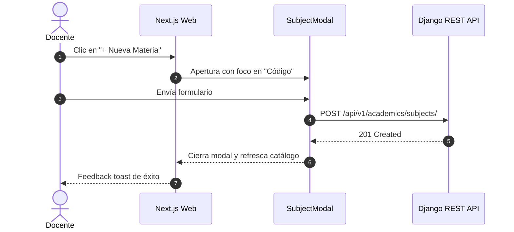

# Plan: Rediseño de Flujo Docente, Configuración y Aislamiento Estudiantil

Status: APPROVED
Version: 1
Spec-SHA256: 818c7a5509d79591c3ddb131d8a49fe6aaec39daa08f9ec53a6badcd0155b49e
Constitution-SHA256: a726869c15a091c769d54e19e825801d04ba2ae10cb890679dc43bc7a7e07212

## 1. Arquitectura y decisiones

- **PLAN-01 (Desacople Jerárquico de Rutas Docentes):**
  - Se sustituye la vista monolítica de `/teacher/courses` por un árbol de navegación limpio en Next.js App Router:
    - Nivel 1: `/teacher/courses` (Mis Materias en grid de tarjetas).
    - Nivel 2: `/teacher/courses/[id]/parallels` (Aulas del docente para esa materia).
    - Nivel 3: `/teacher/parallels/[id]/exams` (Exámenes parciales del paralelo seleccionado).
    - Nivel 4: `/teacher/exams/[id]/builder` (Editor modular de examen con rúbricas IA).
  - Justificación: Elimina la sobrecarga cognitiva de mezclar dos formularios de creación inline con listados anidados.
- **PLAN-02 (Gestión Modal Universal):**
  - Implementación de componentes `SubjectModal`, `ParallelModal` y `ExamModal` con diseño CafeBlend, backdrop blur y foco accesible mediante tecla Escape.
- **PLAN-03 (Dropdown de Configuración de Usuario en Navbar):**
  - Refactorización de `Navbar.tsx` para agrupar perfil, alternador de tema claro/oscuro y logout en un solo menú interactivo flotante con avatar y chevron.
- **PLAN-04 (Aislamiento de Rol Estudiante):**
  - Inyección dinámica de `userRole="STUDENT"` en `StudentPortalPage` y validación de guardia en cliente para restringir la interfaz exclusivamente a exámenes con `is_published=True`.

## 2. Alcance físico de cambios

- **CREATE:**
  - `frontend/src/app/teacher/courses/[id]/parallels/page.tsx`: Vista de gestión de aulas de una materia específica.
  - `frontend/src/app/teacher/parallels/[id]/exams/page.tsx`: Vista de gestión de exámenes parciales de un aula.
  - `frontend/src/components/ui/SubjectModal.tsx`: Diálogo modal para registrar y editar materias.
  - `frontend/src/components/ui/ParallelModal.tsx`: Diálogo modal para aperturar y configurar aulas/paralelos.
  - `frontend/src/components/ui/Breadcrumbs.tsx`: Barra de migas de pan navegable y accesible.
  - `frontend/src/components/ui/UserMenuDropdown.tsx`: Menú flotante de perfil y configuración.
- **MODIFY:**
  - `frontend/src/app/teacher/courses/page.tsx`: Limpieza y conversión a catálogo de materias con modales.
  - `frontend/src/components/ui/Navbar.tsx`: Integración del nuevo `UserMenuDropdown` y soporte dinámico de roles.
  - `frontend/src/app/student/portal/page.tsx`: Conexión de `userRole="STUDENT"` y filtrado estricto de notas publicadas.

## 3. Persistencia e integraciones

- **Backend:** Sin migraciones de base de datos. Se reutilizan los endpoints REST existentes de Django:
  - `GET /api/v1/academics/subjects/` y `POST /api/v1/academics/subjects/`
  - `GET /api/v1/academics/parallels/` y `POST /api/v1/academics/parallels/`
  - `GET /api/v1/exams/?parallel=<id>` y `POST /api/v1/exams/`
  - `GET /api/v1/evaluations/?student_identifier=<id>`

## 4. Contratos frontend/backend

- **Operación 1: Crear Materia (Modal):**
  - `POST /api/v1/academics/subjects/`
  - Entrada: `{ "code": string, "name": string, "description": string }`
  - Respuesta: `201 Created` con objeto `Subject` creado.
- **Operación 2: Aperturar Aula / Paralelo (Modal):**
  - `POST /api/v1/academics/parallels/`
  - Entrada: `{ "subject": string (UUID), "group_code": string, "period": string }`
  - Respuesta: `201 Created` con objeto `ClassroomParallel`.
- **Operación 3: Crear Examen Parcial (Modal):**
  - `POST /api/v1/exams/`
  - Entrada: `{ "parallel": string (UUID), "title": string, "application_date": string, "total_score": number }`
  - Respuesta: `201 Created` con objeto `Exam`.

## 5. Flujos y estados

## 6. Diseño visual e interacción

- **Design System:** CafeBlend (Warm Cream `#FDFBF7` / Dark Espresso `#1A1412`).
- **Elevación y Sombras:** Tokens `--shadow-warm-sm` y `--shadow-warm-md`.
- **Accesibilidad:** Cierre con tecla Escape en modales y dropdowns, labels visibles en formularios, contraste WCAG AA.
- **Responsive:** Grids de 1 columna en smartphones (`< 640px`) y 2 a 3 columnas en escritorio (`>= 1024px`).

## 7. Vertical slices

- **Slice 1 (Navegación y Configuración):** `UserMenuDropdown`, `Navbar.tsx` y vista de perfil.
- **Slice 2 (Módulo Mis Materias & Modales):** `/teacher/courses` limpio con `SubjectModal`.
- **Slice 3 (Aulas y Exámenes):** Rutas jerárquicas `/teacher/courses/[id]/parallels` y `/teacher/parallels/[id]/exams` con `ParallelModal` y `ExamModal`.
- **Slice 4 (Aislamiento Estudiantil):** Blindaje de `/student/portal` con `userRole="STUDENT"` y route guards.

## 8. Verificación

- **Compilación Frontend:** `npm --prefix frontend run build` (código de salida 0).
- **Pruebas de Contrato:** Validación de respuestas 200/201 en endpoints de materias y aulas.
- **Escenarios Verificados:** SC-01.1.1, SC-01.2.1, SC-02.1.1, SC-02.2.1, SC-03.1.1, SC-04.1.1.

## 9. Trazabilidad y riesgos

- **Trazabilidad:**
  - RF-01.1, RF-01.2, SC-01.1.1, SC-01.2.1 $\longrightarrow$ PLAN-01, PLAN-02
  - RF-02.1, RF-02.2, RF-02.3, SC-02.1.1, SC-02.2.1 $\longrightarrow$ PLAN-01, PLAN-02
  - RF-03.1, RF-03.2, SC-03.1.1 $\longrightarrow$ PLAN-03
  - RF-04.1, RF-04.2, SC-04.1.1 $\longrightarrow$ PLAN-04
- **Riesgos y Mitigación:** Pérdida de estado al navegar hacia atrás mitigada mediante URLs explícitas con identificadores UUID.
