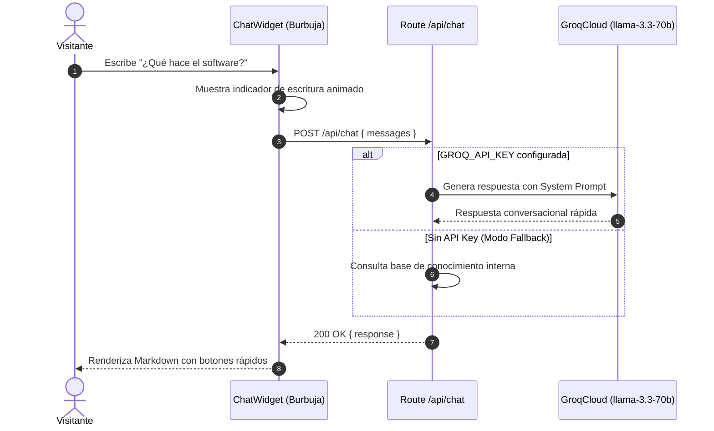

# Plan: Landing Page Corporativa con Chatbot IA GroqCloud

Status: APPROVED
Version: 1
Spec-SHA256: 7692cc5cab51653699c40db8f03b939bb1a13a9f21231d4ce454f6df674c9219
Constitution-SHA256: a726869c15a091c769d54e19e825801d04ba2ae10cb890679dc43bc7a7e07212

## 1. Arquitectura y decisiones

- **PLAN-01 (Arquitectura de la Landing Page en Next.js 14):**
  - Ubicación en `landing/` en la raíz del repositorio, configurada con Next.js 14 App Router, TypeScript y Tailwind CSS.
  - Implementación fiel de los tokens de color del Design System CafeBlend (Warm Cream `#FDFBF7` y Dark Espresso `#1A1412`).
  - Botón CTA prominente en el Header y Hero para ingresar directamente al software principal (`/app` o `/login`).
- **PLAN-02 (Arquitectura del Chatbot Flotante y Modo Dual GroqCloud):**
  - Widget interactivo colapsable posicionado en `bottom: 1.5rem; right: 1.5rem`.
  - Endpoint de servidor seguro `landing/src/app/api/chat/route.ts` que consume el SDK oficial `@groq/groq-sdk` con el modelo `llama-3.3-70b-versatile`.
  - **Modo Dual:** Si la variable `GROQ_API_KEY` en `landing/.env` está ausente o vacía, el route handler opera mediante un motor de conocimiento semántico predefinido que responde con la información verídica del software, módulos y accesos directos; al definirse la clave, activa la inferencia de GroqCloud automáticamente sin alterar código.
- **PLAN-03 (Canales de Conversión y Enlaces Directos):**
  - WhatsApp oficial: `https://wa.me/59177389330?text=Hola%2C%20deseo%20m%C3%A1s%20informaci%C3%B3n%20sobre%20GestorNotas%20IA`.
  - Enlace al repositorio GitHub y enlace al software en producción.
- **PLAN-04 (Despliegue Integrado en Microsoft Azure):**
  - Creación de `landing/Dockerfile.prod` optimizado multicapa (`node:20-alpine`).
  - Incorporación del servicio `gestornotas_landing` en `docker-compose.prod.yml` enlazado con Nginx para servir la landing en la raíz `/` y el software en `/app`.

## 2. Alcance físico de cambios

- **CREATE:**
  - `landing/package.json`: Configuración de dependencias (next, react, tailwindcss, lucide-react, groq-sdk).
  - `landing/tsconfig.json`: Tipado estricto TypeScript.
  - `landing/tailwind.config.ts`: Paleta CafeBlend y tipografías.
  - `landing/src/app/layout.tsx`: Layout raíz con tipografía y metadatos SEO.
  - `landing/src/app/page.tsx`: Página corporativa con Hero, Módulos, Beneficios, Footer y Chatbot.
  - `landing/src/app/api/chat/route.ts`: Route Handler para GroqCloud con Modo Dual.
  - `landing/src/components/ChatWidget.tsx`: Widget de chat flotante con burbuja inferior derecha.
  - `landing/src/components/HeroSection.tsx`: Sección principal con llamada a la acción hacia la app.
  - `landing/src/components/ModulesSection.tsx`: Tarjetas de presentación de Docentes, Estudiantes y Móvil.
  - `landing/src/components/Footer.tsx`: Enlaces a WhatsApp, GitHub y plataforma.
  - `landing/Dockerfile.prod`: Contenedor para producción en Azure.
  - `landing/.env.example`: Plantilla de variables (`GROQ_API_KEY`, `NEXT_PUBLIC_APP_URL`).

## 3. Persistencia e integraciones

- **Persistencia en Cliente:** Historial de la sesión de chat guardado temporalmente en `sessionStorage` para no perder la conversación durante la navegación.
- **Integración Externa:** GroqCloud API (`https://api.groq.com/openai/v1/chat/completions`) utilizando el modelo `llama-3.3-70b-versatile` con System Prompt pedagógico especializado.

## 4. Contratos frontend/backend

- **Endpoint:** `POST /api/chat`
  - **Entrada:**
    ```typescript
    interface ChatRequest {
      messages: Array<{
        role: 'user' | 'assistant' | 'system';
        content: string;
      }>;
    }
    ```
  - **Salida:**
    ```typescript
    interface ChatResponse {
      response: string;
      source: 'groq' | 'fallback';
    }
    ```
  - **Validación:** Límite de 500 caracteres por mensaje para mitigar ataques de inyección.

## 5. Flujos y estados



## 6. Diseño visual e interacción

- **Design System:** CafeBlend (Warm Cream y Dark Espresso).
- **Tipografía:** Playfair Display para titulares corporativos y Plus Jakarta Sans para párrafos legibles.
- **Animaciones:** Apertura suave de la burbuja del chat con rebote elástico y blur de fondo.
- **Responsive:** Adaptable desde teléfonos de 360px de ancho hasta monitores ultra-wide 4K.

## 7. Vertical slices

- **Slice 1 (Estructura y Base):** Inicialización de `landing/` con Next.js 14, Tailwind y tokens CafeBlend.
- **Slice 2 (Landing Corporativa):** Implementación de Navbar, Hero con botón hacia la app, Módulos y Footer.
- **Slice 3 (Motor de Chatbot & Groq):** Endpoint `/api/chat` con Modo Dual y widget `ChatWidget` interactivo.
- **Slice 4 (Despliegue Azure):** `Dockerfile.prod` y servicio en `docker-compose.prod.yml`.

## 8. Verificación

- **Compilación:** `npm --prefix landing run build` con código de salida 0.
- **Pruebas de Chatbot:** Verificación de respuesta en modo fallback sin API key y modo Groq con key.
- **Verificación de Enlaces:** Confirmación de redirección a WhatsApp (`https://wa.me/59177389330`) y botón hacia `/app`.
- **Escenarios Verificados:** SC-01.1.1, SC-02.1.1, SC-02.2.1, SC-02.3.1.

## 9. Trazabilidad y riesgos

- **Trazabilidad:**
  - RF-01.1, RF-01.2, SC-01.1.1 $\longrightarrow$ PLAN-01
  - RF-02.1, RF-02.2, RF-02.3, SC-02.1.1, SC-02.2.1 $\longrightarrow$ PLAN-02
  - RF-02.4, SC-02.3.1 $\longrightarrow$ PLAN-03
  - Despliegue $\longrightarrow$ PLAN-04
- **Riesgos y Mitigación:** Inyección de prompt mitigada mediante delimitadores de contexto estrictos en el System Prompt y validación de longitud de entrada.
