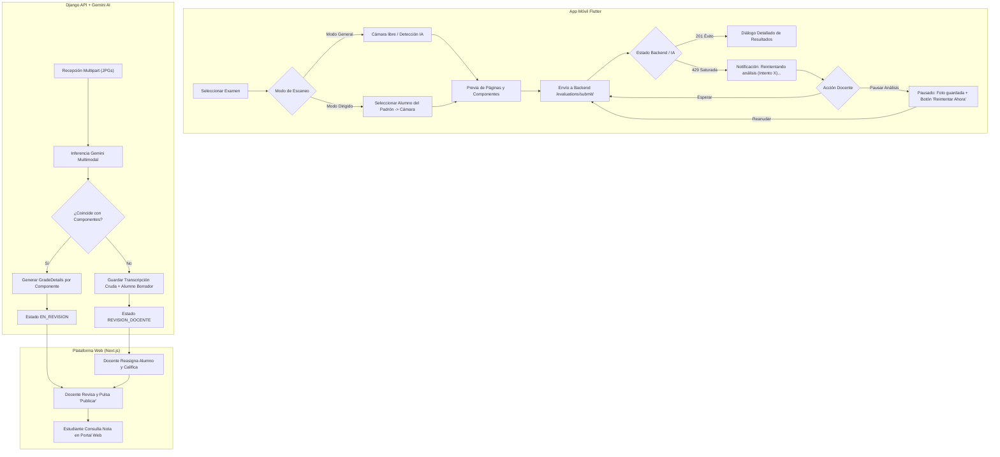

# Specification: 04-correcciones-escaneo-despliegue
Status: APPROVED
Version: 2
Risk: estándar
Audit-Date: 2026-11-19
Audit-Scope: Flujo docente, constructor de exámenes, digitalización móvil dual, resiliencia Gemini Free Tier, seeders y enrutamiento Nginx.

## 1. Objetivo, contexto y alcance

### 1.1 Objetivo
Unificar el flujo docente entre "Mis Materias" y el "Constructor de Exámenes", estructurar la respuesta JSON de componentes para alimentar vistas previas ricas en la app móvil (incluyendo transcripción libre para exámenes no estructurados/borradores), incorporar dos modos de digitalización en móvil (Automático por IA y Dirigido por selección previa de estudiante), manejar elegantemente la saturación de cuota de la capa gratuita de Gemini con notificación de iteración y botón de pausa/reintento manual, proveer datos semilla (seeders) con 2 exámenes completos listos para pruebas, optimizar la experiencia UX/UI del diálogo de resultado de escaneo, y configurar el enrutamiento de producción en Nginx (servidor Azure `20.51.189.52`) para que la Landing Page atienda en la raíz `http://20.51.189.52/` y el software académico en `http://20.51.189.52/app/` o subruta correspondiente.

### 1.2 In Scope
1. **Flujo y Navegación Web Docente:**
   - Redireccionar y armonizar el constructor de exámenes para que mantenga la jerarquía `Materia -> Aula -> Examen` sin editar la estructura base de materias (solo gestiona componentes y rúbrica de exámenes).
2. **Contrato de Componentes JSON & Fallback de Transcripción Libre:**
   - Los componentes de examen (`ExamComponent`) definen los campos observables en la previsualización móvil.
   - Si la IA analiza un examen manuscrito cuyas preguntas no concuerdan con la rúbrica estructurada del examen, el backend no rechaza el envío con error; genera un registro en estado `REVISION_DOCENTE` asignado a un "Estudiante No Asignado / Borrador", almacenando la transcripción integral del texto detectado en JSON y permitiendo al docente auditarlo y reasignarlo desde la web.
3. **Resiliencia ante Saturación de Gemini (Free Tier Rate Limit):**
   - Notificación visual de reintento en móvil cuando la API devuelva saturación temporal (HTTP 429).
   - Botón de **"Pausar Análisis"** para detener la espera y permitir volver a analizar manualmente sobre la fotografía ya capturada sin perderla.
4. **Seeder con 2 Exámenes de Prueba:**
   - Crear datos de prueba completos para el docente demo: 2 materias/aulas con exámenes y componentes predefinidos (preguntas abiertas, opción múltiple y puntajes calibrados).
5. **Dos Modos de Digitalización en Mobile:**
   - **Modo General (IA Automático):** Escaneo libre con detección y emparejamiento automático del estudiante por nombre/código o QR.
   - **Modo Dirigido (Estudiante Pre-seleccionado):** El docente selecciona primero al estudiante de la lista de inscritos del aula y luego abre la cámara con el ID pre-cargado, garantizando asignación directa sin ambigüedad.
6. **Rediseño UX/UI del Diálogo de Resultados en Mobile:**
   - Sustituir el diálogo básico actual por una tarjeta de revisión con desglose visible de preguntas capturadas, texto transcrito, puntajes obtenidos y acceso rápido a publicación de notas.
7. **Despliegue y Enrutamiento Nginx en Azure (`20.51.189.52`):**
   - Configuración de Nginx para que la Landing Page responda en `http://20.51.189.52/` (puerto 80) con botón directo ("Ingresar al Sistema" / "Probar Software") que redirige al software académico (`/app/` o `/login`), manteniendo el backend en `/api/` y Django Admin en `/admin/`.
   - Corrección de `Dockerfile.prod` y creación de `frontend/public/.gitkeep` para prevenir fallos en la construcción de imágenes en el servidor remoto.
8. **Arquitectura de Conexión Móvil:**
   - La app móvil se conecta exclusivamente al backend Django (`http://20.51.189.52/api/v1`), el cual custodia las credenciales de Gemini y procesa la IA. La app móvil nunca almacena la API Key de Google.

### 1.3 Out of Scope
- Reescritura del motor central de inferencia multimodal de Gemini.
- Creación de módulos de cobros o pasarelas de pago.

---

## 2. Actores y Permisos

| Actor | Permisos Efectivos | Restricciones |
| :--- | :--- | :--- |
| **Docente (TEACHER)** | Diseñar exámenes, agregar componentes/rúbricas, escanear exámenes (Modo General y Modo Dirigido), pausar/reintentar análisis IA, publicar calificaciones. | No puede alterar materias de otros docentes ni modificar usuarios institucionales. |
| **Estudiante (STUDENT)** | Consultar calificaciones y retroalimentación de exámenes en estado `PUBLICADO` en su portal web. | No puede acceder a exámenes en borrador ni ver calificaciones de otros alumnos. |
| **Público / Visitante** | Visualizar la Landing Page en `http://20.51.189.52/`, consultar el chatbot informativo y acceder al login del software. | No accede a endpoints privados sin autenticación JWT. |

---

## 3. Datos Funcionales e Invariantes

### 3.1 Invariantes de Dominio
- **RB-01 (Aislamiento de Materias):** El constructor de exámenes no puede alterar nombres, códigos o paralelos creados en "Mis Materias"; únicamente administra la configuración y componentes del examen asociado.
- **RB-02 (Tolerancia a Exámenes no Estructurados):** Cuando la IA no logre asociar las respuestas a las preguntas del examen estructurado, debe almacenar la transcripción completa en el campo `ocr_raw_text` / `teacher_notes` y catalogar la evaluación con estado `REVISION_DOCENTE` asignada a un perfil de estudiante no identificado (`raw_student_identifier="ESTUDIANTE_BORRADOR"`).
- **RB-03 (Seguridad de Credenciales IA):** La app móvil no debe contener en su código ni en su configuración local la `GEMINI_API_KEY`. Todas las inferencias son intermediadas por el backend Django.
- **RB-04 (Publicación Explícita):** Una evaluación solo es visible para el estudiante si `is_published=True` y `status="PUBLICADO"`.
- **RB-05 (Resiliencia de Cuota y Control de Análisis):** Ante saturación de cuota de Gemini (HTTP 429), el sistema reporta la iteración de reintento activo y otorga control al usuario para pausar, cancelar o reanudar manualmente sin descartar las fotos capturadas.

---

## 4. Flujos, Estados y Comportamiento Observable

---

## 5. Requisitos EARS

### 5.1 Navegación y Constructor de Exámenes
- **RF-01.1:** Cuando un docente acceda al constructor de exámenes desde un paralelo, el sistema debe presentar las migas de pan `Mis Materias > [Materia] > [Aula] > Constructor de Exámenes` y restringir las modificaciones exclusivamente a la rúbrica, puntaje y componentes del examen.

### 5.2 Modos de Digitalización en Mobile
- **RF-02.1:** Cuando el docente inicie la digitalización de un examen en la app móvil, el sistema debe ofrecer dos opciones:
  1. *Escaneo General (IA Automático)*.
  2. *Escaneo Dirigido (Seleccionar alumno previamente de la lista de matriculados)*.
- **RF-02.2:** Cuando se seleccione el *Modo Dirigido*, la app móvil debe listar los estudiantes del paralelo con su nombre y matrícula; al seleccionar uno, abrirá el escáner con el `student_identifier` inmutable y precargado.

### 5.3 Procesamiento de Examen, Fallback de Transcripción y Manejo de Saturación
- **RF-03.1:** Cuando la IA procese una imagen que no coincida con los componentes del examen, el sistema debe guardar la transcripción completa del texto en `ocr_raw_text`, asignar el estado `REVISION_DOCENTE`, y vincularlo a un registro borrador observable en el panel docente web.
- **RF-03.2:** Cuando la IA de Gemini devuelva un error de saturación o límite de cuota (HTTP 429), la app móvil debe mostrar una notificación contextual en la UI ("IA saturada: esperando cuota disponible para reintentar... Intento X"), habilitando un botón para **"Pausar / Detener Análisis"**, permitiendo reanudar o reintentar manualmente la inferencia sobre las páginas ya capturadas sin perder la foto.

### 5.4 Seeders para Pruebas Rápidas
- **RF-04.1:** Al inicializar la base de datos o ejecutar el comando seeder, el sistema debe aprovisionar al docente demo con al menos 2 exámenes con componentes ya creados en sus respectivas materias y aulas.

### 5.5 Enrutamiento Nginx & Landing Page en Servidor
- **RF-05.1:** Cuando un usuario acceda a `http://20.51.189.52/`, el servidor Nginx debe servir la Landing Page informativa en el puerto 80 sin requerir ingresar ningún puerto `:XXXX`.
- **RF-05.2:** La Landing Page debe incluir un botón prominente de acción ("Acceder a la Plataforma") que dirija fluidamente a la aplicación académica web (`/app` o `/login`).

---

## 6. Criterios de Aceptación y Escenarios

### SC-01: Escaneo en Modo Dirigido con Estudiante Seleccionado
- **Dado** un docente en el examen "Primer Examen Parcial" del Aula A.
- **Cuando** selecciona "Modo Dirigido" y escoge al alumno "Juan Carlos Pérez Demo (EST-2026-001)".
- **Entonces** la cámara se activa con el estudiante fijado, captura las páginas y envía la evaluación directamente asociada a ese estudiante sin depender de la inferencia de matrícula por OCR.

### SC-02: Fallback de Examen No Estructurado
- **Dado** una captura de un examen manuscrito cuyas preguntas no correspondan a la rúbrica del examen.
- **Cuando** el backend ejecuta el pipeline de evaluación.
- **Entonces** la evaluación se crea en estado `REVISION_DOCENTE`, contiene la transcripción textual completa del documento y aparece listada en el panel web del docente para su revisión manual.

### SC-03: Acceso a la Landing Page en URL Principal
- **Dado** el servidor de producción configurado en `20.51.189.52`.
- **Cuando** un usuario ingresa en el navegador a `http://20.51.189.52`.
- **Entonces** carga directamente la Landing Page comercial y al presionar "Ingresar al Software" navega a la pantalla de login del sistema académico.

### SC-04: Manejo de Saturación de Gemini y Pausa Manual en Mobile
- **Dado** que la API gratuita de Gemini responde con saturación temporal (HTTP 429).
- **Cuando** la app móvil procesa el envío de la evaluación.
- **Entonces** la interfaz muestra el banner de reintento progresivo y un botón "Pausar Análisis"; al pausar, el examen se conserva con su botón "Reintentar Análisis con IA" sin requerir repetir la fotografía.

---

## 7. Registro de Inferencias y Decisiones

| ID | Hallazgo / Requerimiento | Clasificación | Origen | Decisión / Acción |
| :--- | :--- | :--- | :--- | :--- |
| **INF-01** | La app móvil necesita consultar a Gemini | DERIVADO | Seguridad & Arquitectura | La app móvil llama al backend Django en la nube; el backend ejecuta Gemini. La API Key no va en el cliente. |
| **INF-02** | URL directa `20.51.189.52` sin puertos | TÉCNICO | Infraestructura Nginx | Nginx en puerto 80 rutea `/` a Landing (3002), `/app/` a Web Frontend (3000) y `/api/` a Backend (8000). |
| **INF-03** | 2 Modos de escaneo en móvil | PROPUESTA (Aceptada) | Petición del usuario | Incorporar selector: "Escaneo General (Auto IA)" vs "Escaneo por Alumno Específico". |
| **INF-04** | Exámenes con componentes no coincidentes | REGLA DE NEGOCIO | Petición del usuario | Capturar transcripción cruda completa y dejar en estado borrador/revisión sin fallar con error 400/500. |
| **INF-05** | Seeder con 2 exámenes completos | TÉCNICO | Petición del usuario | Crear script/seeder que genere Materia -> Aula -> 2 Exámenes con componentes de opción múltiple y desarrollo. |
| **INF-06** | Saturación de Gemini Free Tier (HTTP 429) | REGLA DE NEGOCIO | Petición del usuario | Agregar notificación iterativa de reintento, botón de pausa y reanudar sobre la foto ya tomada. |

---

## 8. Auditoría Funcional y Aprobación
- **Doble interpretación:** Ausente. Cada modo de escaneo y flujo de saturación tiene precondiciones y efectos observables claros.
- **Implementador externo:** Todos los contratos de entrada/salida y comportamientos de UI y backend están especificados sin depender de supuestos implícitos.
- **Trazabilidad:** Cada requerimiento (RF-01 a RF-05) tiene correspondencia unívoca con criterios de aceptación (SC-01 a SC-04).
- **Estado:** `APPROVED` (Listo para fase de planificación técnica `/sdd-planning`).

## Flujo móvil aprobado

**RF-04.9:** Consultar inscritos y escaneos por parcial, buscar por nombre o matrícula y capturar en modo dirigido o por identificación automática. La cámara registra imágenes válidas e indica lectura real de QR. La revisión permite ampliar, reordenar y reemplazar hojas y cambiar explícitamente al estudiante. El reintento muestra el resultado exitoso. La publicación se confirma desde el parcial e indica alcance total. El acceso distingue credenciales y conectividad.

**SC-04.9.1:** Verificar captura cancelada, QR válido, galería, edición de hojas, reintento, listado, acceso y publicación. Revisión funcional y aprobación registrada el 2026-11-24 a partir de la solicitud docente.
